# Learn RxJS 🌊

<div align="center">

[](https://opensource.org/licenses/MIT)
[](https://rxjs.dev)
[](https://github.com/TheLearningHubOrg/learn-rxjs/actions/workflows/ci.yml)
[](https://github.com/TheLearningHubOrg/learn-rxjs/releases)
[](https://www.typescriptlang.org/)
[](https://rxjs.dev/guide/overview)

**From your first `new Observable()` to staff-level stream architecture, with every example runnable and tested.**  
Observables, operators, higher-order mapping, Subjects and multicasting, schedulers, marble testing, and RxJS inside Angular and Node.

[Getting Started](#1-stage-1-reactive-foundations-observables-observers--subscriptions) • [Creation & pipe()](#2-stage-2-creation-operators--the-pipe-pipeline) • [Transform & Filter](#3-stage-3-transformation-filtering--rate-limiting-operators) • [Higher-Order & Errors](#4-stage-4-higher-order-mapping-combination--error-handling) • [Subjects & Schedulers](#5-stage-5-subjects-multicasting--schedulers) • [Testing & Performance](#6-stage-6-utility-operators-testing--performance) • [Interview Prep](#7-stage-7-staff-rxjs-engineer-interview-handbook--cheatsheet)

<br/>

<a href="https://www.buymeacoffee.com/manthanank">
  
</a>

</div>

---

## 🗺️ 7-Stage Pedagogical Roadmap

```mermaid
flowchart LR
    S1["Stage 1: Observables & Subscriptions"] --> S2["Stage 2: Creation & pipe()"]
    S2 --> S3["Stage 3: Transform, Filter, Rate-limit"]
    S3 --> S4["Stage 4: Higher-Order & Errors"]
    S4 --> S5["Stage 5: Subjects & Schedulers"]
    S5 --> S6["Stage 6: Utility, Testing, Performance"]
    S6 --> M["Masterclasses M1-M5"]
    M --> S7["Stage 7: Staff Interview Handbook"]
```

| Stage | Focus Domain | Core Concepts & Engineering Outcomes |
| :--- | :--- | :--- |
| **Stage 1** | **Reactive Foundations: Observables, Observers & Subscriptions** | `new Observable(subscriber => ...)`, the `next* (error \| complete)?` grammar, partial observers, `Subscription.unsubscribe()`, teardown functions, synchronous vs asynchronous delivery, cold vs hot. Outcome: write an Observable by hand and prove its teardown runs. |
| **Stage 2** | **Creation Operators & the pipe() Pipeline** | `of`, `from`, `range`, `generate`, `interval`, `timer`, `defer`, `fromEvent`, `bindNodeCallback`, `ajax`, `fromFetch`, `webSocket`, join creation functions (`combineLatest`, `forkJoin`, `merge`, `concat`, `zip`, `race`, `partition`), `pipe()`, custom `OperatorFunction`s, `firstValueFrom` / `lastValueFrom`. Outcome: bridge any callback, promise or event source into a stream. |
| **Stage 3** | **Transformation, Filtering & Rate-Limiting Operators** | `map`, `scan` vs `reduce`, `filter`, `take`, `first`, `distinctUntilChanged`, `takeUntil`, `debounceTime` vs `throttleTime` vs `auditTime` vs `sampleTime`, `bufferTime`, `pairwise`, a first look at `switchMap`. Outcome: a tested typeahead pipeline that debounces, deduplicates and cancels stale requests. |
| **Stage 4** | **Higher-Order Mapping, Combination & Error Handling** | `switchMap`, `mergeMap` (with concurrency), `concatMap`, `exhaustMap`, `*All` flatteners, `withLatestFrom`, `startWith`, `catchError`, `retry({ count, delay })`, error isolation inside inner streams. Outcome: pick the right flattening strategy for every user action. |
| **Stage 5** | **Subjects, Multicasting & Schedulers** | `Subject`, `BehaviorSubject`, `ReplaySubject`, `AsyncSubject`, `share()` with reset options, `shareReplay({ bufferSize, refCount })`, `connectable`, `asyncScheduler`, `asapScheduler`, `queueScheduler`, `animationFrameScheduler`. Outcome: share one HTTP call across many subscribers without leaks. |
| **Stage 6** | **Utility Operators, Testing & Performance** | `tap`, `delay`, `timeout({ each, with })`, `materialize`, `toArray`, conditional and aggregate operators, `TestScheduler` marble tests, leak detection, bundle size. Outcome: a pipeline with deterministic tests and no dangling subscriptions. |
| **Masterclasses** | **Internals, custom operators, Angular signals interop, real-time systems, flagship blueprint** | How `Subscriber` and `pipe` work inside, writing lawful custom operators, `toSignal` / `toObservable`, WebSocket reconnection with backoff, and an end-to-end live dashboard. |
| **Stage 7** | **Staff Interview Handbook** | 40+ interview Q&As across core concepts, internals, architecture and debugging scenarios, plus a one-page cheatsheet. |

---

## 🆕 RxJS Versions, What's New & Migration

The examples in this guide are TypeScript, because RxJS is written in TypeScript, ships its own type definitions, and its operator signatures (`OperatorFunction<T, R>`) are easiest to learn with the types visible. Everything also runs as plain JavaScript if you drop the annotations.

### V.1 Release Timeline

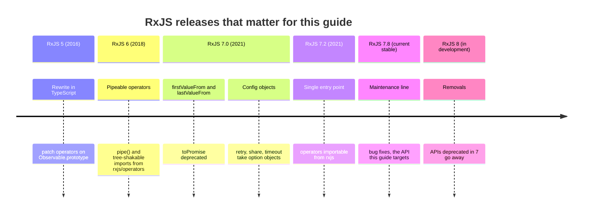

### V.2 Compatibility Matrix

| RxJS | Status | TypeScript | Angular | Runtime | Notes |
| --- | --- | --- | --- | --- | --- |
| 7.8.x | Current stable | 4.2 or newer (5.x recommended) | Angular 13 and newer support RxJS 7; current Angular majors list `rxjs ^6.5.3 \|\| ^7.4.0` as the peer range | Any supported Node.js LTS, all evergreen browsers | ES2015+ output, `exports` map in package.json, full tree shaking |
| 8.x | In development (alphas published) | Current stable TypeScript | Not yet supported by Angular | Modern runtimes only | Removes everything marked `@deprecated` in 7. Do not ship alphas to production. |
| 6.x | Unmaintained | 2.8 or newer | Angular 6 to 12 | Node.js and browsers of that era | Upgrade to 7; most code compiles unchanged |
| 5.x and older | End of life | n/a | AngularJS / Angular 2 to 5 | n/a | Prototype-patching operators, `rxjs-compat` bridge for 6 |

Check what your project resolves today:

```bash
npm ls rxjs              # every copy in the tree; two copies break instanceof checks
npm view rxjs version    # latest published stable on the registry
npm view rxjs dist-tags  # shows "latest" and any "next"/"alpha" tags
```

### V.3 What's New in RxJS 7

#### Promise conversion: `firstValueFrom` and `lastValueFrom`

`toPromise()` resolved with `undefined` when a stream completed without emitting, which hid bugs. The replacements say which value you want and reject with `EmptyError` when there is none.

```typescript
import { interval, take, firstValueFrom, lastValueFrom } from 'rxjs';

const source$ = interval(100).pipe(take(3));

// Before (RxJS 6): resolves with the last value, or undefined if nothing was emitted
// const last = await source$.toPromise();

// After (RxJS 7)
const first = await firstValueFrom(source$); // 0, then unsubscribes
const last = await lastValueFrom(source$); // 2, waits for complete
console.log(first, last);
```

#### `retry` with a config object replaces `retryWhen`

```typescript
import { timer, throwError, retry, defer } from 'rxjs';

let attempt = 0;
const flaky$ = defer(() => (++attempt < 3 ? throwError(() => new Error(`fail ${attempt}`)) : [attempt]));

// Before: retryWhen(errors => errors.pipe(delayWhen(() => timer(1000)), take(3)))
// After: count, a computed delay, and resetOnSuccess in one place
flaky$
  .pipe(retry({ count: 3, delay: (_err, retryCount) => timer(2 ** retryCount * 100) }))
  .subscribe((v) => console.log('succeeded on attempt', v));
```

#### `share` with reset options replaces `multicast`, `publish` and `refCount`

```typescript
import { interval, share, take, ReplaySubject, timer } from 'rxjs';

// Before: source$.pipe(publishReplay(1), refCount())
// After: choose the connector and when to reset
const ticks$ = interval(1000).pipe(
  take(10),
  share({
    connector: () => new ReplaySubject(1),
    resetOnRefCountZero: () => timer(5000), // keep the source alive 5 s after the last unsubscribe
  }),
);
ticks$.subscribe((v) => console.log('A', v));
```

#### `throwError` takes a factory

```typescript
import { throwError } from 'rxjs';

// Before: throwError(new Error('boom')) creates the error eagerly, with a misleading stack
// After: the error is created when a subscriber arrives
const failed$ = throwError(() => new Error('boom'));
failed$.subscribe({ error: (e: Error) => console.log(e.message) });
```

#### One import path

Since 7.2 every operator is exported from `'rxjs'`. `'rxjs/operators'` still works in 7 but is the legacy path.

```typescript
// Before
// import { map, filter } from 'rxjs/operators';
// After
import { of, map, filter } from 'rxjs';

of(1, 2, 3).pipe(filter((n) => n > 1), map((n) => n * 10)).subscribe(console.log);
```

#### `*With` operators replace the operator forms of join functions

```typescript
import { of, mergeWith, concatWith, zipWith, combineLatestWith } from 'rxjs';

const a$ = of(1, 2);
const b$ = of('x', 'y');

// Before: a$.pipe(merge(b$)), a$.pipe(zip(b$)) (operator versions, deprecated)
a$.pipe(mergeWith(b$)).subscribe((v) => console.log('mergeWith', v));
a$.pipe(concatWith(b$)).subscribe((v) => console.log('concatWith', v));
a$.pipe(zipWith(b$)).subscribe((v) => console.log('zipWith', v));
a$.pipe(combineLatestWith(b$)).subscribe((v) => console.log('combineLatestWith', v));
```

### V.4 Migration Guide (RxJS 6 → 7.8)

```bash
# 1. Upgrade the package (and Angular, if you use it, to a version that accepts RxJS 7)
npm install rxjs@^7.8.2

# 2. Make sure only one copy is installed
npm ls rxjs
npm dedupe

# 3. Compile; RxJS 7 tightened many types (for example of() with no arguments is Observable<never>)
npx tsc --noEmit

# 4. Remove the compat layer once everything compiles
npm uninstall rxjs-compat

# 5. Fail the build on deprecated APIs (typescript-eslint v8 with type information)
npx eslint . --rule '{"@typescript-eslint/no-deprecated": "error"}'
```

Work through the deprecations in this order, because the earlier ones are the most likely to change behaviour:

1. `toPromise()` → `firstValueFrom` / `lastValueFrom`. Check every call for streams that can complete empty.
2. `subscribe(next, error, complete)` with several positional callbacks → an observer object.
3. `throwError(err)` → `throwError(() => err)`.
4. `retryWhen` / `repeatWhen` → `retry({ delay })` / `repeat({ delay })`.
5. `multicast`, `publish*`, `refCount` → `share`, `shareReplay`, `connectable`, `connect`.
6. Imports from `'rxjs/operators'` → `'rxjs'` (mechanical; a search and replace is safe).

### V.5 Deprecations & Breaking Changes

| Version | Deprecated / removed | Replacement | What breaks and how to fix it |
| --- | --- | --- | --- |
| 7.0 | `toPromise()` | `firstValueFrom(o$)`, `lastValueFrom(o$)` | Empty streams now reject with `EmptyError`; pass `{ defaultValue }` if empty is valid. |
| 7.0 | `subscribe(next, error, complete)` positional form | `subscribe({ next, error, complete })` | Still runs; only the single-function form `subscribe(fn)` stays undeprecated. |
| 7.0 | `throwError(value)` | `throwError(() => value)` | Eager error object; switch to the factory. |
| 7.0 | `empty()`, `never()` | `EMPTY`, `NEVER` constants | Function calls disappear in v8. |
| 7.0 | `retryWhen`, `repeatWhen` | `retry({ count, delay })`, `repeat({ count, delay })` | Notifier logic moves into a `delay` function that returns an Observable. |
| 7.0 | `multicast`, `publish`, `publishBehavior`, `publishLast`, `publishReplay`, `refCount` | `share({...})`, `shareReplay({...})`, `connectable()`, `connect()` | Different reset semantics; test refcount behaviour after migrating. |
| 7.0 | `pluck('a', 'b')` | `map(x => x.a?.b)` | `pluck` was not type-safe for nested keys. |
| 7.0 | `mapTo`, `concatMapTo`, `mergeMapTo`, `switchMapTo` | `map(() => v)`, `concatMap(() => inner$)` and so on | Mechanical rewrite. |
| 7.0 | `combineAll`, `exhaust` | `combineLatestAll`, `exhaustAll` | Renamed. |
| 7.0 | Operator forms of `merge`, `concat`, `zip`, `combineLatest`, `race`, `partition` | `mergeWith`, `concatWith`, `zipWith`, `combineLatestWith`, `raceWith`, the `partition()` creation function | Import name changes. |
| 7.0 | `combineLatest(a$, b$)` and `forkJoin(a$, b$)` with spread arguments | `combineLatest([a$, b$])`, `forkJoin({ a: a$, b: b$ })` | Spread form still compiles; the array or dictionary form is typed better. |
| 7.0 | `resultSelector` argument on `mergeMap`, `switchMap`, `concatMap`, `exhaustMap` | An inner `map` | `switchMap(id => get(id).pipe(map(r => [id, r])))`. |
| 7.0 | Scheduler argument on creation functions (`of(1, 2, asyncScheduler)`) | `scheduled([1, 2], asyncScheduler)` or `observeOn` | Signature removed in v8. |
| 7.0 | `timeoutWith(due, fallback$)` | `timeout({ first: due, with: () => fallback$ })` | Config object form. |
| 7.2 | `'rxjs/operators'` entry point (legacy, not removed in 7) | `'rxjs'` | Mechanical import change. |
| 8.0 (planned) | Everything above | as listed | Code that compiles in 7.8 with `no-deprecated` clean should upgrade with few changes. |

---

## 📋 Table of Contents

- [RxJS Versions, What's New & Migration](#-rxjs-versions-whats-new--migration)
- [1. Stage 1: Reactive Foundations: Observables, Observers & Subscriptions](#1-stage-1-reactive-foundations-observables-observers--subscriptions)
  - [1.1 What RxJS Is and the Problem It Solves](#11-what-rxjs-is-and-the-problem-it-solves)
  - [1.2 Installation, Imports & First Run](#12-installation-imports--first-run)
  - [1.3 The Observable Contract](#13-the-observable-contract)
  - [1.4 Observers and Partial Observers](#14-observers-and-partial-observers)
  - [1.5 Subscriptions and Teardown](#15-subscriptions-and-teardown)
  - [1.6 Synchronous vs Asynchronous Delivery](#16-synchronous-vs-asynchronous-delivery)
  - [1.7 Cold vs Hot Observables](#17-cold-vs-hot-observables)
  - [1.8 Line-by-Line Breakdown of the Starter Project](#18-line-by-line-breakdown-of-the-starter-project)
  - [1.9 Pitfalls](#19-pitfalls)
  - [1.10 Best Practices](#110-best-practices)
  - [1.11 Hands-on Exercise](#111-hands-on-exercise)
- [2. Stage 2: Creation Operators & the pipe() Pipeline](#2-stage-2-creation-operators--the-pipe-pipeline)
  - [2.1 Operator Kinds: Creation Functions vs Pipeable Operators](#21-operator-kinds-creation-functions-vs-pipeable-operators)
  - [2.2 How pipe() Composes, and Writing Your Own Operator](#22-how-pipe-composes-and-writing-your-own-operator)
  - [2.3 Synchronous Creation: of, from, range, generate, EMPTY, throwError](#23-synchronous-creation-of-from-range-generate-empty-throwerror)
  - [2.4 Time-Based Creation: interval and timer](#24-time-based-creation-interval-and-timer)
  - [2.5 Bridging Promises, Events and Callbacks](#25-bridging-promises-events-and-callbacks)
  - [2.6 HTTP and Sockets: ajax, fromFetch, webSocket](#26-http-and-sockets-ajax-fromfetch-websocket)
  - [2.7 Join Creation Functions: Combining Several Sources](#27-join-creation-functions-combining-several-sources)
  - [2.8 Creation Operators Reference](#28-creation-operators-reference)
  - [2.9 Join Creation Operators Reference](#29-join-creation-operators-reference)
  - [2.10 Pitfalls](#210-pitfalls)
  - [2.11 Best Practices](#211-best-practices)
  - [2.12 Hands-on Exercise](#212-hands-on-exercise)
- [3. Stage 3: Transformation, Filtering & Rate-Limiting Operators](#3-stage-3-transformation-filtering--rate-limiting-operators)
  - [3.1 map, tap and Keeping Operators Pure](#31-map-tap-and-keeping-operators-pure)
  - [3.2 scan vs reduce: Keeping State Across Emissions](#32-scan-vs-reduce-keeping-state-across-emissions)
  - [3.3 Filtering: filter, take, first, last, skip and distinct](#33-filtering-filter-take-first-last-skip-and-distinct)
  - [3.4 Completing on a Signal: takeUntil, takeWhile, skipUntil](#34-completing-on-a-signal-takeuntil-takewhile-skipuntil)
  - [3.5 Rate Limiting: debounceTime, throttleTime, auditTime, sampleTime](#35-rate-limiting-debouncetime-throttletime-audittime-sampletime)
  - [3.6 Buffering, Windowing and Pairs: bufferTime, bufferCount, pairwise, windowTime](#36-buffering-windowing-and-pairs-buffertime-buffercount-pairwise-windowtime)
  - [3.7 A First Look at Higher-Order Mapping](#37-a-first-look-at-higher-order-mapping)
  - [3.8 Worked Example: A Tested Typeahead Pipeline](#38-worked-example-a-tested-typeahead-pipeline)
  - [3.9 Transformation Operators Reference](#39-transformation-operators-reference)
  - [3.10 Filtering Operators Reference](#310-filtering-operators-reference)
  - [3.11 Pitfalls](#311-pitfalls)
  - [3.12 Best Practices](#312-best-practices)
  - [3.13 Hands-on Exercise](#313-hands-on-exercise)
- [4. Stage 4: Higher-Order Mapping, Combination & Error Handling](#4-stage-4-higher-order-mapping-combination--error-handling)
  - [4.1 Join Operators Reference](#41-join-operators-reference)
  - [4.2 Error Handling Operators Reference](#42-error-handling-operators-reference)
- [5. Stage 5: Subjects, Multicasting & Schedulers](#5-stage-5-subjects-multicasting--schedulers)
  - [5.1 Subject](#51-subject)
  - [5.2 Multicasting Operators Reference](#52-multicasting-operators-reference)
  - [5.3 Scheduler](#53-scheduler)
- [6. Stage 6: Utility Operators, Testing & Performance](#6-stage-6-utility-operators-testing--performance)
  - [6.1 Utility Operators Reference](#61-utility-operators-reference)
  - [6.2 Conditional and Boolean Operators Reference](#62-conditional-and-boolean-operators-reference)
  - [6.3 Mathematical and Aggregate Operators Reference](#63-mathematical-and-aggregate-operators-reference)
- [M1. Masterclass: Inside RxJS: Observable, Subscriber and pipe() Internals](#m1-masterclass-inside-rxjs-observable-subscriber-and-pipe-internals)
- [M2. Masterclass: Writing Lawful Custom Operators](#m2-masterclass-writing-lawful-custom-operators)
- [M3. Masterclass: RxJS and Angular Signals Interop](#m3-masterclass-rxjs-and-angular-signals-interop)
- [M4. Masterclass: Real-Time Streams: WebSockets, Reconnection and Backpressure](#m4-masterclass-real-time-streams-websockets-reconnection-and-backpressure)
- [M5. Masterclass: Flagship Blueprint: A Live Operations Dashboard](#m5-masterclass-flagship-blueprint-a-live-operations-dashboard)
- [7. Stage 7: Staff RxJS Engineer Interview Handbook & Cheatsheet](#7-stage-7-staff-rxjs-engineer-interview-handbook--cheatsheet)
- [🧪 Example Projects](#-example-projects)
- [📝 Cheat Sheets](#-cheat-sheets)
- [📚 Resources](#-resources)
- [🤝 Contributing](#-contributing)
- [📄 License](#-license)
- [🙏 Acknowledgments](#-acknowledgments)
- [🌐 Connect with me](#-connect-with-me)
- [☕ Support](#-support)

---

## 1. Stage 1: Reactive Foundations: Observables, Observers & Subscriptions

This stage builds the mental model everything else depends on: an Observable is a lazy function that pushes values to an observer, and a Subscription is the handle that stops it. You need modern JavaScript (arrow functions, closures, promises) and enough TypeScript to read generics like `Observable<number>`. By the end you can write an Observable by hand, predict the order of its notifications, and prove that its resources are released.

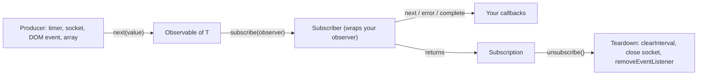

### 1.1 What RxJS Is and the Problem It Solves

RxJS (Reactive Extensions for JavaScript) is a library for composing values that arrive over time. It gives you one type, `Observable<T>`, that can represent a click stream, a WebSocket, an HTTP response, a timer or an array, and about a hundred operators that combine and transform those streams. Because every source has the same shape, the same `debounceTime`, `retry` or `switchMap` works on all of them.

The problem it solves is coordination. A single promise is easy. Three things that interact are hard: "search when the user stops typing, cancel the previous request, retry twice on a 503, and stop when the component is destroyed" turns into nested callbacks, flags and timers. In RxJS it is a pipeline of five operators, and cancellation is built into the type.

The table compares the async primitives you already know:

| Primitive | Values | Push or pull | Lazy | Cancellable | Composable operators |
| --- | --- | --- | --- | --- | --- |
| Callback | Any number | Push | No | Only if the API offers it | No |
| `Promise<T>` | Exactly one (or a rejection) | Push | No, starts on creation | No (`AbortSignal` is separate) | `then`, `Promise.all`, `race` |
| `AsyncIterable<T>` | Any number | Pull (`for await`) | Yes | `return()` on the iterator | Few built-ins (iterator helpers are synchronous) |
| `EventTarget` | Any number | Push | No | `removeEventListener` | No |
| Angular / Preact / Solid signal | Current value only | Push to dependents | n/a | n/a | `computed`, `effect` |
| `Observable<T>` | Zero to infinite, then optional error or complete | Push | Yes, nothing runs until subscribe | Yes, `unsubscribe()` | 100+ operators |

Signals and Observables are complementary. A signal holds state ("what is the value now?"); an Observable models events over time ("what happened, and when?"). Angular ships `toSignal` and `toObservable` precisely because real apps need both. Masterclass M3 covers that bridge.

### 1.2 Installation, Imports & First Run

RxJS has no runtime dependencies other than `tslib`. Install the current stable 7.x line:

```bash
npm install rxjs@^7.8.2
npm ls rxjs          # confirm a single copy
```

Run this guide's starter project, which contains every Stage 1-3 example in this README:

```bash
git clone https://github.com/TheLearningHubOrg/learn-rxjs.git
cd learn-rxjs
npm ci              # installs the exact versions from package-lock.json
npm test            # Vitest: unit tests plus TestScheduler marble tests
npm run build       # tsc -> dist/
npm start           # node dist/index.js prints the output of each stage
npm run dev         # tsx watch mode while you experiment
```

RxJS 7 exposes a small set of entry points. Import operators from `'rxjs'`; the other paths exist for optional features that pull in extra code:

| Entry point | Example import | Contains |
| --- | --- | --- |
| `'rxjs'` | `import { Observable, of, map, switchMap } from 'rxjs';` | Core types, creation functions, every operator (since 7.2), Subjects, schedulers |
| `'rxjs/operators'` | `import { map } from 'rxjs/operators';` | Legacy operator path from RxJS 6. Still works in 7; prefer `'rxjs'` |
| `'rxjs/ajax'` | `import { ajax } from 'rxjs/ajax';` | `XMLHttpRequest`-based HTTP with progress events |
| `'rxjs/fetch'` | `import { fromFetch } from 'rxjs/fetch';` | `fetch` wrapped with abort-on-unsubscribe |
| `'rxjs/webSocket'` | `import { webSocket } from 'rxjs/webSocket';` | `WebSocketSubject` for bidirectional sockets |
| `'rxjs/testing'` | `import { TestScheduler } from 'rxjs/testing';` | Virtual-time marble testing |

The naming convention used everywhere in this guide: a trailing `$` marks a variable that holds an Observable (`clicks$`, `user$`). It is a convention, not syntax, but it makes code reviews much easier.

### 1.3 The Observable Contract

An Observable is declarative: creating one only describes what will happen. The function you pass to `new Observable()` is called the subscribe function, and it runs once per subscriber, at the moment `subscribe()` is called.

```typescript
import { Observable } from 'rxjs';

const observable = new Observable<number>((subscriber) => {
  subscriber.next(1);
  subscriber.next(2);
  subscriber.next(3);
  setTimeout(() => {
    subscriber.next(4);
    subscriber.complete();
  }, 1000);
});

console.log('just before subscribe');
observable.subscribe({
  next(x) {
    console.log('got value ' + x);
  },
  error(err) {
    console.error('something wrong occurred: ' + err);
  },
  complete() {
    console.log('done');
  },
});
console.log('just after subscribe');
```

Output:

```text
just before subscribe
got value 1
got value 2
got value 3
just after subscribe
got value 4
done
```

The values 1, 2 and 3 arrive before `subscribe()` returns because the subscribe function calls `next` synchronously. Value 4 arrives a second later from the timer.

Every Observable obeys one grammar, called the Observable contract:

```text
next* (error | complete)?
```

Zero or more `next` notifications, followed by at most one terminal notification. After `error` or `complete`, nothing else is delivered. RxJS enforces this: if your producer calls `next` after `complete`, the `Subscriber` drops the call.

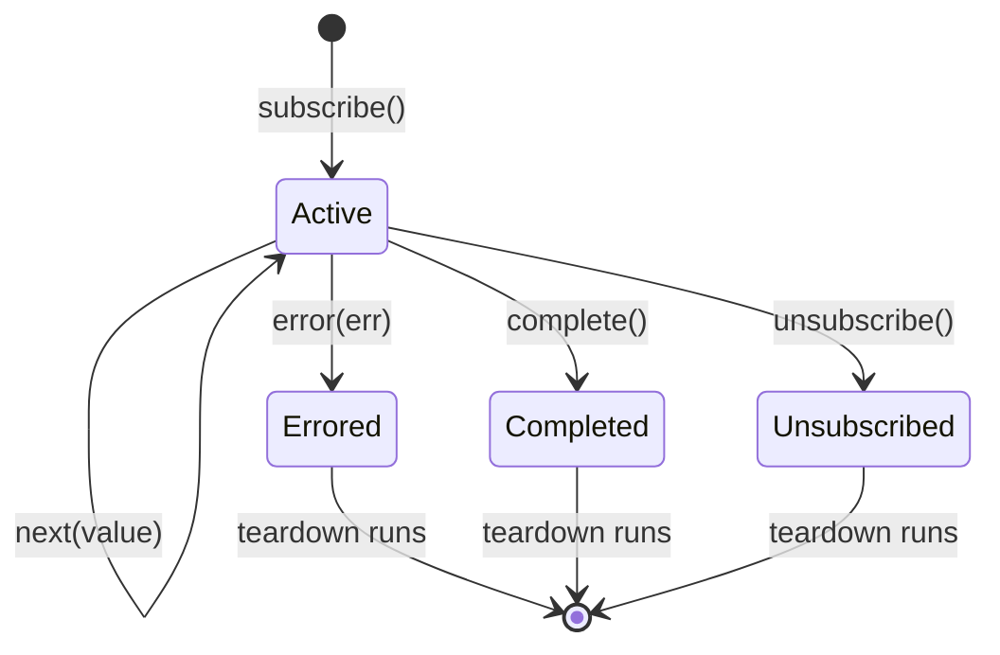

The starter project's first function, in [`src/stage1/observable-basics.ts`](src/stage1/observable-basics.ts), applies the contract:

```typescript
import { Observable } from 'rxjs';

export function countdown(start: number): Observable<number> {
  return new Observable<number>((subscriber) => {
    for (let i = start; i > 0 && !subscriber.closed; i--) {
      subscriber.next(i);
    }
    subscriber.complete();
  });
}
```

| Line / API | Role | What happens at runtime |
| :--- | :--- | :--- |
| `new Observable<number>(fn)` | Wraps the producer function | Nothing runs yet; the function is stored |
| `subscriber` | A `Subscriber<number>` created per `subscribe()` call | Wraps your observer, enforces the contract, tracks `closed` |
| `!subscriber.closed` | Cooperative cancellation | If a downstream `take(2)` unsubscribes, the loop stops instead of spinning a million times |
| `subscriber.next(i)` | Emits a value | Calls your `next` callback synchronously, on the same stack |
| `subscriber.complete()` | Terminal notification | Calls `complete`, marks the subscriber closed, runs teardown |

The `closed` check matters. Without it, `countdown(1_000_000).pipe(take(2))` would still loop a million times, with RxJS silently discarding 999,998 `next` calls. The test `stops producing once the subscriber closes` in [`tests/stage1.test.ts`](tests/stage1.test.ts) checks this.

### 1.4 Observers and Partial Observers

An Observer is a consumer of values delivered by an Observable. It is a plain object with up to three callbacks, one for each notification type: `next`, `error` and `complete`.

```typescript
import { Observable, Observer, of } from 'rxjs';

const observer: Observer<number> = {
  next: (x) => console.log('Observer got a next value: ' + x),
  error: (err) => console.error('Observer got an error: ' + err),
  complete: () => console.log('Observer got a complete notification'),
};

const observable: Observable<number> = of(1, 2, 3);
observable.subscribe(observer);
```

You can pass a partial observer with only the callbacks you care about, or a single function, which is treated as `next`:

```typescript
import { of, throwError, concat } from 'rxjs';

const source$ = concat(of(1, 2), throwError(() => new Error('boom')));

source$.subscribe((v) => console.log('value', v)); // next only: the error is reported as unhandled
source$.subscribe({ next: (v) => console.log(v), error: (e: Error) => console.log('handled:', e.message) });
```

| Form | Status in RxJS 7 | Use it for |
| --- | --- | --- |
| `subscribe(fn)` | Supported | Quick `next`-only subscriptions where errors cannot happen or are handled upstream |
| `subscribe({ next, error, complete })` | Supported, recommended | Anything that can fail or where completion matters |
| `subscribe(next, error, complete)` | Deprecated | Nothing new; rewrite to the object form |
| `subscribe()` | Supported | Running a stream for its side effects only (`tap`) |

An error without an `error` callback is not swallowed. RxJS rethrows it asynchronously through `config.onUnhandledError` (or the host's unhandled-error reporting if that is not set), so in Node you see it on stderr and in a browser in the console. It does not crash the code that called `subscribe`, which is why missing error handlers are easy to overlook.

```typescript
import { config, throwError } from 'rxjs';

// Route every unhandled stream error to your telemetry, once, at app start-up.
config.onUnhandledError = (err) => console.error('[rxjs unhandled]', err);

throwError(() => new Error('nobody listens')).subscribe();
```

### 1.5 Subscriptions and Teardown

A Subscription is an object that represents a disposable resource, usually the execution of an Observable. Calling `unsubscribe()` stops the execution and releases whatever it holds.

```typescript
import { interval } from 'rxjs';

const observable = interval(1000);
const subscription = observable.subscribe((x) => console.log(x));

// Later: stop the timer
setTimeout(() => subscription.unsubscribe(), 3500); // logs 0, 1, 2
```

When you build an Observable yourself, the function you return from the subscribe function is the teardown. RxJS runs it exactly once, on whichever happens first: `unsubscribe()`, `error`, or `complete`. Here is [`createTicker`](src/stage1/observable-basics.ts) from the starter, which counts live timers so the tests can prove teardown happened:

```typescript
import { Observable } from 'rxjs';

export function createTicker(periodMs: number) {
  let active = 0;
  const ticks$ = new Observable<number>((subscriber) => {
    let n = 0;
    active++;
    const id = setInterval(() => subscriber.next(n++), periodMs);
    return () => {
      clearInterval(id);
      active--;
    };
  });
  return { ticks$, activeTimers: () => active };
}
```

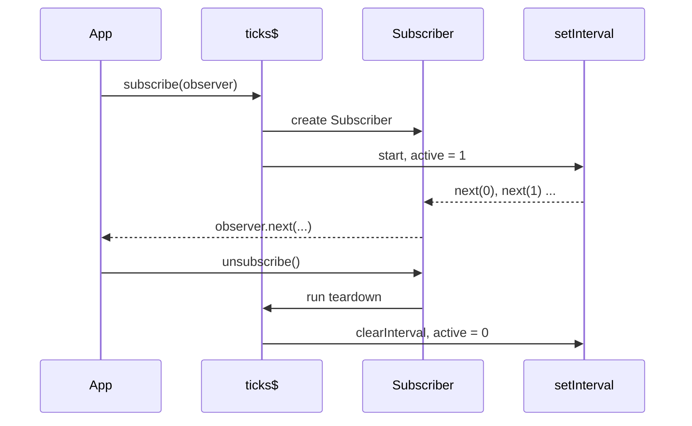

Subscriptions compose. `add()` attaches child teardowns so one `unsubscribe()` releases everything:

```typescript
import { interval, Subscription } from 'rxjs';

const bag = new Subscription();
bag.add(interval(1000).subscribe((n) => console.log('tick', n)));
bag.add(() => console.log('custom cleanup ran'));

setTimeout(() => {
  bag.unsubscribe(); // stops the interval and logs "custom cleanup ran"
  console.log('closed?', bag.closed); // true
}, 2500);
```

In Angular, tie a subscription to the component lifetime with `takeUntilDestroyed`, which replaces the old `ngOnDestroy` plus manual `unsubscribe()` pattern:

```typescript
import { Component, signal } from '@angular/core';
import { takeUntilDestroyed } from '@angular/core/rxjs-interop';
import { interval } from 'rxjs';

@Component({
  selector: 'app-ticker',
  template: `<h1>Seconds open: {{ seconds() }}</h1>`,
})
export class TickerComponent {
  protected readonly seconds = signal(0);

  constructor() {
    // Called in an injection context, so it finds the component's DestroyRef itself.
    interval(1000)
      .pipe(takeUntilDestroyed())
      .subscribe((n) => this.seconds.set(n + 1));
  }
}

// Outside an injection context (for example in ngOnInit), pass a DestroyRef explicitly:
//   private readonly destroyRef = inject(DestroyRef);
//   source$.pipe(takeUntilDestroyed(this.destroyRef)).subscribe(...);
```

The equivalent class-based pattern from older Angular code still works and is worth recognising:

```typescript
import { Component, OnDestroy, OnInit } from '@angular/core';
import { interval, Subscription } from 'rxjs';

@Component({
  selector: 'app-root',
  template: `<h1>subscription in Angular</h1>`,
})
export class App implements OnInit, OnDestroy {
  private subscription?: Subscription;

  ngOnInit() {
    this.subscription = interval(1000).subscribe((x) => console.log(x));
  }

  ngOnDestroy() {
    this.subscription?.unsubscribe();
  }
}
```

### 1.6 Synchronous vs Asynchronous Delivery

RxJS does not make anything asynchronous on its own. An Observable delivers values on whatever schedule its producer uses: `of(1, 2, 3)` is fully synchronous, `interval` uses `setInterval`, `from(promise)` waits for a microtask. This surprises people coming from promises, where `then` callbacks are always asynchronous.

[`recordEmissionOrder`](src/stage1/observable-basics.ts) in the starter proves it:

```typescript
import { Observable } from 'rxjs';

const log: string[] = [];
const source$ = new Observable<string>((subscriber) => {
  subscriber.next('sync value');
  setTimeout(() => {
    subscriber.next('async value');
    subscriber.complete();
  }, 0);
});

log.push('before subscribe');
source$.subscribe({ next: (v) => log.push(v), complete: () => console.log(log) });
log.push('after subscribe');
// [ 'before subscribe', 'sync value', 'after subscribe', 'async value' ]
```

| Source | Delivery | Consequence |
| --- | --- | --- |
| `of`, `from(array)`, `range`, `EMPTY` | Synchronous, during `subscribe()` | Values arrive before the next line runs; `subscribe` may return an already closed Subscription |
| `from(promise)`, `defer(() => promise)` | Microtask | After the current synchronous code, before timers |
| `timer`, `interval`, `delay` | Macrotask (`asyncScheduler`, `setTimeout`/`setInterval`) | After microtasks and rendering opportunities |
| `fromEvent` | Whenever the event fires | Depends on the event source |
| `animationFrames()` | Before the next repaint | Browser only |

If code relies on a value having arrived "by now", it is relying on the producer's timing. Make the dependency explicit with operators rather than ordering assumptions. Stage 5 shows how schedulers (`observeOn(asyncScheduler)`) move delivery when you really need to.

### 1.7 Cold vs Hot Observables

A cold Observable creates its producer inside the subscribe function, so each subscriber gets an independent execution. `countdown`, `interval`, `ajax` and `from(array)` are cold: two subscribers to an `ajax` call mean two HTTP requests.

A hot Observable shares a producer that exists independently of any one subscriber. DOM events seen through `fromEvent`, a WebSocket you opened earlier, and every `Subject` are hot: late subscribers miss values that were emitted before they arrived.

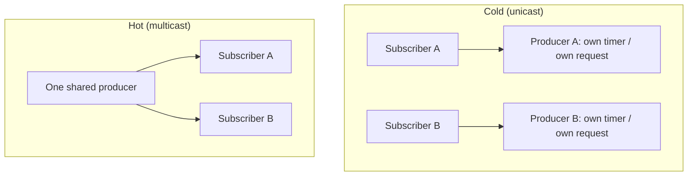

```typescript
import { interval, share, take } from 'rxjs';

const cold$ = interval(100).pipe(take(3));
cold$.subscribe((v) => console.log('cold A', v));
setTimeout(() => cold$.subscribe((v) => console.log('cold B', v)), 150); // B starts from 0

const hot$ = interval(100).pipe(take(3), share());
hot$.subscribe((v) => console.log('hot A', v));
setTimeout(() => hot$.subscribe((v) => console.log('hot B', v)), 150); // B joins late and starts from 1
```

`share()` turns a cold source hot by putting a `Subject` between the source and the subscribers. Stage 5 covers `share`, `shareReplay` and the reset options in depth. For now remember the default: every new subscription is a new execution, and that is usually what you want.

### 1.8 Line-by-Line Breakdown of the Starter Project

The repository root is a small TypeScript project. Stage 1-3 code lives in folders named after the stage; the tests next to them are the executable version of this README.

```text
learn-rxjs/
├── src/
│   ├── index.ts                    demo runner: npm start prints every stage
│   ├── stage1/observable-basics.ts countdown, createTicker, recordEmissionOrder
│   ├── stage2/creation.ts          multiplyBy, evenSquares, defer, bindNodeCallback
│   ├── stage3/running-stats.ts     scan-based live statistics
│   ├── stage3/typeahead.ts         debounce + distinct + switchMap search
│   ├── observables/stream-lab.ts   BehaviorSubject store, flattening, retry (Stages 4-5)
│   └── types/roadmap.ts            stage metadata printed by the runner
├── tests/                          Vitest suites, one per stage
├── package.json                    scripts: dev, start, build, lint, test
├── tsconfig.json                   strict, NodeNext modules, ES2022
└── Dockerfile                      builds, tests, then runs the demo
```

| File / setting | Role | What happens at runtime |
| :--- | :--- | :--- |
| `"type": "module"` in `package.json` | Native ES modules | Imports need the `.js` extension (`'./stage1/observable-basics.js'`) even in `.ts` files, because NodeNext resolution mirrors what Node will load |
| `"strict": true` in `tsconfig.json` | Full type checking | Catches `Observable<string \| undefined>` leaking into code that expects `string` |
| `npm run lint` (`tsc --noEmit`) | Type check without output | CI fails on type errors before tests run |
| `npm test` (`vitest run`) | Runs `tests/**/*.test.ts` | Marble tests use virtual time, so the suite takes about two seconds |
| `src/index.ts` `main()` | Demo entry point | Awaits each stage in order and exits non-zero on failure |
| `Dockerfile` | Three stages: deps, build, runtime | Type-checks and tests during `docker build`; the image runs `node dist/index.js` as the `node` user |

### 1.9 Pitfalls

| Pitfall | Symptom | Fix |
| --- | --- | --- |
| Expecting an Observable to run without `subscribe()` | `http.get(url)` in Angular, or `ajax(url)`, sends no request; no error | Something must subscribe: `subscribe()`, the `async` pipe, `toSignal`, or `firstValueFrom` |
| Subscribing twice to a cold HTTP Observable | Two identical requests in the network tab | Subscribe once, or share with `shareReplay({ bufferSize: 1, refCount: true })` (Stage 5) |
| No `error` callback | `Error: ...` printed from an RxJS timeout callback, far from the code that caused it | Pass an observer with `error`, or handle with `catchError` upstream; set `config.onUnhandledError` for reporting |
| Long-lived subscription never unsubscribed | Memory grows, callbacks fire for destroyed components, duplicate log lines after navigation | `takeUntilDestroyed()`, `takeUntil(destroy$)`, the `async` pipe, or keep the `Subscription` and call `unsubscribe()` |
| Hand-written Observable with no teardown | Timers and sockets keep running after unsubscribe; Node process never exits | Return a teardown function from the subscribe function |
| Producer ignores `subscriber.closed` | CPU spike when a synchronous loop is cut short by `take(n)` | Check `subscriber.closed` in loops |
| Calling `next` after `complete` | Values silently disappear | Respect the contract; complete only once all values are sent |
| Assuming async delivery | Code that reads a variable after `subscribe()` sees the value with `of(x)` but `undefined` with an HTTP source | Do the work inside the pipeline instead of after `subscribe()` |

### 1.10 Best Practices

- Suffix Observable variables with `$`: reviewers can see at a glance what needs subscribing and unsubscribing.
- Prefer the observer object form of `subscribe`: it makes the missing `error` handler visible.
- Every hand-written Observable returns a teardown: it is the only place resources can be released.
- Keep the number of `subscribe()` calls small and at the edges (components, controllers, `main`): logic inside pipelines is testable, logic in callbacks is not.
- Treat an Observable as a recipe, not a value: you can pass it around and subscribe later, and each subscription is a fresh run unless you share it.
- Set `config.onUnhandledError` once at start-up: unhandled stream errors then reach your logs instead of only the console.
- Pin one copy of RxJS in the dependency tree: two copies break `instanceof Observable` checks and double the bundle.

### 1.11 Hands-on Exercise

Write `fromArraySlowly<T>(items: T[], gapMs: number): Observable<T>` that emits each item `gapMs` apart and then completes, using `new Observable` and `setTimeout` (no RxJS creation functions).

Requirements:

1. Unsubscribing halfway must cancel the pending timeout.
2. An empty array completes immediately.
3. Add a test next to [`tests/stage1.test.ts`](tests/stage1.test.ts) that subscribes, takes two values, and asserts that no timer is left running, following the `createTicker` pattern of counting active timers.

Expected output for `fromArraySlowly(['a', 'b', 'c'], 100).subscribe(console.log)`:

```text
a        (after 100 ms)
b        (after 200 ms)
c        (after 300 ms)
```

The reference implementation of the same technique is `createTicker` in [`src/stage1/observable-basics.ts`](src/stage1/observable-basics.ts); the teardown test is `runs the teardown when an operator completes the stream` in [`tests/stage1.test.ts`](tests/stage1.test.ts).

[Back to top ⤴️](#-table-of-contents)

---

## 2. Stage 2: Creation Operators & the pipe() Pipeline

Stage 1 built Observables by hand. In practice you almost never call `new Observable` in application code: creation functions turn arrays, promises, events, callbacks, timers, HTTP calls and sockets into Observables, and `pipe()` chains operators onto them. Prerequisite: Stage 1. Afterwards you can bring any asynchronous API into RxJS, write your own pipeable operator, and convert back to a promise at the edge of your code.

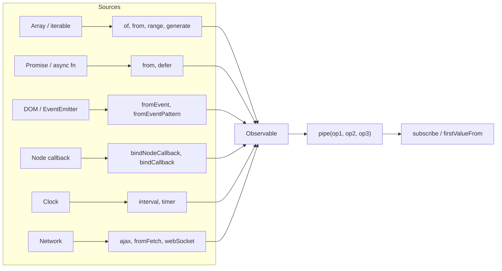

### 2.1 Operator Kinds: Creation Functions vs Pipeable Operators

Operators are functions. There are two kinds:

- **Creation operators** (also called creation functions) are standalone functions that return a new Observable: `of(1, 2)`, `interval(1000)`, `fromEvent(button, 'click')`, `combineLatest([a$, b$])`.
- **Pipeable operators** are functions that take configuration and return an `OperatorFunction<T, R>`, which is itself a function `(source: Observable<T>) => Observable<R>`. You apply them with `source$.pipe(operator())`. A pipeable operator never changes its source; it returns a new Observable that subscribes to the source when it is subscribed to.

```typescript
import { Observable, OperatorFunction, of, map, filter } from 'rxjs';

// map(fn) returns an OperatorFunction...
const double: OperatorFunction<number, number> = map((n) => n * 2);

// ...which is just a function from Observable to Observable.
const source$: Observable<number> = of(1, 2, 3);
const doubled$: Observable<number> = double(source$);

// pipe(a, b) is the readable way to write b(a(source$)).
const same$ = source$.pipe(double, filter((n) => n > 2));
same$.subscribe(console.log); // 4, 6
doubled$.subscribe(console.log); // 2, 4, 6 (source$ is unchanged)
```

| | Creation operator | Pipeable operator |
| --- | --- | --- |
| Called as | `of(1, 2, 3)` | `source$.pipe(map(fn))` |
| Input | Plain values, promises, events, other Observables | An upstream Observable |
| Returns | `Observable<T>` | `OperatorFunction<T, R>` (or `MonoTypeOperatorFunction<T>` when the type is unchanged) |
| Examples | `of`, `from`, `interval`, `defer`, `forkJoin`, `merge` | `map`, `filter`, `scan`, `switchMap`, `catchError`, `mergeWith` |
| Imported from | `'rxjs'` | `'rxjs'` (7.2+) or the legacy `'rxjs/operators'` |

### 2.2 How pipe() Composes, and Writing Your Own Operator

`pipe()` is a left-to-right function composition. When you subscribe to the result, the subscription travels upstream through each operator to the source, and values travel downstream through the same chain.

```mermaid
sequenceDiagram
    participant You
    participant M as map(x * 2)
    participant F as filter(x > 2)
    participant Src as of(1, 2, 3)
    Note over You,Src: pipe(map, filter) wires the chain; nothing runs yet
    You->>F: subscribe()
    F->>M: subscribe()
    M->>Src: subscribe()
    Src-->>M: next(1)
    M-->>F: next(2)
    Note over F: 2 fails the predicate, dropped
    Src-->>M: next(2)
    M-->>F: next(4)
    F-->>You: next(4)
    Src-->>M: complete()
    M-->>F: complete()
    F-->>You: complete()
```

Because an operator is a function from Observable to Observable, the simplest custom operator is a reusable slice of pipeline. This is [`multiplyBy`](src/stage2/creation.ts) from the starter:

```typescript
import { OperatorFunction, map, of } from 'rxjs';

export function multiplyBy(factor: number): OperatorFunction<number, number> {
  return (source$) => source$.pipe(map((n) => n * factor));
}

of(1, 2, 3).pipe(multiplyBy(2), multiplyBy(5)).subscribe(console.log); // 10, 20, 30
```

When no combination of built-in operators fits, write the subscription yourself. The rules: subscribe to the source inside a new Observable, forward `error` and `complete`, and return the inner subscription so unsubscribing propagates upstream.

```typescript
import { Observable, MonoTypeOperatorFunction, of } from 'rxjs';

/** Emits every nth value (1-based): everyNth(3) passes the 3rd, 6th, 9th ... */
export function everyNth<T>(n: number): MonoTypeOperatorFunction<T> {
  return (source$) =>
    new Observable<T>((subscriber) => {
      let index = 0;
      return source$.subscribe({
        next: (value) => {
          if (++index % n === 0) subscriber.next(value);
        },
        error: (err) => subscriber.error(err),
        complete: () => subscriber.complete(),
      });
    });
}

of('a', 'b', 'c', 'd', 'e', 'f').pipe(everyNth(3)).subscribe(console.log); // c, f
```

Note that `index` lives inside the subscribe function, so each subscriber has its own counter. Putting it outside, next to `n`, would make two subscribers share and corrupt it. Masterclass M2 covers the remaining rules for lawful operators.

| Approach | Use when | Watch out for |
| --- | --- | --- |
| Compose existing operators (`source$.pipe(...)`) | Almost always | Nothing; this is the default |
| `new Observable` wrapper around `source$.subscribe` | Custom state or timing that no operator expresses | Per-subscriber state, forwarding error/complete, returning the subscription |
| `operate()` from RxJS internals | Never in application code | Not part of the public API |

### 2.3 Synchronous Creation: of, from, range, generate, EMPTY, throwError

These sources deliver everything during `subscribe()` unless you give them a scheduler.

```typescript
import { of, from, range, generate, EMPTY, NEVER, throwError, iif } from 'rxjs';

of(1, 'two', { three: 3 }).subscribe(console.log); // each argument is one value
of([1, 2, 3]).subscribe(console.log); // one value: the array itself
from([1, 2, 3]).subscribe(console.log); // three values
from(new Map([['a', 1]])).subscribe(console.log); // ['a', 1] - any iterable works
from('hi').subscribe(console.log); // 'h', 'i' - strings are iterable
range(5, 3).subscribe(console.log); // 5, 6, 7 (start, count)

// generate: a for-loop as an Observable
generate({ initialState: 1, condition: (x) => x < 50, iterate: (x) => x * 3 }).subscribe(console.log); // 1, 3, 9, 27

EMPTY.subscribe({ complete: () => console.log('EMPTY completes immediately') });
NEVER.subscribe(() => console.log('never printed')); // never emits, never completes

throwError(() => new Error('bad input')).subscribe({ error: (e: Error) => console.log(e.message) });

// iif decides at subscribe time, not at creation time
let loggedIn = false;
const greeting$ = iif(() => loggedIn, of('welcome back'), of('please sign in'));
greeting$.subscribe(console.log); // please sign in
loggedIn = true;
greeting$.subscribe(console.log); // welcome back
```

| Function | Emits | Completes | Typical use |
| --- | --- | --- | --- |
| `of(a, b, c)` | Each argument | Yes | Fixed values, test stubs, a fallback in `catchError` |
| `from(x)` | Each item of an array/iterable, or the promise's value, or an Observable-like's values | Yes | Adapting existing data |
| `range(start, count)` | `count` integers | Yes | Indexes, pagination numbers |
| `generate({...})` | Loop states | When `condition` is false | Generated sequences without arrays |
| `EMPTY` | Nothing | Immediately | "No result" branch inside `switchMap` or `catchError` |
| `NEVER` | Nothing | Never | Placeholder that keeps a combination alive |
| `throwError(() => err)` | Nothing | Errors | Turning a validation failure into a stream error |
| `iif(cond, a$, b$)` | `a$` or `b$` | When the chosen one does | Subscribe-time branching |

### 2.4 Time-Based Creation: interval and timer

`interval(period)` emits 0, 1, 2 ... every `period` ms, starting after the first period. `timer(due)` emits 0 once after `due` ms and completes; `timer(due, period)` waits `due` and then behaves like `interval(period)`. `due` can also be a `Date`.

```typescript
import { interval, timer, take, map } from 'rxjs';

interval(1000).pipe(take(3)).subscribe((n) => console.log('interval', n)); // 0 at 1s, 1 at 2s, 2 at 3s
timer(500).subscribe(() => console.log('timer fired once at 500 ms'));
timer(0, 1000).pipe(take(3)).subscribe((n) => console.log('timer(0, 1000)', n)); // 0 now, then every second

// Polling every 5 seconds, starting immediately
const poll$ = timer(0, 5000).pipe(map((tick) => `poll #${tick}`));
const sub = poll$.subscribe(console.log);
setTimeout(() => sub.unsubscribe(), 12_000);
```

Marble notation shows the difference; each `-` is 250 ms here:

```text
interval(1000)     ----0---1---2---3--->
timer(0, 1000)     0---1---2---3------->
timer(500)         --0|
timer(2000, 500)   --------0-1-2-3----->
```

`interval` and `timer` are cold: each subscriber gets its own clock. Both run on `asyncScheduler` (`setInterval`/`setTimeout` under the hood), so they drift slightly and pause in background browser tabs, where browsers throttle timers. For animation use `animationFrames()` instead.

### 2.5 Bridging Promises, Events and Callbacks

#### Promises: from, defer and the eager-promise trap

A promise starts running when it is created. `from(promise)` therefore adapts work that has already begun, and re-subscribing replays the same settled result rather than repeating the work. Wrap the promise factory in `defer` to make it lazy and repeatable. This matters for `retry`: retrying `from(fetch(url))` resubscribes to the same rejected promise, so nothing is actually retried.

```typescript
import { defer, from, retry, lastValueFrom } from 'rxjs';

let calls = 0;
const fetchUser = async () => {
  calls++;
  if (calls < 3) throw new Error(`attempt ${calls} failed`);
  return { id: 1, name: 'Ada' };
};

// Wrong: one promise, created once. retry re-subscribes to the same rejection.
// from(fetchUser()).pipe(retry(3))

// Right: defer calls fetchUser on every (re)subscription.
const user$ = defer(() => from(fetchUser())).pipe(retry(3));
console.log(await lastValueFrom(user$), 'after', calls, 'calls'); // { id: 1, name: 'Ada' } after 3 calls
```

The starter's [`fromPromiseFactory`](src/stage2/creation.ts) and [`freshTimestamp`](src/stage2/creation.ts) show the same pattern, and [`tests/stage2.test.ts`](tests/stage2.test.ts) asserts that no work starts before `subscribe`.

#### Back to promises: firstValueFrom and lastValueFrom

```typescript
import { firstValueFrom, lastValueFrom, EMPTY, of, interval } from 'rxjs';

console.log(await firstValueFrom(interval(10))); // 0, then unsubscribes from the infinite interval
console.log(await lastValueFrom(of(1, 2, 3))); // 3
console.log(await lastValueFrom(EMPTY, { defaultValue: 'none' })); // 'none'
await lastValueFrom(EMPTY).catch((e: Error) => console.log(e.name)); // EmptyError
```

Never `lastValueFrom` an infinite stream such as `interval` or a `fromEvent`: the promise never settles.

#### Events: fromEvent and fromEventPattern

`fromEvent` accepts DOM `EventTarget`s, Node `EventEmitter`s and jQuery-style objects, and removes the listener on unsubscribe.

```typescript
import { fromEvent, map, take } from 'rxjs';
import { EventEmitter } from 'node:events';

const bus = new EventEmitter();
// A handler called with one argument emits that argument; with several, an array of them.
fromEvent<string>(bus, 'message')
  .pipe(
    take(2),
    map((text) => text.toUpperCase()),
  )
  .subscribe({ next: console.log, complete: () => console.log('complete') });

bus.emit('message', 'hello');
bus.emit('message', 'world'); // HELLO, WORLD, complete
// take(2) unsubscribed after the second value, so fromEvent removed its listener
console.log('listeners left:', bus.listenerCount('message')); // 0
```

In the browser the same call is `fromEvent<MouseEvent>(document, 'click')`. `fromEventPattern(add, remove)` covers APIs that use other method names:

```typescript
import { fromEventPattern } from 'rxjs';

const media = window.matchMedia('(prefers-color-scheme: dark)');
const darkMode$ = fromEventPattern<MediaQueryListEvent>(
  (handler) => media.addEventListener('change', handler),
  (handler) => media.removeEventListener('change', handler),
);
darkMode$.subscribe((e) => console.log('dark mode is now', e.matches));
```

#### Callbacks: bindNodeCallback and bindCallback

`bindNodeCallback(fn)` turns a function whose last argument is an error-first callback `(err, value) => void` into a function that returns an Observable. `bindCallback` does the same for callbacks without an error argument. From the starter:

```typescript
import { bindNodeCallback, firstValueFrom } from 'rxjs';

function lookupUser(id: number, cb: (err: Error | null, value: string) => void): void {
  setTimeout(() => {
    if (id <= 0) cb(new Error(`invalid id ${id}`), '');
    else cb(null, `user-${id}`);
  }, 0);
}

const lookupUser$ = bindNodeCallback(lookupUser); // (id: number) => Observable<string>
console.log(await firstValueFrom(lookupUser$(7))); // user-7
lookupUser$(0).subscribe({ error: (e: Error) => console.log(e.message) }); // invalid id 0
```

| Line / API | Role | What happens at runtime |
| :--- | :--- | :--- |
| `bindNodeCallback(lookupUser)` | Higher-order adapter | Returns a new function with the callback parameter removed |
| `lookupUser$(7)` | Creates a cold Observable | Calls `lookupUser(7, cb)` on subscribe, not before |
| `cb(null, value)` | Success path | Becomes `next(value)` then `complete()` |
| `cb(err, ...)` | Failure path | Becomes `error(err)` |

For Node's own APIs prefer the promise versions (`node:fs/promises`) with `defer(() => readFile(path, 'utf8'))`; `bindNodeCallback` is for libraries that still only offer callbacks.

### 2.6 HTTP and Sockets: ajax, fromFetch, webSocket

| Function | Transport | Cancels on unsubscribe | Notes |
| --- | --- | --- | --- |
| `ajax(url \| config)` from `'rxjs/ajax'` | `XMLHttpRequest` | Yes (`xhr.abort()`) | Emits an `AjaxResponse` with `status` and `response`; progress events with `includeUploadProgress`/`includeDownloadProgress`; errors on non-2xx |
| `ajax.getJSON<T>(url)` | `XMLHttpRequest` | Yes | Emits only the parsed body |
| `fromFetch(url, init)` from `'rxjs/fetch'` | `fetch` | Yes (`AbortController`) | Emits the `Response`; you call `response.json()`; non-2xx does not error by itself. Use `selector` to read the body inside the same cancellation scope |
| `webSocket<T>(url \| config)` from `'rxjs/webSocket'` | `WebSocket` | Closes the socket when the last subscriber leaves | A `Subject`: `subscribe` to receive, `next` to send; `multiplex` for topic subscriptions |
| Angular `HttpClient` | Configurable (`fetch` or XHR) | Yes | Use it in Angular apps; it adds interceptors and testing support |

```typescript
import { ajax } from 'rxjs/ajax';
import { fromFetch } from 'rxjs/fetch';
import { map, switchMap, of, catchError } from 'rxjs';

ajax.getJSON<{ login: string }[]>('https://api.github.com/users?per_page=2')
  .pipe(map((users) => users.map((u) => u.login)))
  .subscribe(console.log);

fromFetch('https://api.github.com/repos/ReactiveX/rxjs', {
  selector: (response) => (response.ok ? response.json() : Promise.reject(new Error(`HTTP ${response.status}`))),
})
  .pipe(catchError((err: Error) => of({ error: err.message })))
  .subscribe(console.log);

// Without selector you would have to switchMap to response.json(); the body read
// would then not be aborted when the subscriber unsubscribes mid-download.
fromFetch('https://api.github.com/zen').pipe(switchMap((r) => r.text())).subscribe(console.log);
```

```typescript
import { webSocket } from 'rxjs/webSocket';

type Msg = { type: 'price'; symbol: string; value: number } | { type: 'subscribe'; symbol: string };

const socket$ = webSocket<Msg>('wss://example.test/prices');
socket$.subscribe({ next: (m) => console.log(m), error: (e) => console.error('socket closed with error', e) });
socket$.next({ type: 'subscribe', symbol: 'ACME' }); // queued until the socket opens
```

Reconnection, heartbeats and backoff for sockets are covered in Masterclass M4.

### 2.7 Join Creation Functions: Combining Several Sources

Join creation functions take several Observables and return one. They differ in when they subscribe to each input and when they emit.

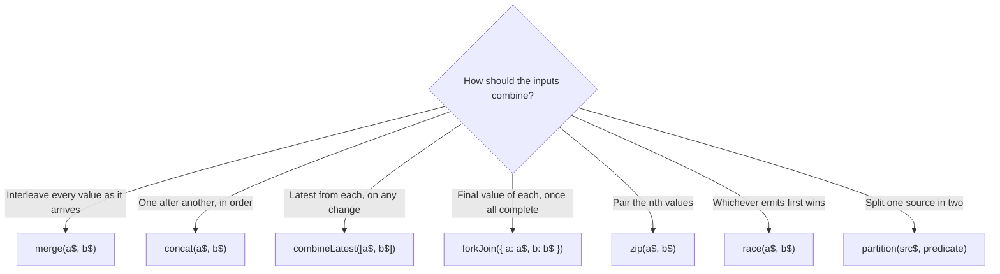

```typescript
import { combineLatest, forkJoin, merge, concat, zip, race, partition, of, timer, map } from 'rxjs';

const fast$ = timer(10).pipe(map(() => 'fast'));
const slow$ = timer(50).pipe(map(() => 'slow'));

merge(slow$, fast$).subscribe((v) => console.log('merge', v)); // fast, slow
concat(slow$, fast$).subscribe((v) => console.log('concat', v)); // slow (50 ms), fast (60 ms)
race(slow$, fast$).subscribe((v) => console.log('race', v)); // fast; slow$ is unsubscribed
zip(of(1, 2, 3), of('a', 'b')).subscribe((v) => console.log('zip', v)); // [1,'a'], [2,'b']

// Dictionary form gives named, typed results
forkJoin({ user: of({ id: 1 }), settings: of({ theme: 'dark' }) }).subscribe(console.log);
// { user: { id: 1 }, settings: { theme: 'dark' } }

combineLatest([of('EUR'), timer(0, 20).pipe(map((n) => n * 10))]).subscribe((pair) => console.log('combineLatest', pair));
// emits ['EUR', 0], ['EUR', 10], ... until unsubscribed

const [evens$, odds$] = partition(of(1, 2, 3, 4), (n) => n % 2 === 0);
evens$.subscribe((n) => console.log('even', n));
odds$.subscribe((n) => console.log('odd', n));
```

| Function | Emits when | Completes when | Gotcha |
| --- | --- | --- | --- |
| `merge` | Any input emits | All inputs complete | Optional last argument limits concurrency |
| `concat` | The current input emits | The last input completes | A never-completing input blocks the rest forever |
| `combineLatest` | Any input emits, once every input has emitted at least once | All inputs complete | Silent until each input has a value: add `startWith` to inputs that may be late |
| `forkJoin` | Once, after all inputs complete | Right after emitting | Completes without emitting if any input completes empty; never emits with infinite inputs |
| `zip` | Every input has an unpaired value | Any input completes and its buffer is drained | Buffers the faster side without limit |
| `race` | The first input to emit, then only that input | That input completes | Losers are unsubscribed |
| `partition` | Returns two Observables | Each completes with the source | Subscribes to the source twice (it is cold) |

### 2.8 Creation Operators Reference

The rest of this section is an alphabetical reference with an Angular example and a plain TypeScript example for most functions. The Angular examples are standalone components (`bootstrapApplication`) and log to the console in `ngOnInit`.

These operators are used to create an observable. Some of the creation operators are:

- ajax
- bindCallback
- bindNodeCallback
- defer
- empty
- from
- fromEvent
- fromEventPattern
- generate
- interval
- of
- range
- throwError
- timer
- iif

**ajax** - It creates an observable for an Ajax request with either a request object with url, headers, etc or a string for a URL.

Example with Angular:

```typescript
import { Component, OnInit } from '@angular/core';
import { CommonModule } from '@angular/common';
import { bootstrapApplication } from '@angular/platform-browser';
import { ajax } from 'rxjs/ajax';

@Component({
  selector: 'my-app',
  standalone: true,
  imports: [CommonModule],
  template: `
    <h1>ajax Example</h1>
  `,
})
export class App implements OnInit {
  ngOnInit() {
    const githubUsers = ajax('https://api.github.com/users?per_page=2');
    githubUsers.subscribe((res) => console.log(res.status, res.response));
  }
}

bootstrapApplication(App);
```

[Stackblitz Angular Example Link](https://stackblitz.com/edit/angular-ees5qn?file=src%2Fmain.ts)

Example with TypeScript:

```typescript
import { ajax } from 'rxjs/ajax';

const githubUsers = ajax('https://api.github.com/users?per_page=2');
githubUsers.subscribe((res) => console.log(res.status, res.response));
```

[Stackblitz TypeScript Example Link](https://stackblitz.com/edit/rxjs-umrlkx?file=index.ts)

**bindCallback** - `bindCallback` operator is used to convert a callback-style function into an observable.

It allows you to work with asynchronous APIs that follow the Node.js-style callback pattern, where the last argument of a function is a callback function that is invoked with the result or error.

**bindNodeCallback** - `bindNodeCallback` is a function that converts a Node.js-style callback function into an Observable.

Example with Angular:

```typescript
import { Component, OnInit } from '@angular/core';
import { CommonModule } from '@angular/common';
import { bootstrapApplication } from '@angular/platform-browser';
import { bindNodeCallback } from 'rxjs';

// Assume we have a Node.js-style callback function for file reading
function readFileAsync(filePath: string, callback: (error: Error | null, data: string) => void) {
  // Some asynchronous file reading logic
  // Call the callback with the error (if any) and the file data
  setTimeout(() => {
    if (filePath === '/path/to/file.txt') {
      callback(null, 'File content goes here');
    } else {
      callback(new Error('File not found'), null);
    }
  }, 2000);
}

@Component({
  selector: 'my-app',
  standalone: true,
  imports: [CommonModule],
  template: `
    <h1>bindNodeCallback Example</h1>
    <div>{{ fileContent }}</div>
  `,
})
export class App implements OnInit {
  
  fileContent: string;

  ngOnInit() {
    const readFile = bindNodeCallback(readFileAsync);
    const filePath = '/path/to/file.txt';

    const readFile$ = readFile(filePath);

    readFile$.subscribe(
      (data: string) => {
        this.fileContent = data;
        console.log('File content:', data);
      },
      (error: Error) => {
        console.error('Error reading file:', error);
      }
    );
  }
}

bootstrapApplication(App);
```

[Stackblitz Angular Example Link](https://stackblitz.com/edit/stackblitz-starters-avcder?file=src%2Fmain.ts)

**defer** - Creates an Observable that, on subscribe, calls an Observable factory to make an Observable for each new Observer.

```typescript
import { Component, OnInit } from '@angular/core';
import { CommonModule } from '@angular/common';
import { bootstrapApplication } from '@angular/platform-browser';
import { switchMap, defer, of, timer, merge } from 'rxjs';

@Component({
  selector: 'my-app',
  standalone: true,
  imports: [CommonModule],
  template: `<h1>defer operator</h1>`,
})
export class App implements OnInit {

  ngOnInit() {
    const s1 = of(new Date()); //will capture current date time
    const s2 = defer(() => of(new Date())); //will capture date time at the moment of subscription

    console.log(new Date());

    timer(2000)
      .pipe(switchMap(_ => merge(s1, s2)))
      .subscribe(console.log);
  }
}

bootstrapApplication(App);
```

**empty** - Replaced with the EMPTY constant or scheduled (e.g. scheduled([], scheduler)). Will be removed in v8.

```typescript
import { Component, OnInit } from '@angular/core';
import { CommonModule } from '@angular/common';
import { bootstrapApplication } from '@angular/platform-browser';
import { EMPTY } from 'rxjs';

@Component({
  selector: 'my-app',
  standalone: true,
  imports: [CommonModule],
  template: `
  <h1>empty operator</h1>
  `,
})
export class App implements OnInit {

  ngOnInit() {
    const subscribe = EMPTY.subscribe({
      next: () => console.log('Next'),
      complete: () => console.log('Complete!')
    });
  }
}

bootstrapApplication(App);
```

**from** - Creates an Observable from an Array, an array-like object, a Promise, an iterable object, or an Observable-like object.

```jsx
import { Component, OnInit } from '@angular/core';
import { CommonModule } from '@angular/common';
import { bootstrapApplication } from '@angular/platform-browser';
import { from } from 'rxjs';

@Component({
  selector: 'my-app',
  standalone: true,
  imports: [CommonModule],
  template: `
  <h1>from operator</h1>
  `,
})
export class App implements OnInit {
  data: any;

  ngOnInit() {
    const obj = from(['a', 'b', 'c', 'd']);

    obj.subscribe((res) => {
      console.log(res);
      this.data = res;
    });
  }
}

bootstrapApplication(App);
```

[Stackblitz Example Link](https://stackblitz.com/edit/angular-psyjew?file=src/main.ts)

**fromEvent** - Creates an Observable that emits events of a specific type coming from the given event target.

Example:

```jsx
import { AfterViewInit, Component, ElementRef, ViewChild } from '@angular/core';
import { CommonModule } from '@angular/common';
import { bootstrapApplication } from '@angular/platform-browser';
import { fromEvent } from 'rxjs';

@Component({
  selector: 'my-app',
  standalone: true,
  imports: [CommonModule],
  template: `
    <h1>fromEvent Example</h1>
    <button #add>Add</button>
    {{countVal}}
    <table>
      <tr *ngFor="let value of values">
        <td>{{value}}</td>
      </tr>
    </table>
  `,
})
export class App implements AfterViewInit {
  data: any;
  count = 0;
  values = [];
  countVal: any;

  @ViewChild('add') add: ElementRef;

  ngAfterViewInit() {
    let count = 0;
    fromEvent(this.add.nativeElement, 'click').subscribe((data) => {
      console.log(count++);
      this.countVal = count++;
      console.log(this.countVal);
      this.count++;
      this.values.push(this.count);
    });
  }
}

bootstrapApplication(App);
```

[Stackblitz Example Link](https://stackblitz.com/edit/angular-qy1hve?file=src/main.ts)

**fromEventPattern** - Creates an Observable from an arbitrary API for registering event handlers.

```typescript
import { AfterViewInit, Component, ElementRef, ViewChild } from '@angular/core';
import { CommonModule } from '@angular/common';
import { bootstrapApplication } from '@angular/platform-browser';
import { fromEventPattern, Subject } from 'rxjs';

@Component({
  selector: 'my-app',
  standalone: true,
  imports: [CommonModule],
  template: `
    <button (click)="startListening()">Start Listening</button>
    <button (click)="stopListening()">Stop Listening</button>
  `,
})
export class App implements AfterViewInit {
  private eventListener: EventListenerOrEventListenerObject;
  private eventSubject: Subject<Event>;

  ngOnInit() {
    this.eventSubject = new Subject<Event>();
    this.eventListener = (event: Event) => this.eventSubject.next(event);
  }

  ngOnDestroy() {
    this.eventSubject.complete();
  }

  startListening() {
    const observable = fromEventPattern(
      // Function to add the event listener
      (handler: EventListenerOrEventListenerObject) => {
        document.addEventListener('customEvent', handler);
      },
      // Function to remove the event listener
      (handler: EventListenerOrEventListenerObject) => {
        document.removeEventListener('customEvent', handler);
      }
    );

    observable.subscribe((event: Event) => {
      console.log('Event received:', event);
      // Handle the event as needed
    });

    this.eventSubject.subscribe((event: Event) => {
      document.dispatchEvent(event);
    });
  }

  stopListening() {
    this.eventSubject.complete();
  }
}

bootstrapApplication(App);
```

**generate** - Generates an observable sequence by running a state-driven loop producing the sequence's elements, using the specified scheduler to send out observer messages.

```typescript
import { Component, OnInit } from '@angular/core';
import { CommonModule } from '@angular/common';
import { bootstrapApplication } from '@angular/platform-browser';
import { generate } from 'rxjs';

@Component({
  selector: 'my-app',
  standalone: true,
  imports: [CommonModule],
  template: `
    <h1>generate example</h1>
  `,
})
export class App implements OnInit {

  ngOnInit() {
    const result = generate(0, x => x < 3, x => x + 1, x => x);

    result.subscribe(x => console.log(x));
  }
}

bootstrapApplication(App);
```

**interval** - Creates an Observable that emits sequential numbers every specified interval of time, on a specified SchedulerLike.

```typescript
import { Component, OnInit } from '@angular/core';
import { CommonModule } from '@angular/common';
import { bootstrapApplication } from '@angular/platform-browser';
import { interval, take } from 'rxjs';

@Component({
  selector: 'my-app',
  standalone: true,
  imports: [CommonModule],
  template: `
    <h1>interval operator</h1>
  `,
})
export class App implements OnInit {
  ngOnInit() {
    const numbers = interval(1000);
    
    const takeFourNumbers = numbers.pipe(take(4));
    
    takeFourNumbers.subscribe(x => console.log('Next: ', x));
  }
}

bootstrapApplication(App);
```

**of** - Converts the arguments to an observable sequence.

```jsx
import { Component, OnInit } from '@angular/core';
import { CommonModule } from '@angular/common';
import { bootstrapApplication } from '@angular/platform-browser';
import { from, of } from 'rxjs';

@Component({
  selector: 'my-app',
  standalone: true,
  imports: [CommonModule],
  template: `
  <h1>of operator</h1>
  `,
})
export class App implements OnInit {
  ngOnInit() {
    const obj = of('a', 'b', 'c', 'd');

    obj.subscribe((res) => {
      console.log(res);
    });
  }
}

bootstrapApplication(App);
```

**range** - Creates an Observable that emits a sequence of numbers within a specified range.

```typescript
import { Component, OnInit } from '@angular/core';
import { CommonModule } from '@angular/common';
import { bootstrapApplication } from '@angular/platform-browser';
import { range } from 'rxjs';

@Component({
  selector: 'my-app',
  standalone: true,
  imports: [CommonModule],
  template: `
  <h1>range operator</h1>
  `,
})
export class App implements OnInit {
  ngOnInit() {
    //emit 1-10 in sequence
    const source = range(1, 10);
    //output: 1,2,3,4,5,6,7,8,9,10
    const example = source.subscribe(val => console.log(val));
  }
}

bootstrapApplication(App);
```

[Stackblitz Example Link](https://stackblitz.com/edit/stackblitz-starters-7899ka?file=src%2Fmain.ts)

**throwError** - Creates an observable that will create an error instance and push it to the consumer as an error immediately upon subscription.

```typescript
import { Component, OnInit } from '@angular/core';
import { CommonModule } from '@angular/common';
import { bootstrapApplication } from '@angular/platform-browser';
import { throwError } from 'rxjs';

@Component({
  selector: 'my-app',
  standalone: true,
  imports: [CommonModule],
  template: `
  <h1>throwError operator</h1>
  `,
})
export class App implements OnInit {
  ngOnInit() {
    let errorCount = 0;
    
    const errorWithTimestamp$ = throwError(() => {
      const error: any = new Error(`This is error number ${ ++errorCount }`);
      error.timestamp = Date.now();
      return error;
    });
    
    errorWithTimestamp$.subscribe({
      error: err => console.log(err.timestamp, err.message)
    });
    
    errorWithTimestamp$.subscribe({
      error: err => console.log(err.timestamp, err.message)
    });
  }
}

bootstrapApplication(App);
```

[Stackblitz Example Link](https://stackblitz.com/edit/stackblitz-starters-mdhkry?file=src%2Fmain.ts)

**timer** - It is a creation operator used to create an observable that starts emitting the values after the timeout, and the value will keep increasing after each call.

```typescript
import { Component, OnInit } from '@angular/core';
import { CommonModule } from '@angular/common';
import { bootstrapApplication } from '@angular/platform-browser';
import { timer } from 'rxjs';

@Component({
  selector: 'my-app',
  standalone: true,
  imports: [CommonModule],
  template: `
  <h1>timer operator</h1>
  `,
})
export class App implements OnInit {
  ngOnInit() {
    const source = timer(1000);
    //output: 0
    const subscribe = source.subscribe(val => console.log(val));
  }
}

bootstrapApplication(App);
```

[Stackblitz Example Link](https://stackblitz.com/edit/stackblitz-starters-6ylica?file=src%2Fmain.ts)

**iif** - Checks a boolean at subscription time, and chooses between one of two observable sources

```typescript
import { Component, OnInit } from '@angular/core';
import { CommonModule } from '@angular/common';
import { bootstrapApplication } from '@angular/platform-browser';
import { iif, of, interval } from 'rxjs';
import { mergeMap } from 'rxjs/operators';

@Component({
  selector: 'my-app',
  standalone: true,
  imports: [CommonModule],
  template: `
  <h1>iif operator</h1>
  `,
})
export class App implements OnInit {
  ngOnInit() {
    const r$ = of('R');
    const x$ = of('X');

    interval(1000)
      .pipe(mergeMap(v => iif(() => v % 4 === 0, r$, x$)))
      .subscribe(console.log);
  }
}

bootstrapApplication(App);
```

[Stackblitz Example Link](https://stackblitz.com/edit/stackblitz-starters-ek4ybc?file=src%2Fmain.ts)

### 2.9 Join Creation Operators Reference

These operators are used to create an observable by combining multiple observables. Some of the join creation operators are:

- combineLatest
- concat
- forkJoin
- merge
- partition
- race
- zip

**combineLatest** - Combines multiple Observables to create an Observable whose values are calculated from the latest values of each of its input Observables.

```typescript
import { Component, OnInit } from '@angular/core';
import { CommonModule } from '@angular/common';
import { bootstrapApplication } from '@angular/platform-browser';
import { timer, combineLatest } from 'rxjs';

@Component({
  selector: 'my-app',
  standalone: true,
  imports: [CommonModule],
  template: `
    <h1>combineLatest operator</h1>
  `,
})
export class App implements OnInit {
  ngOnInit() {
    const firstTimer = timer(0, 1000); // emit 0, 1, 2... after every second, starting from now
    const secondTimer = timer(500, 1000); // emit 0, 1, 2... after every second, starting 0,5s from now
    const combinedTimers = combineLatest([firstTimer, secondTimer]);
    combinedTimers.subscribe(value => console.log(value));
  }
}

bootstrapApplication(App);
```

[Stackblitz RxJS Example Link](https://stackblitz.com/edit/rxjs-zhrajm?file=index.ts)

[Stackblitz Example Link](https://stackblitz.com/edit/stackblitz-starters-dknwwt?file=src%2Fmain.ts)

**concat** - Creates an output Observable which sequentially emits all values from the first given Observable and then moves on to the next.

```typescript
import { Component, OnInit } from '@angular/core';
import { CommonModule } from '@angular/common';
import { bootstrapApplication } from '@angular/platform-browser';
import { interval, take, range, concat } from 'rxjs';

@Component({
  selector: 'my-app',
  standalone: true,
  imports: [CommonModule],
  template: `
    <h1>combineLatest operator</h1>
  `,
})
export class App implements OnInit {
  ngOnInit() {
    const timer = interval(1000).pipe(take(4));
    const sequence = range(1, 10);
    const result = concat(timer, sequence);
    result.subscribe((x) => console.log(x));
  }
}

bootstrapApplication(App);
```

[Stackblitz RxJS Example Link](https://stackblitz.com/edit/rxjs-dvj3th?file=index.ts)

[Stackblitz Example Link](https://stackblitz.com/edit/stackblitz-starters-yshqh7?file=src%2Fmain.ts)

**forkJoin** - Accepts an Array of ObservableInput or a dictionary Object of ObservableInput and returns an Observable that emits either an array of values in the exact same order as the passed array, or a dictionary of values in the same shape as the passed dictionary.

```typescript
import { Component, OnInit } from '@angular/core';
import { CommonModule } from '@angular/common';
import { bootstrapApplication } from '@angular/platform-browser';
import { forkJoin, of, timer } from 'rxjs';

@Component({
  selector: 'my-app',
  standalone: true,
  imports: [CommonModule],
  template: `
    <h1>forkJoin operator</h1>
  `,
})
export class App implements OnInit {
  ngOnInit() {
    const observable = forkJoin({
      foo: of(1, 2, 3, 4),
      bar: Promise.resolve(8),
      baz: timer(4000),
    });
    observable.subscribe({
      next: (value) => console.log(value),
      complete: () => console.log('This is how it ends!'),
    });
  }
}

bootstrapApplication(App);
```

[Stackblitz RxJS Example Link](https://stackblitz.com/edit/rxjs-gehtea?file=index.html)

[Stackblitz Example Link](https://stackblitz.com/edit/stackblitz-starters-7lvb9w?file=src%2Fmain.ts)

**merge** - Creates an output Observable which concurrently emits all values from every given input Observable.

```typescript
import { Component, OnInit } from '@angular/core';
import { CommonModule } from '@angular/common';
import { bootstrapApplication } from '@angular/platform-browser';
import { merge, fromEvent, interval } from 'rxjs';

@Component({
  selector: 'my-app',
  standalone: true,
  imports: [CommonModule],
  template: `
    <h1>merge operator</h1>
  `,
})
export class App implements OnInit {
  ngOnInit() {
    const clicks = fromEvent(document, 'click');
    const timer = interval(1000);
    const clicksOrTimer = merge(clicks, timer);
    clicksOrTimer.subscribe(x => console.log(x));
  }
}

bootstrapApplication(App);
```

[Stackblitz RxJS Example Link](https://stackblitz.com/edit/rxjs-e4uy3s?file=index.html)

[Stackblitz Example Link](https://stackblitz.com/edit/stackblitz-starters-x8njvg?file=src%2Fmain.ts)

**partition** - Splits the source Observable into two, one with values that satisfy a predicate, and another with values that don't satisfy the predicate.

```typescript
import { Component, OnInit } from '@angular/core';
import { CommonModule } from '@angular/common';
import { bootstrapApplication } from '@angular/platform-browser';
import { of, partition } from 'rxjs';

@Component({
  selector: 'my-app',
  standalone: true,
  imports: [CommonModule],
  template: `
    <h1>partition operator</h1>
  `,
})
export class App implements OnInit {
  ngOnInit() {
    const observableValues = of(1, 2, 3, 4, 5, 6);
    const [evens$, odds$] = partition(observableValues, value => value % 2 === 0);
    
    odds$.subscribe(x => console.log('odds', x));
    evens$.subscribe(x => console.log('evens', x));
  }
}

bootstrapApplication(App);
```

[Stackblitz RxJS Example Link](https://stackblitz.com/edit/rxjs-u9s5gf?file=index.html)

[Stackblitz Example Link](https://stackblitz.com/edit/stackblitz-starters-tmvrze?file=src%2Fmain.ts)

**race** - Returns an observable that mirrors the first source observable to emit an item.

```typescript
import { Component, OnInit } from '@angular/core';
import { CommonModule } from '@angular/common';
import { bootstrapApplication } from '@angular/platform-browser';
import { interval, map, race } from 'rxjs';

@Component({
  selector: 'my-app',
  standalone: true,
  imports: [CommonModule],
  template: `
    <h1>race operator</h1>
  `,
})
export class App implements OnInit {
  ngOnInit() {
    const obs1 = interval(7000).pipe(map(() => 'slow one'));
    const obs2 = interval(3000).pipe(map(() => 'fast one'));
    const obs3 = interval(5000).pipe(map(() => 'medium one'));
  }
}

bootstrapApplication(App);
```

**zip** - Combines multiple Observables to create an Observable whose values are calculated from the values, in order, of each of its input Observables.

```typescript
import { Component, OnInit } from '@angular/core';
import { CommonModule } from '@angular/common';
import { bootstrapApplication } from '@angular/platform-browser';
import { of, zip, map } from 'rxjs';

@Component({
  selector: 'my-app',
  standalone: true,
  imports: [CommonModule],
  template: `
    <h1>zip operator</h1>
  `,
})
export class App implements OnInit {
  ngOnInit() {
    const age$ = of(27, 25, 29);
    const name$ = of('Foo', 'Bar', 'Beer');
    const isDev$ = of(true, true, false);
    
    zip(age$, name$, isDev$).pipe(
      map(([age, name, isDev]) => ({ age, name, isDev }))
    )
    .subscribe(x => console.log(x));
  }
}

bootstrapApplication(App);
```

### 2.10 Pitfalls

| Pitfall | Symptom | Fix |
| --- | --- | --- |
| `of([1, 2, 3])` when you meant three values | One emission containing the whole array | `from([1, 2, 3])`, or `of(...items)` |
| `from(promise)` with `retry` | `retry(3)` "succeeds" immediately with the same rejection, the request is sent once | `defer(() => from(makeRequest()))` |
| Calling a function eagerly inside `of` | `of(Date.now())` returns the same timestamp to every subscriber | `defer(() => of(Date.now()))` |
| `forkJoin` with an infinite input | Nothing ever emits, no error | `take(1)` / `first()` on the infinite input, or use `combineLatest` |
| `forkJoin` input completes without a value | `forkJoin` completes silently without emitting | `defaultIfEmpty(null)` on inputs that may be empty |
| `combineLatest` waiting for a late input | Screen stays empty until the slowest source emits once | `startWith(initial)` on that input |
| `lastValueFrom(EMPTY)` | `EmptyError: no elements in sequence` | `lastValueFrom(src$, { defaultValue })` |
| `fromFetch` without checking `response.ok` | 404 and 500 responses arrive as `next`, not `error` | Use the `selector` option and reject on `!response.ok` |
| Operators imported from both `'rxjs'` and `'rxjs/operators'` | Works, but mixed imports and duplicate code paths in older bundlers | Import everything from `'rxjs'` |
| `import 'zone.js/dist/zone'` in old Angular examples | `Module not found: zone.js/dist/zone` with current zone.js | Drop the import (Angular 20+ apps can run zoneless) or use `import 'zone.js'` |

### 2.11 Best Practices

- Use `defer` around any promise-returning call: it keeps the stream lazy and makes `retry` and `repeat` actually repeat the work.
- Prefer the array or dictionary forms of `combineLatest` and `forkJoin`: TypeScript infers each slot's type, and dictionaries name the results.
- Convert to a promise only at the boundary (`await firstValueFrom(...)` in a route handler, a CLI or a test); keep pipelines inside reactive code.
- Wrap a third-party API once, in a function that returns an Observable, and reuse it: the teardown logic then exists in exactly one place.
- Reach for `fromFetch` or `HttpClient` over `ajax` in new code unless you need upload progress events: `fetch` is the platform default and works in Node 18+.
- Write custom operators as functions of existing operators first: a hand-written `new Observable` operator is the last resort.

### 2.12 Hands-on Exercise

Build `getDashboard(userId: number)` that loads three things in parallel and emits a single object:

1. `user`: `defer(() => fetchUser(userId))`, where `fetchUser` returns a promise.
2. `notifications`: an Observable that may complete without emitting; default it to `[]`.
3. `serverTime`: `timer(0, 1000)` mapped to `Date.now()`, but only its first value.

Requirements: use `forkJoin` with the dictionary form, make the call lazy (no request until subscribe), and add a test to [`tests/stage2.test.ts`](tests/stage2.test.ts) proving that `fetchUser` is not called before subscription.

Expected result shape:

```text
{ user: { id: 1, name: 'Ada' }, notifications: [], serverTime: 1767225600000 }
```

The patterns you need are in [`src/stage2/creation.ts`](src/stage2/creation.ts) (`fromPromiseFactory` for laziness) and the `defer(() => from(promise)) does not start work until subscribe` test in [`tests/stage2.test.ts`](tests/stage2.test.ts).

[Back to top ⤴️](#-table-of-contents)

---

## 3. Stage 3: Transformation, Filtering & Rate-Limiting Operators

With sources in hand, this stage covers the operators that shape a single stream: transforming values, keeping state across them, dropping the ones you do not need, ending a stream on a signal, and controlling how often values pass. Prerequisites: Stages 1 and 2. The stage ends with a tested typeahead search, the canonical RxJS example, built from the starter project.

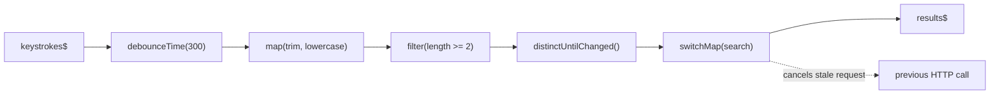

### 3.1 map, tap and Keeping Operators Pure

`map(project)` applies a function to each value; its second argument is the zero-based index. `tap(observer)` runs a side effect and passes the value through unchanged. Keep `map` pure and put logging, metrics or DOM writes in `tap`, so a reader knows which steps can be reordered or removed safely.

```typescript
import { from, map, tap } from 'rxjs';

type Order = { id: string; cents: number };

from<Order[]>([
  { id: 'a', cents: 1250 },
  { id: 'b', cents: 899 },
])
  .pipe(
    tap((o) => console.log('received', o.id)), // side effect only
    map((o, index) => ({ line: index + 1, id: o.id, euros: o.cents / 100 })), // pure
  )
  .subscribe(console.log);
// received a, { line: 1, id: 'a', euros: 12.5 }, received b, { line: 2, id: 'b', euros: 8.99 }
```

`tap` accepts a full observer, plus `subscribe`, `unsubscribe` and `finalize` hooks, which makes it the standard debugging tool:

```typescript
import { interval, take, tap } from 'rxjs';

interval(100)
  .pipe(
    take(2),
    tap({
      subscribe: () => console.log('[debug] subscribed'),
      next: (v) => console.log('[debug] next', v),
      complete: () => console.log('[debug] complete'),
      unsubscribe: () => console.log('[debug] unsubscribed early'),
      finalize: () => console.log('[debug] finalize (always runs)'),
    }),
  )
  .subscribe();
```

| Operator | Changes the value | Use for | Avoid |
| --- | --- | --- | --- |
| `map` | Yes | Pure transformations, projections, parsing | Mutating the input object, HTTP calls (use a flattening operator) |
| `tap` | No | Logging, metrics, writing to a cache, debugging | Changing state that downstream operators read (hidden coupling) |
| `pluck` (deprecated) | Yes | Nothing new | Replace with `map((x) => x.a?.b)` |
| `mapTo` (deprecated) | Yes | Nothing new | Replace with `map(() => value)` |

### 3.2 scan vs reduce: Keeping State Across Emissions

`scan(accumulator, seed)` is `Array.prototype.reduce` that emits every intermediate result. `reduce` emits only the final accumulated value, when the source completes. On an infinite stream `reduce` never emits; `scan` is the one you want for live state.

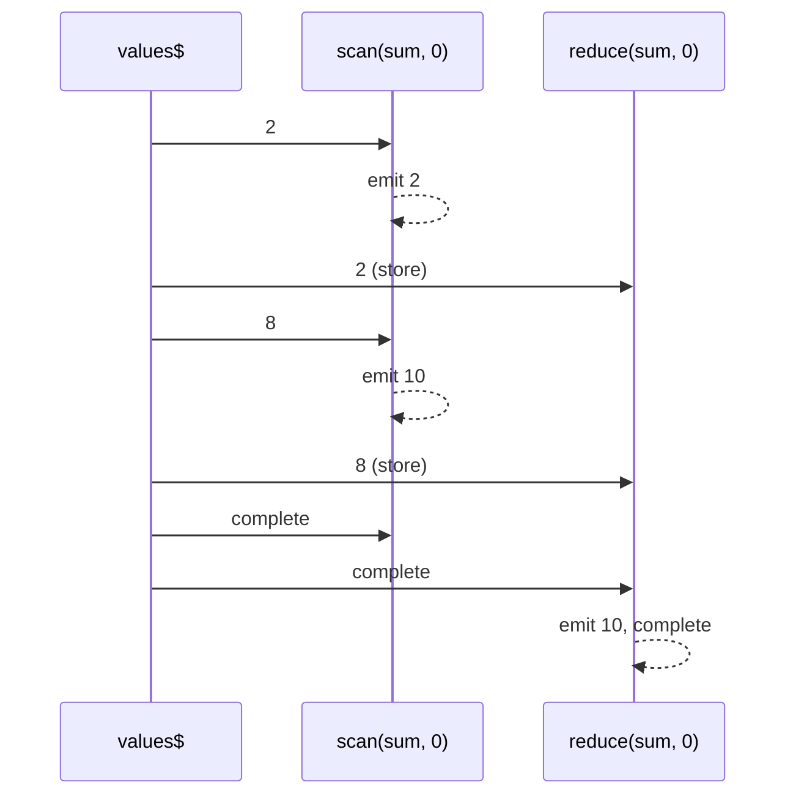

The starter's [`runningStats`](src/stage3/running-stats.ts) keeps count, sum, min and max with `scan`, then derives the mean with `map`:

```typescript
import { Observable, map, scan } from 'rxjs';

export interface Stats { count: number; sum: number; min: number; max: number; mean: number }

const EMPTY_STATS: Stats = { count: 0, sum: 0, min: Infinity, max: -Infinity, mean: 0 };

export function runningStats(values$: Observable<number>): Observable<Stats> {
  return values$.pipe(
    scan(
      (acc, v) => ({
        count: acc.count + 1,
        sum: acc.sum + v,
        min: Math.min(acc.min, v),
        max: Math.max(acc.max, v),
        mean: 0,
      }),
      EMPTY_STATS,
    ),
    map((s) => ({ ...s, mean: s.sum / s.count })),
  );
}
```

| Line / API | Role | What happens at runtime |
| :--- | :--- | :--- |
| `scan(fn, EMPTY_STATS)` | Accumulator with a seed | For each value, calls `fn(previousAcc, value)` and emits the result |
| Returning a new object | Immutability | Downstream `distinctUntilChanged` and UI change detection see a new reference |
| `EMPTY_STATS` seed | Initial state | The seed itself is not emitted; with no seed the first value becomes the accumulator |
| `map(... mean ...)` | Derived field | Keeps the accumulator minimal; derived values are computed, not stored |

The scan state is per subscription: two subscribers to `runningStats(source$)` each keep their own totals. [`tests/stage3.test.ts`](tests/stage3.test.ts) verifies each emitted snapshot with a marble test.

`scan` is also the core of a minimal reducer-style store:

```typescript
import { Subject, scan, startWith } from 'rxjs';

type Action = { type: 'add'; item: string } | { type: 'remove'; item: string } | { type: 'clear' };

const actions$ = new Subject<Action>();
const cart$ = actions$.pipe(
  scan((items: string[], a: Action) => {
    switch (a.type) {
      case 'add': return [...items, a.item];
      case 'remove': return items.filter((i) => i !== a.item);
      case 'clear': return [];
    }
  }, []),
  startWith([] as string[]),
);

cart$.subscribe((items) => console.log('cart', items));
actions$.next({ type: 'add', item: 'book' });
actions$.next({ type: 'add', item: 'pen' });
actions$.next({ type: 'remove', item: 'book' });
// cart [], cart ['book'], cart ['book', 'pen'], cart ['pen']
```

### 3.3 Filtering: filter, take, first, last, skip and distinct

```typescript
import { of, filter, take, first, last, skip, distinct, distinctUntilChanged, distinctUntilKeyChanged, elementAt } from 'rxjs';

const n$ = of(1, 1, 2, 3, 3, 3, 2, 4);

n$.pipe(filter((n) => n % 2 === 0)).subscribe((v) => console.log('filter', v)); // 2, 2, 4
n$.pipe(take(3)).subscribe((v) => console.log('take', v)); // 1, 1, 2
n$.pipe(first((n) => n > 2)).subscribe((v) => console.log('first', v)); // 3
n$.pipe(last()).subscribe((v) => console.log('last', v)); // 4
n$.pipe(skip(6)).subscribe((v) => console.log('skip', v)); // 2, 4
n$.pipe(elementAt(3)).subscribe((v) => console.log('elementAt', v)); // 3
n$.pipe(distinct()).subscribe((v) => console.log('distinct', v)); // 1, 2, 3, 4 (remembers every value)
n$.pipe(distinctUntilChanged()).subscribe((v) => console.log('dUC', v)); // 1, 2, 3, 2, 4

type User = { id: number; name: string };
of<User[]>({ id: 1, name: 'Ada' }, { id: 1, name: 'Ada L.' }, { id: 2, name: 'Bob' })
  .pipe(distinctUntilKeyChanged('id'))
  .subscribe((u) => console.log('by id', u.name)); // Ada, Bob

// Custom comparator: ignore case
of('rx', 'RX', 'Rxjs')
  .pipe(distinctUntilChanged((a, b) => a.toLowerCase() === b.toLowerCase()))
  .subscribe((v) => console.log('case-insensitive', v)); // rx, Rxjs
```

`filter` also narrows types when the predicate is a type guard, which removes the need for non-null assertions further down:

```typescript
import { of, filter, map } from 'rxjs';

const maybe$ = of<(string | null)[]>('a', null, 'b');
maybe$
  .pipe(
    filter((v): v is string => v !== null), // Observable<string> from here on
    map((s) => s.toUpperCase()),
  )
  .subscribe(console.log); // A, B
```

| Operator | Emits | Completes | Error case |
| --- | --- | --- | --- |
| `take(n)` | First `n` values | After the nth value (unsubscribes from the source) | None; `take(0)` completes immediately |
| `first(pred?)` | First (matching) value | Right after it | `EmptyError` if the source completes first; pass a default as the second argument |
| `last(pred?)` | Last (matching) value | When the source completes | `EmptyError` if nothing matched |
| `single(pred?)` | The only (matching) value | When the source completes | Errors if zero or more than one value matches |
| `distinct(key?, flushes$?)` | Values never seen before | With the source | Keeps a `Set` of every value; unbounded memory on long streams unless you pass `flushes$` |
| `distinctUntilChanged(cmp?, key?)` | Values different from the previous one | With the source | Compares with `===` by default; objects need a comparator or key selector |

### 3.4 Completing on a Signal: takeUntil, takeWhile, skipUntil

`takeUntil(notifier$)` mirrors the source until `notifier$` emits, then completes. It is the general form of "stop when X happens" and the basis of Angular's `takeUntilDestroyed`.

```typescript
import { fromEvent, interval, takeUntil, takeWhile, skipUntil, timer } from 'rxjs';

// Stop a timer when the user clicks Cancel
const cancel = document.querySelector<HTMLButtonElement>('#cancel')!;
interval(1000)
  .pipe(takeUntil(fromEvent(cancel, 'click')))
  .subscribe({ next: (s) => console.log(`${s}s`), complete: () => console.log('cancelled') });

// takeWhile with inclusive = true also emits the value that failed the predicate
interval(100)
  .pipe(takeWhile((n) => n < 3, true))
  .subscribe((n) => console.log('takeWhile', n)); // 0, 1, 2, 3

// skipUntil ignores values until the notifier emits
interval(100)
  .pipe(skipUntil(timer(350)), takeWhile((n) => n < 6))
  .subscribe((n) => console.log('skipUntil', n)); // 3, 4, 5
```

Place `takeUntil` last in the pipe. Operators after it can keep their own inner subscriptions alive: `source$.pipe(takeUntil(stop$), switchMap(() => interval(1000)))` keeps the inner interval running after `stop$` emits, because `switchMap` lets its active inner finish even when the outer completes.

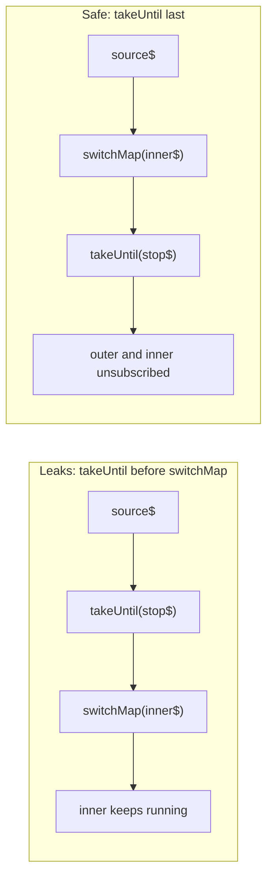

### 3.5 Rate Limiting: debounceTime, throttleTime, auditTime, sampleTime

These four operators all reduce a fast stream to fewer values, and choosing the wrong one is a common source of UI bugs. Given a burst of values `a b c` in quick succession, then a pause, then `d`, with a 5-frame window for every operator (one character is one frame; this output was produced with `TestScheduler`):

```text
source            a-b-c--------d-------|
debounceTime(5)   ---------c--------d--|   emits after 5 quiet frames; every value restarts the timer
throttleTime(5)   a------------d-------|   emits the first value, then ignores values for 5 frames
auditTime(5)      -----c------------d--|   a value opens a 5-frame window; the latest value is emitted when it closes
sampleTime(5)     -----c---------d-----|   checks every 5 frames and emits the latest value if a new one arrived
```

| Operator | Emits | Best for | Not for |
| --- | --- | --- | --- |
| `debounceTime(ms)` | The last value after `ms` of silence | Search boxes, autosave, resize end | Continuous streams: if values never pause, nothing is emitted |
| `throttleTime(ms)` | The first value, then silence for `ms` | Preventing double-clicks, rate-limiting a button | Cases where the final value matters (it can be dropped) |
| `throttleTime(ms, asyncScheduler, { leading: true, trailing: true })` | First and last in each window | Scroll position, slider values | Exactly-once semantics |
| `auditTime(ms)` | The latest value at the end of each window | Mouse move or scroll handlers that should reflect the latest position | Inputs where the first event matters |
| `sampleTime(ms)` | The latest value at fixed intervals | Sensor and telemetry dashboards | Sparse sources (no new value means no emission) |
| `debounce(fn)`, `throttle(fn)`, `audit(fn)`, `sample(notifier$)` | Same, with the duration chosen per value by an Observable | Adaptive delays (shorter debounce for longer queries) | Simple fixed windows (use the `*Time` forms) |

```typescript
import { fromEvent, map, debounceTime, throttleTime, auditTime } from 'rxjs';

const input = document.querySelector<HTMLInputElement>('#search')!;
fromEvent(input, 'input')
  .pipe(map(() => input.value), debounceTime(300))
  .subscribe((q) => console.log('search for', q));

const save = document.querySelector<HTMLButtonElement>('#save')!;
fromEvent(save, 'click')
  .pipe(throttleTime(1000))
  .subscribe(() => console.log('saved once per second at most'));

fromEvent<PointerEvent>(document, 'pointermove')
  .pipe(auditTime(50), map((e) => [e.clientX, e.clientY]))
  .subscribe(([x, y]) => console.log('pointer at', x, y));
```

`debounceTime` emits its pending value immediately when the source completes, so a finite input stream never loses its last value. The starter's demo relies on this: four keystrokes arrive 10 ms apart, the debounce is 30 ms, and the final query still reaches the search when the keystroke stream completes.

### 3.6 Buffering, Windowing and Pairs: bufferTime, bufferCount, pairwise, windowTime

Buffering operators collect values into arrays; windowing operators collect them into nested Observables. Use buffers unless you need to process each group as a stream (for example to apply `reduce` per window without holding the array).

```typescript
import { interval, take, bufferCount, bufferTime, pairwise, windowTime, mergeMap, toArray, map, of } from 'rxjs';

interval(100).pipe(take(7), bufferCount(3)).subscribe((b) => console.log('bufferCount', b));
// [0,1,2], [3,4,5], [6]  - the final partial buffer is emitted on complete

interval(100).pipe(take(10), bufferTime(250)).subscribe((b) => console.log('bufferTime', b));
// roughly [0,1], [2,3], [4,5,6], [7,8], [9]

of(10, 12, 9, 15)
  .pipe(pairwise(), map(([prev, curr]) => curr - prev))
  .subscribe((delta) => console.log('delta', delta)); // 2, -3, 6

interval(100)
  .pipe(
    take(10),
    windowTime(300),
    mergeMap((window$) => window$.pipe(toArray())),
  )
  .subscribe((w) => console.log('window', w));
```

A common production use is batching writes: collect events for up to one second or 100 items, whichever comes first, and drop empty batches.

```typescript
import { Subject, bufferTime, filter } from 'rxjs';

const events$ = new Subject<{ name: string }>();
events$
  .pipe(
    bufferTime(1000, null, 100), // (timeSpan, creationInterval, maxBufferSize)
    filter((batch) => batch.length > 0),
  )
  .subscribe((batch) => console.log(`POST /analytics with ${batch.length} events`));
```

### 3.7 A First Look at Higher-Order Mapping

When the function you pass to `map` returns an Observable (an HTTP call, a timer), you get an Observable of Observables. Flattening operators subscribe to those inner Observables for you, and each one has a different policy for what to do when a new outer value arrives while an inner one is still running.

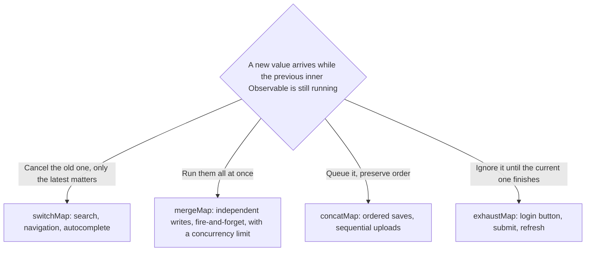

```typescript
import { of, timer, map, switchMap, mergeMap, concatMap, exhaustMap, toArray } from 'rxjs';

const work = (id: number) => timer((4 - id) * 10).pipe(map(() => `job-${id}`)); // later ids finish sooner

of(1, 2, 3).pipe(switchMap(work), toArray()).subscribe((r) => console.log('switchMap', r)); // [job-3]
of(1, 2, 3).pipe(mergeMap(work), toArray()).subscribe((r) => console.log('mergeMap', r)); // [job-3, job-2, job-1]
of(1, 2, 3).pipe(concatMap(work), toArray()).subscribe((r) => console.log('concatMap', r)); // [job-1, job-2, job-3]
of(1, 2, 3).pipe(exhaustMap(work), toArray()).subscribe((r) => console.log('exhaustMap', r)); // [job-1]
```

These results are asserted in [`tests/rxjs-streams.test.ts`](tests/rxjs-streams.test.ts) using [`runHigherOrderPipeline`](src/observables/stream-lab.ts). Stage 4 covers flattening in depth: concurrency limits for `mergeMap`, error isolation, and the `*All` operators.

### 3.8 Worked Example: A Tested Typeahead Pipeline

[`src/stage3/typeahead.ts`](src/stage3/typeahead.ts) combines everything in this stage. It takes a stream of raw input values and a `search` function, and returns a stream of results:

```typescript
import { Observable, catchError, debounceTime, distinctUntilChanged, filter, map, of, switchMap } from 'rxjs';

export interface TypeaheadOptions { debounceMs?: number; minLength?: number }
export type SearchResult = { query: string; items: string[]; error?: string };

export function typeahead(
  input$: Observable<string>,
  search: (query: string) => Observable<string[]>,
  { debounceMs = 300, minLength = 2 }: TypeaheadOptions = {},
): Observable<SearchResult> {
  return input$.pipe(
    debounceTime(debounceMs),
    map((raw) => raw.trim().toLowerCase()),
    filter((query) => query.length >= minLength),
    distinctUntilChanged(),
    switchMap((query) =>
      search(query).pipe(
        map((items): SearchResult => ({ query, items })),
        catchError((err: unknown) =>
          of<SearchResult>({ query, items: [], error: err instanceof Error ? err.message : String(err) }),
        ),
      ),
    ),
  );
}
```

| Line / API | Role | What happens at runtime |
| :--- | :--- | :--- |
| `debounceTime(debounceMs)` | Wait for a pause in typing | Each keystroke restarts a timer; only the value before the pause continues |
| `map(trim, toLowerCase)` | Normalise | `' RXJ '` and `'rxj'` become the same query |
| `filter(length >= minLength)` | Skip short queries | One-letter queries never hit the server |
| `distinctUntilChanged()` | Skip repeats | Typing a letter and deleting it does not resend the same query |
| `switchMap(search)` | Cancel stale requests | When a new query arrives, the previous inner subscription is unsubscribed, which aborts its HTTP call |
| `catchError` inside `switchMap` | Isolate failures | A failed request becomes a result with `error`; the outer stream keeps listening. Outside `switchMap`, one error would complete the whole typeahead |
| Dependency-injected `search` | Testability | Tests pass a `cold()` marble Observable; the app passes `HttpClient` or `fromFetch` |

The test in [`tests/stage3.test.ts`](tests/stage3.test.ts) runs the pipeline in virtual time with `TestScheduler`, so `debounceTime(5)` takes no real time:

```typescript
import { expect, it } from 'vitest';
import { TestScheduler } from 'rxjs/testing';
import { typeahead } from '../src/stage3/typeahead.js';

it('debounces keystrokes and drops repeated queries', () => {
  const scheduler = new TestScheduler((actual, expected) => expect(actual).toEqual(expected));
  scheduler.run(({ hot, cold, expectObservable }) => {
    const input$ = hot('a-b-c 10ms d 10ms e', { a: 'r', b: 'rx', c: 'rxj', d: ' RXJ ', e: 'rxjs' });
    const search = (q: string) => cold('--r|', { r: [`${q}-result`] });
    expectObservable(typeahead(input$, search, { debounceMs: 5, minLength: 2 })).toBe('11ms x 21ms y', {
      x: { query: 'rxj', items: ['rxj-result'] },
      y: { query: 'rxjs', items: ['rxjs-result'] },
    });
  });
});
```

How to read the marbles: inside `run()`, each character is one virtual millisecond (frame) and `10ms` advances ten frames. Values `a`, `b`, `c` arrive at frames 0, 2 and 4; `c` survives the 5-frame debounce at frame 9 and the search answers two frames later, at 11. `d` normalises to `rxj`, which `distinctUntilChanged` drops. `e` arrives at 26, settles at 31 and answers at 33, which is 21 frames after the `x` at frame 11 (`x` itself occupies frame 11, so `21ms` lands on 33). Two more tests in the same file prove that `switchMap` cancels a slow request and that a failed request does not end the stream.

Wiring the same function into a browser input with `fromFetch`:

```typescript
import { fromEvent, map } from 'rxjs';
import { fromFetch } from 'rxjs/fetch';
import { typeahead } from './stage3/typeahead.js';

const box = document.querySelector<HTMLInputElement>('#q')!;
const input$ = fromEvent(box, 'input').pipe(map(() => box.value));
const search = (q: string) =>
  fromFetch(`/api/packages?q=${encodeURIComponent(q)}`, {
    selector: (r) => (r.ok ? (r.json() as Promise<string[]>) : Promise.reject(new Error(`HTTP ${r.status}`))),
  });

typeahead(input$, search).subscribe(({ items, error }) => {
  document.querySelector('#results')!.textContent = error ?? items.join(', ');
});
```

### 3.9 Transformation Operators Reference

The alphabetical reference below keeps an Angular and a plain TypeScript example for each operator. Operators marked deprecated still work in RxJS 7 and are removed in v8; each entry names the replacement.

These operators are used to transform the values emitted by an observable. Some of the transformation operators are:

- buffer
- bufferCount
- bufferTime
- bufferToggle
- bufferWhen
- concatMap
- concatMapTo
- exhaust
- exhaustMap
- expand
- groupBy
- map
- mapTo
- mergeMap
- mergeMapTo
- mergeScan
- pairwise
- partition
- pluck
- scan
- switchScan
- switchMap
- switchMapTo
- window
- windowCount
- windowTime
- windowToggle
- windowWhen

**buffer** - Buffers the source Observable values until closingNotifier emits.

```typescript
import { Component, OnInit } from '@angular/core';
import { CommonModule } from '@angular/common';
import { bootstrapApplication } from '@angular/platform-browser';
import { fromEvent, interval, buffer } from 'rxjs';

@Component({
  selector: 'my-app',
  standalone: true,
  imports: [CommonModule],
  template: `
    <h1>buffer operator</h1>
  `,
})
export class App implements OnInit {
  ngOnInit() {
    const clicks = fromEvent(document, 'click');
    const intervalEvents = interval(1000);
    const buffered = intervalEvents.pipe(buffer(clicks));
    buffered.subscribe(x => console.log(x));
  }
}

bootstrapApplication(App);
```

**bufferCount** - Buffers the source Observable values until the size hits the maximum bufferSize given.

```typescript
import { Component, OnInit } from '@angular/core';
import { CommonModule } from '@angular/common';
import { bootstrapApplication } from '@angular/platform-browser';
import { fromEvent, bufferCount } from 'rxjs';

@Component({
  selector: 'my-app',
  standalone: true,
  imports: [CommonModule],
  template: `
    <h1>bufferCount operator</h1>
  `,
})
export class App implements OnInit {
  ngOnInit() {
    const clicks = fromEvent(document, 'click');
    const buffered = clicks.pipe(bufferCount(2));
    buffered.subscribe(x => console.log(x));
  }
}

bootstrapApplication(App);
```

**bufferTime** - Buffers the source Observable values for a specific time period.

```typescript
import { Component, OnInit } from '@angular/core';
import { CommonModule } from '@angular/common';
import { bootstrapApplication } from '@angular/platform-browser';
import { fromEvent, bufferTime } from 'rxjs';

@Component({
  selector: 'my-app',
  standalone: true,
  imports: [CommonModule],
  template: `
    <h1>bufferTime operator</h1>
  `,
})
export class App implements OnInit {
  ngOnInit() {
    const clicks = fromEvent(document, 'click');
    const buffered = clicks.pipe(bufferTime(1000));
    buffered.subscribe(x => console.log(x));
  }
}

bootstrapApplication(App);
```

**bufferToggle** - Buffers the source Observable values starting from an emission from openings and ending when the output of closingSelector emits.

```typescript
import { Component, OnInit } from '@angular/core';
import { CommonModule } from '@angular/common';
import { bootstrapApplication } from '@angular/platform-browser';
import { fromEvent, interval, bufferToggle, EMPTY } from 'rxjs';

@Component({
  selector: 'my-app',
  standalone: true,
  imports: [CommonModule],
  template: `
    <h1>bufferToggle operator</h1>
  `,
})
export class App implements OnInit {
  ngOnInit() {
    const clicks = fromEvent(document, 'click');
    const openings = interval(1000);
    const buffered = clicks.pipe(bufferToggle(openings, i =>
      i % 2 ? interval(500) : EMPTY
    ));
    buffered.subscribe(x => console.log(x));
  }
}

bootstrapApplication(App);
```

**bufferWhen** - Buffers the source Observable values, using a factory function of closing Observables to determine when to close, emit, and reset the buffer.

```typescript
import { Component, OnInit } from '@angular/core';
import { CommonModule } from '@angular/common';
import { bootstrapApplication } from '@angular/platform-browser';
import { fromEvent, bufferWhen, interval } from 'rxjs';

@Component({
  selector: 'my-app',
  standalone: true,
  imports: [CommonModule],
  template: `
    <h1>bufferWhen operator</h1>
  `,
})
export class App implements OnInit {
  ngOnInit() {
    const clicks = fromEvent(document, 'click');
    const buffered = clicks.pipe(
      bufferWhen(() => interval(1000 + Math.random() * 4000))
    );
    buffered.subscribe(x => console.log(x));
  }
}

bootstrapApplication(App);
```

**concatMap** - Projects each source value to an Observable which is merged in the output Observable, in a serialized fashion waiting for each one to complete before merging the next.

```typescript
import { Component, OnInit } from '@angular/core';
import { CommonModule } from '@angular/common';
import { bootstrapApplication } from '@angular/platform-browser';
import { fromEvent, concatMap, interval, take } from 'rxjs';

@Component({
  selector: 'my-app',
  standalone: true,
  imports: [CommonModule],
  template: `
    <h1>concatMap operator</h1>
  `,
})
export class App implements OnInit {
  ngOnInit() {
    const clicks = fromEvent(document, 'click');
    const result = clicks.pipe(
      concatMap(ev => interval(1000).pipe(take(4)))
    );
    result.subscribe(x => console.log(x));
  }
}

bootstrapApplication(App);
```

**concatMapTo** - Projects each source value to the same Observable which is merged multiple times in a serialized fashion on the output Observable.

> Deprecated in RxJS 7 and removed in v8. Write `concatMap(() => inner$)` instead.

```typescript
import { Component, OnInit } from '@angular/core';
import { CommonModule } from '@angular/common';
import { bootstrapApplication } from '@angular/platform-browser';
import { fromEvent, concatMapTo, interval, take } from 'rxjs';

@Component({
  selector: 'my-app',
  standalone: true,
  imports: [CommonModule],
  template: `
    <h1>concatMapTo operator</h1>
  `,
})
export class App implements OnInit {
  ngOnInit() {
    const clicks = fromEvent(document, 'click');
    const result = clicks.pipe(
      concatMapTo(interval(1000).pipe(take(4)))
    );
    result.subscribe(x => console.log(x));
  }
}

bootstrapApplication(App);
```

**exhaust** - Renamed to exhaustAll.

**exhaustMap** - Projects each source value to an Observable which is merged in the output Observable only if the previous projected Observable has completed.

```typescript
import { Component, OnInit } from '@angular/core';
import { CommonModule } from '@angular/common';
import { bootstrapApplication } from '@angular/platform-browser';
import { fromEvent, exhaustMap, interval, take } from 'rxjs';

@Component({
  selector: 'my-app',
  standalone: true,
  imports: [CommonModule],
  template: `
    <h1>exhaustMap operator</h1>
  `,
})
export class App implements OnInit {
  ngOnInit() {
    const clicks = fromEvent(document, 'click');
    const result = clicks.pipe(
      exhaustMap(() => interval(1000).pipe(take(5)))
    );
    result.subscribe(x => console.log(x));
  }
}

bootstrapApplication(App);
```

**expand** - Recursively projects each source value to an Observable which is merged in the output Observable.

```typescript
import { Component, OnInit } from '@angular/core';
import { CommonModule } from '@angular/common';
import { bootstrapApplication } from '@angular/platform-browser';
import { fromEvent, map, expand, of, delay, take } from 'rxjs';

@Component({
  selector: 'my-app',
  standalone: true,
  imports: [CommonModule],
  template: `
    <h1>expand operator</h1>
  `,
})
export class App implements OnInit {
  ngOnInit() {
    const clicks = fromEvent(document, 'click');
    const powersOfTwo = clicks.pipe(
      map(() => 1),
      expand(x => of(2 * x).pipe(delay(1000))),
      take(10)
    );
    powersOfTwo.subscribe(x => console.log(x));
  }
}

bootstrapApplication(App);
```

**groupBy** - Groups the elements of an observable sequence according to a specified key selector function.

```typescript
import { Component, OnInit } from '@angular/core';
import { CommonModule } from '@angular/common';
import { bootstrapApplication } from '@angular/platform-browser';
import { of, groupBy, mergeMap, reduce } from 'rxjs';

@Component({
  selector: 'my-app',
  standalone: true,
  imports: [CommonModule],
  template: `
    <h1>groupBy operator</h1>
  `,
})
export class App implements OnInit {
  ngOnInit() {
    of(
      { id: 1, name: 'JavaScript' },
      { id: 2, name: 'Parcel' },
      { id: 2, name: 'webpack' },
      { id: 1, name: 'TypeScript' },
      { id: 3, name: 'TSLint' }
    ).pipe(
      groupBy(p => p.id),
      mergeMap(group$ => group$.pipe(reduce((acc, cur) => [...acc, cur], [])))
    )
    .subscribe(p => console.log(p));
  }
}

bootstrapApplication(App);
```

**map** - Applies a given project function to each value emitted by the source Observable, and emits the resulting values as an Observable.

```jsx
import { Component, OnInit } from '@angular/core';
import { CommonModule } from '@angular/common';
import { bootstrapApplication } from '@angular/platform-browser';
import { from, map } from 'rxjs';

@Component({
  selector: 'my-app',
  standalone: true,
  imports: [CommonModule],
  template: `
    <h1>map operator</h1>
  `,
})
export class App implements OnInit {
  ngOnInit() {
    const data = from([
      {
        id: 1,
      },
      {
        id: 2,
      },
      {
        id: 3,
      },
      {
        id: 4,
      },
      {
        id: 5,
      },
    ]);

    data.pipe(map((data) => data.id)).subscribe((res) => console.log(res));
  }
}

bootstrapApplication(App);
```

**mapTo** - Emits the given constant value on the output Observable every time the source Observable emits a value.

> Deprecated in RxJS 7 and removed in v8. Write `map(() => value)` instead.

```typescript
import { Component, OnInit } from '@angular/core';
import { CommonModule } from '@angular/common';
import { bootstrapApplication } from '@angular/platform-browser';
import { fromEvent, mapTo } from 'rxjs';

@Component({
  selector: 'my-app',
  standalone: true,
  imports: [CommonModule],
  template: `
    <h1>mapTo operator</h1>
  `,
})
export class App implements OnInit {
  ngOnInit() {
    const clicks = fromEvent(document, 'click');
    const greetings = clicks.pipe(mapTo('Hi'));

    greetings.subscribe(x => console.log(x));
  }
}

bootstrapApplication(App);
```

**mergeMap** - Projects each source value to an Observable which is merged in the output Observable.

```typescript
import { Component, OnInit } from '@angular/core';
import { CommonModule } from '@angular/common';
import { bootstrapApplication } from '@angular/platform-browser';
import { of, mergeMap, interval, map } from 'rxjs';

@Component({
  selector: 'my-app',
  standalone: true,
  imports: [CommonModule],
  template: `
    <h1>mergeMap operator</h1>
  `,
})
export class App implements OnInit {
  ngOnInit() {
    const letters = of('a', 'b', 'c');
    const result = letters.pipe(
      mergeMap(x => interval(1000).pipe(map(i => x + i)))
    );
    
    result.subscribe(x => console.log(x));
  }
}

bootstrapApplication(App);
```

**mergeMapTo** - Projects each source value to the same Observable which is merged multiple times in the output Observable.

> Deprecated in RxJS 7 and removed in v8. Write `mergeMap(() => inner$)` instead.

```typescript
import { Component, OnInit } from '@angular/core';
import { CommonModule } from '@angular/common';
import { bootstrapApplication } from '@angular/platform-browser';
import { fromEvent, mergeMapTo, interval } from 'rxjs';

@Component({
  selector: 'my-app',
  standalone: true,
  imports: [CommonModule],
  template: `
    <h1>mergeMapTo operator</h1>
  `,
})
export class App implements OnInit {
  ngOnInit() {
    const clicks = fromEvent(document, 'click');
    const result = clicks.pipe(mergeMapTo(interval(1000)));

    result.subscribe(x => console.log(x));
  }
}

bootstrapApplication(App);
```

**mergeScan** - Applies an accumulator function over the source Observable where the accumulator function itself returns an Observable, then each intermediate Observable returned is merged into the output Observable.

```typescript
import { Component, OnInit } from '@angular/core';
import { CommonModule } from '@angular/common';
import { bootstrapApplication } from '@angular/platform-browser';
import { fromEvent, map, mergeScan, of } from 'rxjs';

@Component({
  selector: 'my-app',
  standalone: true,
  imports: [CommonModule],
  template: `
    <h1>mergeScan operator</h1>
  `,
})
export class App implements OnInit {
  ngOnInit() {
    const click$ = fromEvent(document, 'click');
    const one$ = click$.pipe(map(() => 1));
    const seed = 0;
    const count$ = one$.pipe(
      mergeScan((acc, one) => of(acc + one), seed)
    );
    
    count$.subscribe(x => console.log(x));
  }
}

bootstrapApplication(App);
```

**pairwise** - Groups pairs of consecutive emissions together and emits them as an array of two values.

```typescript
import { Component, OnInit } from '@angular/core';
import { CommonModule } from '@angular/common';
import { bootstrapApplication } from '@angular/platform-browser';
import { fromEvent, pairwise, map } from 'rxjs';

@Component({
  selector: 'my-app',
  standalone: true,
  imports: [CommonModule],
  template: `
    <h1>pairwise operator</h1>
  `,
})
export class App implements OnInit {
  ngOnInit() {
    const clicks = fromEvent<PointerEvent>(document, 'click');
    const pairs = clicks.pipe(pairwise());
    const distance = pairs.pipe(
      map(([first, second]) => {
        const x0 = first.clientX;
        const y0 = first.clientY;
        const x1 = second.clientX;
        const y1 = second.clientY;
        return Math.sqrt(Math.pow(x0 - x1, 2) + Math.pow(y0 - y1, 2));
      })
    );
    
    distance.subscribe(x => console.log(x));
  }
}

bootstrapApplication(App);
```

**partition** - Splits the source Observable into two, one with values that satisfy a predicate, and another with values that don't satisfy the predicate.

> The `partition` operator is deprecated. Use the `partition(source$, predicate)` creation function described in [2.7](#27-join-creation-functions-combining-several-sources).

```typescript
import { Component, OnInit } from '@angular/core';
import { CommonModule } from '@angular/common';
import { bootstrapApplication } from '@angular/platform-browser';
import { of, partition } from 'rxjs';

@Component({
  selector: 'my-app',
  standalone: true,
  imports: [CommonModule],
  template: `
    <h1>partition operator</h1>
  `,
})
export class App implements OnInit {
  ngOnInit() {
    const observableValues = of(1, 2, 3, 4, 5, 6);
    const [evens$, odds$] = partition(observableValues, value => value % 2 === 0);
    
    odds$.subscribe(x => console.log('odds', x));
    evens$.subscribe(x => console.log('evens', x));
  }
}

bootstrapApplication(App);
```

**pluck** - Maps each source value to its specified nested property.

> Deprecated in RxJS 7 and removed in v8. Write `map((x) => x.a?.b)`, which is also type-safe.

```typescript
import { Component, OnInit } from '@angular/core';
import { CommonModule } from '@angular/common';
import { bootstrapApplication } from '@angular/platform-browser';
import { from, pluck, toArray } from 'rxjs';

@Component({
  selector: 'my-app',
  standalone: true,
  imports: [CommonModule],
  template: `
    <h1>Pluck Example</h1>
    <div class="row">
      <div class="col">
        <ul *ngFor="let item of data1">
          <li>{{item}}</li>
        </ul>
      </div>
      <div class="col">
        <ul *ngFor="let item of data2">
          <li>{{item}}</li>
        </ul>
      </div>
    </div>
  `,
})
export class App implements OnInit {
  users = [
    {
      name: 'abc',
      age: '25',
      address: {
        state: 'DL',
        country: 'India',
      },
    },
    {
      name: 'efg',
      age: '25',
      address: {
        state: 'MH',
        country: 'India',
      },
    },
    {
      name: 'lmn',
      age: '25',
      address: {
        state: 'KA',
        country: 'India',
      },
    },
    {
      name: 'pqr',
      age: '25',
      address: {
        state: 'KL',
        country: 'India',
      },
    },
    {
      name: 'xyz',
      age: '25',
      address: {
        state: 'GA',
        country: 'India',
      },
    },
  ];
  data1: any;
  data2: any;
  constructor() {}

  ngOnInit() {
    from(this.users)
      .pipe(pluck('name'), toArray())
      .subscribe((res) => {
        console.log(res);
        this.data1 = res;
      });
    from(this.users)
      .pipe(pluck('address', 'state'), toArray())
      .subscribe((res) => {
        console.log(res);
        this.data2 = res;
      });
  }
}

bootstrapApplication(App);
```

**scan** - Useful for encapsulating and managing state. Applies an accumulator (or "reducer function") to each value from the source after an initial state is established -- either via a seed value (second argument), or from the first value from the source.

```typescript
import { Component, OnInit } from '@angular/core';
import { CommonModule } from '@angular/common';
import { bootstrapApplication } from '@angular/platform-browser';
import { of, scan, map } from 'rxjs';

@Component({
  selector: 'my-app',
  standalone: true,
  imports: [CommonModule],
  template: `
    <h1>scan operator</h1>
  `,
})
export class App implements OnInit {
  ngOnInit() {
    const numbers$ = of(1, 2, 3);
    
    numbers$
      .pipe(
        // Get the sum of the numbers coming in.
        scan((total, n) => total + n),
        // Get the average by dividing the sum by the total number
        // received so far (which is 1 more than the zero-based index).
        map((sum, index) => sum / (index + 1))
      )
      .subscribe(console.log);
  }
}

bootstrapApplication(App);
```

[Stackblitz Example Link](https://stackblitz.com/edit/stackblitz-starters-yk2lwk?file=src%2Fmain.ts)

**switchScan** - Applies an accumulator function over the source Observable where the accumulator function itself returns an Observable, emitting values only from the most recently returned Observable.

**switchMap** - Projects each source value to an Observable which is merged in the output Observable, emitting values only from the most recently projected Observable.

```jsx
import { Component, OnInit } from '@angular/core';
import { CommonModule } from '@angular/common';
import { bootstrapApplication } from '@angular/platform-browser';
import { from, of, switchMap } from 'rxjs';

@Component({
  selector: 'my-app',
  standalone: true,
  imports: [CommonModule],
  template: `
    <h1>switchMap operator</h1>
  `,
})
export class App implements OnInit {
  ngOnInit() {
    const data = from(['abc', 'xyz', 'efg', 'pqr', 'lmn']);

    data
      .pipe(switchMap((data) => this.getData(data)))
      .subscribe((res) => console.log(res));
  }

  getData(data) {
    return of('name is' + data);
  }
}

bootstrapApplication(App);
```

**switchMapTo** - Projects each source value to the same Observable which is flattened multiple times with switchMap in the output Observable.

> Deprecated in RxJS 7 and removed in v8. Write `switchMap(() => inner$)` instead.

```typescript
import { Component, OnInit } from '@angular/core';
import { CommonModule } from '@angular/common';
import { bootstrapApplication } from '@angular/platform-browser';
import { fromEvent, switchMapTo, interval } from 'rxjs';

@Component({
  selector: 'my-app',
  standalone: true,
  imports: [CommonModule],
  template: `
    <h1>switchMapTo operator</h1>
  `,
})
export class App implements OnInit {
  ngOnInit() {
    const clicks = fromEvent(document, 'click');
    const result = clicks.pipe(switchMapTo(interval(1000)));
    result.subscribe(x => console.log(x));
  }
}

bootstrapApplication(App);
```

[Stackblitz Example Link](https://stackblitz.com/edit/stackblitz-starters-wbj1xt?file=src%2Fmain.ts)

**window** - Branch out the source Observable values as a nested Observable whenever windowBoundaries emits.

```typescript
import { Component, OnInit } from '@angular/core';
import { CommonModule } from '@angular/common';
import { bootstrapApplication } from '@angular/platform-browser';
import { fromEvent, interval, window, map, take, mergeAll } from 'rxjs';

@Component({
  selector: 'my-app',
  standalone: true,
  imports: [CommonModule],
  template: `
    <h1>window operator</h1>
  `,
})
export class App implements OnInit {
  ngOnInit() {
    const clicks = fromEvent(document, 'click');
    const sec = interval(1000);
    const result = clicks.pipe(
      window(sec),
      map(win => win.pipe(take(2))), // take at most 2 emissions from each window
      mergeAll()                     // flatten the Observable-of-Observables
    );
    result.subscribe(x => console.log(x));
  }
}

bootstrapApplication(App);
```

[Stackblitz Example Link](https://stackblitz.com/edit/stackblitz-starters-q7tjwj?file=src%2Fmain.ts)

**windowCount** - Branch out the source Observable values as a nested Observable with each nested Observable emitting at most windowSize values.

```typescript
import { Component, OnInit } from '@angular/core';
import { CommonModule } from '@angular/common';
import { bootstrapApplication } from '@angular/platform-browser';
import { fromEvent, windowCount, map, skip, mergeAll } from 'rxjs';

@Component({
  selector: 'my-app',
  standalone: true,
  imports: [CommonModule],
  template: `
    <h1>windowCount operator</h1>
  `,
})
export class App implements OnInit {
  ngOnInit() {
    const clicks = fromEvent(document, 'click');
    const result = clicks.pipe(
      windowCount(3),
      map(win => win.pipe(skip(1))), // skip first of every 3 clicks
      mergeAll()                     // flatten the Observable-of-Observables
    );
    result.subscribe(x => console.log(x));
  }
}

bootstrapApplication(App);
```

[Stackblitz Example 1 Link](https://stackblitz.com/edit/stackblitz-starters-xpy6gh?file=src%2Fmain.ts)

```typescript
import { Component, OnInit } from '@angular/core';
import { CommonModule } from '@angular/common';
import { bootstrapApplication } from '@angular/platform-browser';
import { fromEvent, windowCount, mergeAll } from 'rxjs';

@Component({
  selector: 'my-app',
  standalone: true,
  imports: [CommonModule],
  template: `
    <h1>windowCount operator</h1>
  `,
})
export class App implements OnInit {
  ngOnInit() {
    const clicks = fromEvent(document, 'click');
    const result = clicks.pipe(
      windowCount(2, 3),
      mergeAll() // flatten the Observable-of-Observables
    );
    result.subscribe(x => console.log(x));
  }
}

bootstrapApplication(App);
```

[Stackblitz Example 2 Link](https://stackblitz.com/edit/stackblitz-starters-q7tjwj?file=src%2Fmain.ts)

**windowTime** - Branch out the source Observable values as a nested Observable periodically in time.

```typescript
import { Component, OnInit } from '@angular/core';
import { CommonModule } from '@angular/common';
import { bootstrapApplication } from '@angular/platform-browser';
import { fromEvent, windowTime, map, take, mergeAll } from 'rxjs';

@Component({
  selector: 'my-app',
  standalone: true,
  imports: [CommonModule],
  template: `
    <h1>windowTime operator</h1>
  `,
})
export class App implements OnInit {
  ngOnInit() {
    const clicks = fromEvent(document, 'click');
    const result = clicks.pipe(
      windowTime(1000),
      map(win => win.pipe(take(2))), // take at most 2 emissions from each window
      mergeAll()                     // flatten the Observable-of-Observables
    );
    result.subscribe(x => console.log(x));
  }
}

bootstrapApplication(App);
```

[Stackblitz Example 1 Link](https://stackblitz.com/edit/stackblitz-starters-uvwhnp?file=src%2Fmain.ts)

```typescript
import { Component, OnInit } from '@angular/core';
import { CommonModule } from '@angular/common';
import { bootstrapApplication } from '@angular/platform-browser';
import { fromEvent, windowTime, map, take, mergeAll } from 'rxjs';

@Component({
  selector: 'my-app',
  standalone: true,
  imports: [CommonModule],
  template: `
    <h1>windowTime operator</h1>
  `,
})
export class App implements OnInit {
  ngOnInit() {
    const clicks = fromEvent(document, 'click');
    const result = clicks.pipe(
      windowTime(1000, 5000),
      map(win => win.pipe(take(2))), // take at most 2 emissions from each window
      mergeAll()                     // flatten the Observable-of-Observables
    );
    result.subscribe(x => console.log(x));
  }
}

bootstrapApplication(App);
```

[Stackblitz Example 2 Link](https://stackblitz.com/edit/stackblitz-starters-mcsaht?file=src%2Fmain.ts)

```typescript
import { Component, OnInit } from '@angular/core';
import { CommonModule } from '@angular/common';
import { bootstrapApplication } from '@angular/platform-browser';
import { fromEvent, windowTime, mergeAll } from 'rxjs';

@Component({
  selector: 'my-app',
  standalone: true,
  imports: [CommonModule],
  template: `
    <h1>windowTime operator</h1>
  `,
})
export class App implements OnInit {
  ngOnInit() {
    const clicks = fromEvent(document, 'click');
    const result = clicks.pipe(
      windowTime(1000, 5000, 2), // take at most 2 emissions from each window
      mergeAll()                 // flatten the Observable-of-Observables
    );
    result.subscribe(x => console.log(x));
  }
}

bootstrapApplication(App);
```

[Stackblitz Example 3 Link](https://stackblitz.com/edit/stackblitz-starters-x1qyak?file=src%2Fmain.ts)

**windowToggle** - Branch out the source Observable values as a nested Observable starting from an emission from openings and ending when the output of closingSelector emits.

```typescript
import { Component, OnInit } from '@angular/core';
import { CommonModule } from '@angular/common';
import { bootstrapApplication } from '@angular/platform-browser';
import { fromEvent, interval, windowToggle, EMPTY, mergeAll } from 'rxjs';

@Component({
  selector: 'my-app',
  standalone: true,
  imports: [CommonModule],
  template: `
    <h1>windowToggle operator</h1>
  `,
})
export class App implements OnInit {
  ngOnInit() {
    const clicks = fromEvent(document, 'click');
    const openings = interval(1000);
    const result = clicks.pipe(
      windowToggle(openings, i => i % 2 ? interval(500) : EMPTY),
      mergeAll()
    );
    result.subscribe(x => console.log(x));
  }
}

bootstrapApplication(App);
```

[Stackblitz Example Link](https://stackblitz.com/edit/stackblitz-starters-qdmr61?file=src%2Fmain.ts)

**windowWhen** - Branch out the source Observable values as a nested Observable using a factory function of closing Observables to determine when to start a new window.

```typescript
import { Component, OnInit } from '@angular/core';
import { CommonModule } from '@angular/common';
import { bootstrapApplication } from '@angular/platform-browser';
import { fromEvent, windowWhen, interval, map, take, mergeAll } from 'rxjs';

@Component({
  selector: 'my-app',
  standalone: true,
  imports: [CommonModule],
  template: `
    <h1>windowWhen operator</h1>
  `,
})
export class App implements OnInit {
  ngOnInit() {
    const clicks = fromEvent(document, 'click');
    const result = clicks.pipe(
      windowWhen(() => interval(1000 + Math.random() * 4000)),
      map(win => win.pipe(take(2))), // take at most 2 emissions from each window
      mergeAll()                     // flatten the Observable-of-Observables
    );
    result.subscribe(x => console.log(x));
  }
}

bootstrapApplication(App);
```

[Stackblitz Example 1 Link](https://stackblitz.com/edit/stackblitz-starters-vjykyp?file=src%2Fmain.ts)

### 3.10 Filtering Operators Reference

These operators allow you to filter the values emitted by Observables. Some of the most commonly used filtering operators are:

- audit
- auditTime
- debounce
- debounceTime
- distinct
- distinctUntilChanged
- distinctUntilKeyChanged
- elementAt
- filter
- first
- ignoreElements
- last
- sample
- sampleTime
- single
- skip
- skipLast
- skipUntil
- skipWhile
- take
- takeLast
- takeUntil
- takeWhile
- throttle
- throttleTime

**audit** - Ignores source values for a duration determined by another Observable, then emits the most recent value from the source Observable, then repeats this process.

```typescript
import { Component, OnInit } from '@angular/core';
import { CommonModule } from '@angular/common';
import { bootstrapApplication } from '@angular/platform-browser';
import { fromEvent, audit, interval } from 'rxjs';

@Component({
  selector: 'my-app',
  standalone: true,
  imports: [CommonModule],
  template: `
    <h1>audit operator</h1>
  `,
})
export class App implements OnInit {
  ngOnInit() {
    const clicks = fromEvent(document, 'click');
    const result = clicks.pipe(audit(ev => interval(1000)));
    result.subscribe(x => console.log(x));
  }
}

bootstrapApplication(App);
```

[Stackblitz Example Link](https://stackblitz.com/edit/stackblitz-starters-xskoee?file=src%2Fmain.ts)

**auditTime** - Ignores source values for duration milliseconds, then emits the most recent value from the source Observable, then repeats this process.

```typescript
import { Component, OnInit } from '@angular/core';
import { CommonModule } from '@angular/common';
import { bootstrapApplication } from '@angular/platform-browser';
import { fromEvent, auditTime } from 'rxjs';

@Component({
  selector: 'my-app',
  standalone: true,
  imports: [CommonModule],
  template: `
    <h1>auditTime operator</h1>
  `,
})
export class App implements OnInit {
  ngOnInit() {
    const clicks = fromEvent(document, 'click');
    const result = clicks.pipe(auditTime(1000));
    result.subscribe(x => console.log(x));
  }
}

bootstrapApplication(App);
```

[Stackblitz Example Link](https://stackblitz.com/edit/stackblitz-starters-dcpyww?file=src%2Fmain.ts)

**debounce** - Emits a notification from the source Observable only after a particular time span determined by another Observable has passed without another source emission.

```typescript
import { Component, OnInit } from '@angular/core';
import { CommonModule } from '@angular/common';
import { bootstrapApplication } from '@angular/platform-browser';
import { fromEvent, scan, debounce, interval } from 'rxjs';

@Component({
  selector: 'my-app',
  standalone: true,
  imports: [CommonModule],
  template: `
    <h1>debounce operator</h1>
  `,
})
export class App implements OnInit {
  ngOnInit() {
    const clicks = fromEvent(document, 'click');
    const result = clicks.pipe(
      scan(i => ++i, 1),
      debounce(i => interval(200 * i))
    );
    result.subscribe(x => console.log(x));
  }
}

bootstrapApplication(App);
```

[Stackblitz Example Link](https://stackblitz.com/edit/stackblitz-starters-o6khgs?file=src%2Fmain.ts)

**debounceTime** - Emits a notification from the source Observable only after a particular time span has passed without another source emission.

```typescript
import {
  AfterViewInit,
  Component,
  ElementRef,
  OnInit,
  ViewChild,
} from '@angular/core';
import { CommonModule } from '@angular/common';
import { bootstrapApplication } from '@angular/platform-browser';
import { fromEvent, map, debounceTime } from 'rxjs';

@Component({
  selector: 'my-app',
  standalone: true,
  imports: [CommonModule],
  template: `
    <h1>debounceTime Example</h1>
    <input type="text" #myInput />
    <p *ngIf="requestedData != null">Data: {{requestedData}}</p>
  `,
})
export class App implements OnInit, AfterViewInit {
  requestedData = null;
  @ViewChild('myInput') myInput: ElementRef;
  constructor() {}

  ngOnInit() {}

  ngAfterViewInit() {
    const searchItem = fromEvent<any>(this.myInput.nativeElement, 'keyup').pipe(
      map((event) => {
        event.target.value;
      }),
      debounceTime(1000)
    );
    searchItem.subscribe((res) => {
      console.log(res);
      this.requestedData = res;

      setTimeout(() => {
        this.requestedData = null;
      }, 2000);
    });
  }
}

bootstrapApplication(App);
```

**distinct** - Returns an Observable that emits all items emitted by the source Observable that are distinct by comparison from previous items.

```typescript
import { Component, OnInit } from '@angular/core';
import { CommonModule } from '@angular/common';
import { bootstrapApplication } from '@angular/platform-browser';
import { of, distinct } from 'rxjs';

@Component({
  selector: 'my-app',
  standalone: true,
  imports: [CommonModule],
  template: `
    <h1>distinct operator</h1>
  `,
})
export class App implements OnInit {
  ngOnInit() {
    of(1, 1, 2, 2, 2, 1, 2, 3, 4, 3, 2, 1)
      .pipe(distinct())
      .subscribe(x => console.log(x));
  }
}

bootstrapApplication(App);
```

[Stackblitz Example Link](https://stackblitz.com/edit/stackblitz-starters-ehgdax?file=src%2Fmain.ts)

**distinctUntilChanged** - Returns a result Observable that emits all values pushed by the source observable if they are distinct in comparison to the last value the result observable emitted.

```typescript
import {
  AfterViewInit,
  Component,
  ElementRef,
  OnInit,
  ViewChild,
} from '@angular/core';
import { CommonModule } from '@angular/common';
import { bootstrapApplication } from '@angular/platform-browser';
import { fromEvent, map, debounceTime, distinctUntilChanged } from 'rxjs';

@Component({
  selector: 'my-app',
  standalone: true,
  imports: [CommonModule],
  template: `
    <h1>distinctUntilChanged Example</h1>
    <input type="text" #myInput />
    <p *ngIf="requestedData != null">Data: {{requestedData}}</p>
  `,
})
export class App implements OnInit, AfterViewInit {
  requestedData = null;
  @ViewChild('myInput') myInput: ElementRef;
  constructor() {}

  ngOnInit() {}

  ngAfterViewInit() {
    const searchItem = fromEvent<any>(this.myInput.nativeElement, 'keyup').pipe(
      map((event) => {
        event.target.value;
      }),
      debounceTime(500),
      distinctUntilChanged()
    );
    searchItem.subscribe((res) => {
      console.log(res);
      this.requestedData = res;

      setTimeout(() => {
        this.requestedData = null;
      }, 2000);
    });
  }
}

bootstrapApplication(App);
```

**distinctUntilKeyChanged** - Returns an Observable that emits all items emitted by the source Observable that are distinct by comparison from the previous item, using a property accessed by using the key provided to check if the two items are distinct.

```typescript
import { Component, OnInit } from '@angular/core';
import { CommonModule } from '@angular/common';
import { bootstrapApplication } from '@angular/platform-browser';
import { of, distinctUntilKeyChanged } from 'rxjs';

@Component({
  selector: 'my-app',
  standalone: true,
  imports: [CommonModule],
  template: `
    <h1>distinctUntilKeyChanged Example</h1>
  `,
})
export class App implements OnInit {

  ngOnInit() {
    of(
      { age: 4, name: 'Foo' },
      { age: 7, name: 'Bar' },
      { age: 5, name: 'Foo' },
      { age: 6, name: 'Foo' }
    ).pipe(
      distinctUntilKeyChanged('name')
    )
    .subscribe(x => console.log(x));
  }
}

bootstrapApplication(App);
```

[Stackblitz RxJS Example Link](https://stackblitz.com/edit/rxjs-754d9b?file=index.html)

[Stackblitz Angular Example Link](https://stackblitz.com/edit/stackblitz-starters-jtriop?file=src%2Fmain.ts)

**elementAt** - Emits the single value at the specified index in a sequence of emissions from the source Observable.

```typescript
import { Component, OnInit } from '@angular/core';
import { CommonModule } from '@angular/common';
import { bootstrapApplication } from '@angular/platform-browser';
import { fromEvent, elementAt } from 'rxjs';

@Component({
  selector: 'my-app',
  standalone: true,
  imports: [CommonModule],
  template: `
    <h1>elementAt Example</h1>
  `,
})
export class App implements OnInit {

  ngOnInit() {
    const clicks = fromEvent(document, 'click');
    const result = clicks.pipe(elementAt(2));
    result.subscribe(x => console.log(x));
  }
}

bootstrapApplication(App);
```

**filter** - Filter items emitted by the source Observable by only emitting those that satisfy a specified predicate.

```typescript
import { Component, OnInit } from '@angular/core';
import { CommonModule } from '@angular/common';
import { bootstrapApplication } from '@angular/platform-browser';
import { fromEvent, filter } from 'rxjs';

@Component({
  selector: 'my-app',
  standalone: true,
  imports: [CommonModule],
  template: `
    <h1>filter Example</h1>
  `,
})
export class App implements OnInit {

  ngOnInit() {
    const div = document.createElement('div');
    div.style.cssText = 'width: 200px; height: 200px; background: #09c;';
    document.body.appendChild(div);

    const clicks = fromEvent(document, 'click');
    const clicksOnDivs = clicks.pipe(filter(ev => (<HTMLElement>ev.target).tagName === 'DIV'));
    clicksOnDivs.subscribe(x => console.log(x));
  }
}

bootstrapApplication(App);
```

**first** - Emits only the first value (or the first value that meets some condition) emitted by the source Observable.

```typescript
import { Component, OnInit } from '@angular/core';
import { CommonModule } from '@angular/common';
import { bootstrapApplication } from '@angular/platform-browser';
import { fromEvent, first } from 'rxjs';

@Component({
  selector: 'my-app',
  standalone: true,
  imports: [CommonModule],
  template: `
    <h1>first Example</h1>
  `,
})
export class App implements OnInit {

  ngOnInit() {
    const clicks = fromEvent(document, 'click');
    const result = clicks.pipe(first());
    result.subscribe(x => console.log(x));
  }
}

bootstrapApplication(App);
```

**ignoreElements** - Ignores all items emitted by the source Observable and only passes calls of complete or error.

```typescript
import { Component, OnInit } from '@angular/core';
import { CommonModule } from '@angular/common';
import { bootstrapApplication } from '@angular/platform-browser';
import { of, ignoreElements } from 'rxjs';

@Component({
  selector: 'my-app',
  standalone: true,
  imports: [CommonModule],
  template: `
    <h1>ignoreElements Example</h1>
  `,
})
export class App implements OnInit {

  ngOnInit() {
    of('you', 'talking', 'to', 'me')
      .pipe(ignoreElements())
      .subscribe({
        next: word => console.log(word),
        error: err => console.log('error:', err),
        complete: () => console.log('the end'),
      });
  }
}

bootstrapApplication(App);
```

**last** - Returns an Observable that emits only the last item emitted by the source Observable. It optionally takes a predicate function as a parameter, in which case, rather than emitting the last item from the source Observable, the resulting Observable will emit the last item from the source Observable that satisfies the predicate.

```typescript
import { Component, OnInit } from '@angular/core';
import { CommonModule } from '@angular/common';
import { bootstrapApplication } from '@angular/platform-browser';
import { from, last } from 'rxjs';

@Component({
  selector: 'my-app',
  standalone: true,
  imports: [CommonModule],
  template: `
    <h1>last Example</h1>
  `,
})
export class App implements OnInit {

  ngOnInit() {
    const source = from(['x', 'y', 'z']);
    const result = source.pipe(last());

    result.subscribe(value => console.log(`Last alphabet: ${ value }`));
  }
}

bootstrapApplication(App);
```

**sample** - Emits the most recently emitted value from the source Observable whenever another Observable, the notifier, emits.

```typescript
import { Component, OnInit } from '@angular/core';
import { CommonModule } from '@angular/common';
import { bootstrapApplication } from '@angular/platform-browser';
import { fromEvent, interval, sample } from 'rxjs';

@Component({
  selector: 'my-app',
  standalone: true,
  imports: [CommonModule],
  template: `
    <h1>sample Example</h1>
  `,
})
export class App implements OnInit {

  ngOnInit() {
    const seconds = interval(1000);
    const clicks = fromEvent(document, 'click');
    const result = seconds.pipe(sample(clicks));

    result.subscribe(x => console.log(x));
  }
}

bootstrapApplication(App);
```

**sampleTime** - Emits the most recently emitted value from the source Observable within periodic time intervals.

```typescript
import { Component, OnInit } from '@angular/core';
import { CommonModule } from '@angular/common';
import { bootstrapApplication } from '@angular/platform-browser';
import { fromEvent, sampleTime } from 'rxjs';

@Component({
  selector: 'my-app',
  standalone: true,
  imports: [CommonModule],
  template: `
    <h1>sampleTime Example</h1>
  `,
})
export class App implements OnInit {

  ngOnInit() {
    const clicks = fromEvent(document, 'click');
    const result = clicks.pipe(sampleTime(1000));

    result.subscribe(x => console.log(x));
  }
}

bootstrapApplication(App);
```

**single** - Returns an observable that asserts that only one value is emitted from the observable that matches the predicate. If no predicate is provided, then it will assert that the observable only emits one value.

```typescript
import { Component, OnInit } from '@angular/core';
import { CommonModule } from '@angular/common';
import { bootstrapApplication } from '@angular/platform-browser';
import { of, single } from 'rxjs';

@Component({
  selector: 'my-app',
  standalone: true,
  imports: [CommonModule],
  template: `
    <h1>single Example</h1>
  `,
})
export class App implements OnInit {

  ngOnInit() {
    const source1 = of(
    { name: 'Ben' },
    { name: 'Tracy' },
    { name: 'Laney' },
    { name: 'Lily' }
    );
    
    source1
      .pipe(single(x => x.name.startsWith('B')))
      .subscribe(x => console.log(x));
    // Emits 'Ben'
    
    
    const source2 = of(
    { name: 'Ben' },
    { name: 'Tracy' },
    { name: 'Bradley' },
    { name: 'Lincoln' }
    );
    
    source2
      .pipe(single(x => x.name.startsWith('B')))
      .subscribe({ error: err => console.error(err) });
    // Error emitted: SequenceError('Too many values match')
    
    
    const source3 = of(
    { name: 'Laney' },
    { name: 'Tracy' },
    { name: 'Lily' },
    { name: 'Lincoln' }
    );
    
    source3
      .pipe(single(x => x.name.startsWith('B')))
      .subscribe({ error: err => console.error(err) });
    // Error emitted: NotFoundError('No values match')
  }
}

bootstrapApplication(App);
```

**skip** -Returns an Observable that skips the first count items emitted by the source Observable.

```typescript
import { Component, OnInit } from '@angular/core';
import { CommonModule } from '@angular/common';
import { bootstrapApplication } from '@angular/platform-browser';
import { interval, skip } from 'rxjs';

@Component({
  selector: 'my-app',
  standalone: true,
  imports: [CommonModule],
  template: `
    <h1>skip Example</h1>
  `,
})
export class App implements OnInit {

  ngOnInit() {
    // emit every half second
    const source = interval(500);
    // skip the first 10 emitted values
    const result = source.pipe(skip(10));

    result.subscribe(value => console.log(value));
  }
}

bootstrapApplication(App);
```

**skipLast** - Skip a specified number of values before the completion of an observable.

```typescript
import { Component, OnInit } from '@angular/core';
import { CommonModule } from '@angular/common';
import { bootstrapApplication } from '@angular/platform-browser';
import { of, skipLast } from 'rxjs';

@Component({
  selector: 'my-app',
  standalone: true,
  imports: [CommonModule],
  template: `
    <h1>skipLast Example</h1>
  `,
})
export class App implements OnInit {

  ngOnInit() {
    const numbers = of(1, 2, 3, 4, 5);
    const skipLastTwo = numbers.pipe(skipLast(2));
    skipLastTwo.subscribe(x => console.log(x));
  }
}

bootstrapApplication(App);
```

**skipUntil** - Returns an Observable that skips items emitted by the source Observable until a second Observable emits an item.

```typescript
import { Component, OnInit } from '@angular/core';
import { CommonModule } from '@angular/common';
import { bootstrapApplication } from '@angular/platform-browser';
import { interval, fromEvent, skipUntil } from 'rxjs';

@Component({
  selector: 'my-app',
  standalone: true,
  imports: [CommonModule],
  template: `
    <h1>skipUntil Example</h1>
  `,
})
export class App implements OnInit {

  ngOnInit() {
    const intervalObservable = interval(1000);
    const click = fromEvent(document, 'click');

    const emitAfterClick = intervalObservable.pipe(
      skipUntil(click)
    );
    // clicked at 4.6s. output: 5...6...7...8........ or
    // clicked at 7.3s. output: 8...9...10..11.......
    emitAfterClick.subscribe(value => console.log(value));
  }
}

bootstrapApplication(App);
```

**skipWhile** - Returns an Observable that skips all items emitted by the source Observable as long as a specified condition holds true, but emits all further source items as soon as the condition becomes false.

```typescript
import { Component, OnInit } from '@angular/core';
import { CommonModule } from '@angular/common';
import { bootstrapApplication } from '@angular/platform-browser';
import { from, skipWhile } from 'rxjs';

@Component({
  selector: 'my-app',
  standalone: true,
  imports: [CommonModule],
  template: `
    <h1>skipWhile Example</h1>
  `,
})
export class App implements OnInit {

  ngOnInit() {
    const source = from(['Green Arrow', 'SuperMan', 'Flash', 'SuperGirl', 'Black Canary'])
    // Skip the heroes until SuperGirl
    const example = source.pipe(skipWhile(hero => hero !== 'SuperGirl'));
    // output: SuperGirl, Black Canary
    example.subscribe(femaleHero => console.log(femaleHero));
  }
}

bootstrapApplication(App);
```

**take** - Emits only the first count values emitted by the source Observable.

```jsx
import { Component, OnInit } from '@angular/core';
import { CommonModule } from '@angular/common';
import { bootstrapApplication } from '@angular/platform-browser';
import { from, interval, take } from 'rxjs';

@Component({
  selector: 'my-app',
  standalone: true,
  imports: [CommonModule],
  template: `
    <h1>take Example</h1>
  `,
})
export class App implements OnInit {
  data = ['a', 'b', 'c', 'd'];
  ngOnInit() {
    const datas = from(this.data);

    datas.pipe(take(3)).subscribe((res) => {
      console.log(res);
    });
  }
}

bootstrapApplication(App);
```

**takeLast** - Waits for the source to complete, then emits the last N values from the source, as specified by the count argument.

```typescript
import { Component, OnInit } from '@angular/core';
import { CommonModule } from '@angular/common';
import { bootstrapApplication } from '@angular/platform-browser';
import { range, takeLast } from 'rxjs';

@Component({
  selector: 'my-app',
  standalone: true,
  imports: [CommonModule],
  template: `
    <h1>takeLast Example</h1>
  `,
})
export class App implements OnInit {

  ngOnInit() {
    const many = range(1, 100);
    const lastThree = many.pipe(takeLast(3));
    lastThree.subscribe(x => console.log(x));
  }
}

bootstrapApplication(App);
```

**takeUntil** - Emits the values emitted by the source Observable until a notifier Observable emits a value.

```typescript
import { Component, OnInit } from '@angular/core';
import { CommonModule } from '@angular/common';
import { bootstrapApplication } from '@angular/platform-browser';
import { interval, fromEvent, takeUntil } from 'rxjs';

@Component({
  selector: 'my-app',
  standalone: true,
  imports: [CommonModule],
  template: `
    <h1>takeUntil Example</h1>
  `,
})
export class App implements OnInit {

  ngOnInit() {
    const source = interval(1000);
    const clicks = fromEvent(document, 'click');
    const result = source.pipe(takeUntil(clicks));
    result.subscribe(x => console.log(x));
  }
}

bootstrapApplication(App);
```

**takeWhile** - Emits values emitted by the source Observable so long as each value satisfies the given predicate, and then completes as soon as this predicate is not satisfied.

```typescript
import { Component, OnInit } from '@angular/core';
import { CommonModule } from '@angular/common';
import { bootstrapApplication } from '@angular/platform-browser';
import { fromEvent, takeWhile } from 'rxjs';

@Component({
  selector: 'my-app',
  standalone: true,
  imports: [CommonModule],
  template: `
    <h1>takeWhile Example</h1>
  `,
})
export class App implements OnInit {

  ngOnInit() {
    const clicks = fromEvent<PointerEvent>(document, 'click');
    const result = clicks.pipe(takeWhile(ev => ev.clientX > 200));
    result.subscribe(x => console.log(x));
  }
}

bootstrapApplication(App);
```

**throttle** - Emits a value from the source Observable, then ignores subsequent source values for a duration determined by another Observable, then repeats this process.

```typescript
import { Component, OnInit } from '@angular/core';
import { CommonModule } from '@angular/common';
import { bootstrapApplication } from '@angular/platform-browser';
import { fromEvent, throttle, interval } from 'rxjs';

@Component({
  selector: 'my-app',
  standalone: true,
  imports: [CommonModule],
  template: `
    <h1>throttle Example</h1>
  `,
})
export class App implements OnInit {

  ngOnInit() {
    const clicks = fromEvent(document, 'click');
    const result = clicks.pipe(throttle(() => interval(1000)));

    result.subscribe(x => console.log(x));
  }
}

bootstrapApplication(App);
```

**throttleTime** - Emits a value from the source Observable, then ignores subsequent source values for duration milliseconds, then repeats this process.

```typescript
import { Component, OnInit } from '@angular/core';
import { CommonModule } from '@angular/common';
import { bootstrapApplication } from '@angular/platform-browser';
import { fromEvent, throttleTime } from 'rxjs';

@Component({
  selector: 'my-app',
  standalone: true,
  imports: [CommonModule],
  template: `
    <h1>throttleTime Example</h1>
  `,
})
export class App implements OnInit {

  ngOnInit() {
    const clicks = fromEvent(document, 'click');
    const result = clicks.pipe(throttleTime(1000));

    result.subscribe(x => console.log(x));
  }
}

bootstrapApplication(App);
```

### 3.11 Pitfalls

| Pitfall | Symptom | Fix |
| --- | --- | --- |
| HTTP call inside `map` | Subscribers receive `Observable` objects instead of data; no request is sent | Use `switchMap`, `mergeMap`, `concatMap` or `exhaustMap` |
| `catchError` placed after `switchMap` on the outer stream | The typeahead stops working after the first failed request | Put `catchError` inside the inner pipe, as in [`typeahead.ts`](src/stage3/typeahead.ts) |
| `reduce` on an infinite stream | Nothing is ever emitted | Use `scan` for running values; `reduce` only for finite streams |
| `distinctUntilChanged()` on objects | Every emission passes, because new objects are never `===` | `distinctUntilChanged((a, b) => a.id === b.id)` or `distinctUntilKeyChanged('id')` |
| Mutating the accumulator in `scan` | UI does not update; `distinctUntilChanged` drops changes | Return a new object or array from the accumulator |
| `debounceTime` on a continuous stream | No output while values keep arriving (for example `pointermove`) | `auditTime` or `throttleTime` with `trailing: true` |
| `takeUntil` before `switchMap` or `mergeMap` | Inner subscriptions keep running after the stop signal | Make `takeUntil` the last operator |
| `first()` on a stream that can complete empty | `EmptyError: no elements in sequence` | `first(predicate, defaultValue)` or `take(1)` |
| `distinct()` on a long-lived stream | Memory grows with every unique value | Pass a `flushes` notifier, or use `distinctUntilChanged` |
| `bufferTime` without a filter | Empty arrays emitted every period | `filter((b) => b.length > 0)` |

### 3.12 Best Practices

- Normalise before you deduplicate (`map(trim)` then `distinctUntilChanged()`): otherwise whitespace changes look like new queries.
- Keep `map` pure and side effects in `tap`: pure steps can be tested with marbles and moved freely.
- Inject the effectful function (`search`) into the pipeline: tests replace it with a `cold()` Observable and never touch the network.
- Choose rate-limiting by the question "first, last, or latest-at-intervals?": that question maps directly to `throttleTime`, `debounceTime`, or `auditTime`/`sampleTime`.
- Make `takeUntil` the last operator: it then tears down every inner subscription above it.
- Use type-guard predicates in `filter`: TypeScript narrows the stream type and removes `!` assertions downstream.
- Test time-based operators with `TestScheduler.run()`: the tests are deterministic and take milliseconds instead of real seconds.

### 3.13 Hands-on Exercise

Extend the typeahead with two features and test both with marbles:

1. **Loading state.** Change the return type to `Observable<{ status: 'loading' | 'done'; query: string; items: string[] }>` and emit a `loading` result for each query before the search responds. Hint: `startWith` inside the `switchMap`.
2. **Clear on short input.** When the trimmed query is shorter than `minLength`, emit `{ status: 'done', query, items: [] }` instead of filtering it out, so the UI can clear old results. Hint: replace `filter` with a branch inside `switchMap` that returns `of(...)` for short queries.

Expected marble for input `a-b 10ms c` with `a='r'`, `b='rx'`, `c='r'`, `debounceMs: 1`, `minLength: 2` and a search that answers after 2 frames:

```text
input     a-b 10ms c
output    ---l-x 8ms e
          l = loading 'rx', x = done 'rx' with items, e = done 'r' with []
```

Start from [`src/stage3/typeahead.ts`](src/stage3/typeahead.ts) and add the tests to [`tests/stage3.test.ts`](tests/stage3.test.ts), next to the existing `typeahead pipeline` suite.

[Back to top ⤴️](#-table-of-contents)

---

## 4. Stage 4: Higher-Order Mapping, Combination & Error Handling

This stage covers operators whose inputs are other Observables: the flattening family (`switchMap`, `mergeMap`, `concatMap`, `exhaustMap` and their `*All` counterparts), operators that combine the source with other streams (`withLatestFrom`, `startWith`, the `*With` family), and the error-handling operators that keep a pipeline alive (`catchError`, `retry`). Prerequisite: Stage 3, especially [3.7](#37-a-first-look-at-higher-order-mapping). The runnable flattening and retry examples are in [`src/observables/stream-lab.ts`](src/observables/stream-lab.ts).

### 4.1 Join Operators Reference

The join operators are used to combine the emissions of multiple Observables. Some of the join operators are:

- combineLatestAll
- concatAll
- exhaustAll
- mergeAll
- switchAll
- startWith
- withLatestFrom

**combineLatestAll** - Flattens an Observable-of-Observables by applying combineLatest when the Observable-of-Observables completes.

```typescript
import { Component, OnInit } from '@angular/core';
import { CommonModule } from '@angular/common';
import { bootstrapApplication } from '@angular/platform-browser';
import { fromEvent, map, interval, take, combineLatestAll } from 'rxjs';

@Component({
  selector: 'my-app',
  standalone: true,
  imports: [CommonModule],
  template: `
    <h1>combineLatestAll Example</h1>
  `,
})
export class App implements OnInit {

  ngOnInit() {
    const clicks = fromEvent(document, 'click');
    const higherOrder = clicks.pipe(
      map(() => interval(Math.random() * 2000).pipe(take(3))),
      take(2)
    );
    const result = higherOrder.pipe(combineLatestAll());

    result.subscribe(x => console.log(x));
  }
}

bootstrapApplication(App);
```

**concatAll** - Converts a higher-order Observable into a first-order Observable by concatenating the inner Observables in order.

```typescript
import { Component, OnInit } from '@angular/core';
import { CommonModule } from '@angular/common';
import { bootstrapApplication } from '@angular/platform-browser';
import { fromEvent, map, interval, take, concatAll } from 'rxjs';

@Component({
  selector: 'my-app',
  standalone: true,
  imports: [CommonModule],
  template: `
    <h1>concatAll Example</h1>
  `,
})
export class App implements OnInit {

  ngOnInit() {
    const clicks = fromEvent(document, 'click');
    const higherOrder = clicks.pipe(
      map(() => interval(1000).pipe(take(4)))
    );
    const firstOrder = higherOrder.pipe(concatAll());
    firstOrder.subscribe(x => console.log(x));
  }
}

bootstrapApplication(App);
```

**exhaustAll** - Converts a higher-order Observable into a first-order Observable by dropping inner Observables while the previous inner Observable has not yet completed.

```typescript
import { Component, OnInit } from '@angular/core';
import { CommonModule } from '@angular/common';
import { bootstrapApplication } from '@angular/platform-browser';
import { fromEvent, map, interval, take, exhaustAll } from 'rxjs';

@Component({
  selector: 'my-app',
  standalone: true,
  imports: [CommonModule],
  template: `
    <h1>exhaustAll Example</h1>
  `,
})
export class App implements OnInit {

  ngOnInit() {
    const clicks = fromEvent(document, 'click');
    const higherOrder = clicks.pipe(
      map(() => interval(1000).pipe(take(5)))
    );
    const result = higherOrder.pipe(exhaustAll());
    result.subscribe(x => console.log(x));
  }
}

bootstrapApplication(App);
```

**mergeAll** - Converts a higher-order Observable into a first-order Observable which concurrently delivers all values that are emitted on the inner Observables.

```typescript
import { Component, OnInit } from '@angular/core';
import { CommonModule } from '@angular/common';
import { bootstrapApplication } from '@angular/platform-browser';
import { fromEvent, map, interval, mergeAll } from 'rxjs';

@Component({
  selector: 'my-app',
  standalone: true,
  imports: [CommonModule],
  template: `
    <h1>mergeAll Example</h1>
  `,
})
export class App implements OnInit {

  ngOnInit() {
    const clicks = fromEvent(document, 'click');
    const higherOrder = clicks.pipe(map(() => interval(1000)));
    const firstOrder = higherOrder.pipe(mergeAll());

    firstOrder.subscribe(x => console.log(x));
  }
}

bootstrapApplication(App);
```

**switchAll** - Converts a higher-order Observable into a first-order Observable producing values only from the most recent observable sequence

```typescript
import { Component, OnInit } from '@angular/core';
import { CommonModule } from '@angular/common';
import { bootstrapApplication } from '@angular/platform-browser';
import { fromEvent, tap, map, interval, switchAll } from 'rxjs';

@Component({
  selector: 'my-app',
  standalone: true,
  imports: [CommonModule],
  template: `
    <h1>switchAll Example</h1>
  `,
})
export class App implements OnInit {

  ngOnInit() {
    const clicks = fromEvent(document, 'click').pipe(tap(() => console.log('click')));
    const source = clicks.pipe(map(() => interval(1000)));
    
    source
      .pipe(switchAll())
      .subscribe(x => console.log(x));
  }
}

bootstrapApplication(App);
```

**startWith** - Returns an observable that, at the moment of subscription, will synchronously emit all values provided to this operator, then subscribe to the source and mirror all of its emissions to subscribers.

```typescript
import { Component, OnInit } from '@angular/core';
import { CommonModule } from '@angular/common';
import { bootstrapApplication } from '@angular/platform-browser';
import { timer, map, startWith } from 'rxjs';

@Component({
  selector: 'my-app',
  standalone: true,
  imports: [CommonModule],
  template: `
    <h1>startWith Example</h1>
  `,
})
export class App implements OnInit {

  ngOnInit() {
    timer(1000)
      .pipe(
        map(() => 'timer emit'),
        startWith('timer start')
      )
      .subscribe(x => console.log(x));
  }
}

bootstrapApplication(App);
```

**withLatestFrom** - Combines the source Observable with other Observables to create an Observable whose values are calculated from the latest values of each, only when the source emits.

```typescript
import { Component, OnInit } from '@angular/core';
import { CommonModule } from '@angular/common';
import { bootstrapApplication } from '@angular/platform-browser';
import { fromEvent, interval, withLatestFrom } from 'rxjs';

@Component({
  selector: 'my-app',
  standalone: true,
  imports: [CommonModule],
  template: `
    <h1>withLatestFrom Example</h1>
  `,
})
export class App implements OnInit {

  ngOnInit() {
    const clicks = fromEvent(document, 'click');
    const higherOrder = clicks.pipe(
      map(() => interval(1000).pipe(take(5)))
    );
    const result = higherOrder.pipe(exhaustAll());
    result.subscribe(x => console.log(x));
  }
}

bootstrapApplication(App);
```

### 4.2 Error Handling Operators Reference

These operators are used to handle errors that occur in the observable sequence. Some of the error handling operators are:

- catchError
- retry
- retryWhen

**catchError** - Catches errors on the observable to be handled by returning a new observable or throwing an error.

```jsx
import { Component, OnInit } from '@angular/core';
import { CommonModule } from '@angular/common';
import { bootstrapApplication } from '@angular/platform-browser';
import { of, map, catchError } from 'rxjs';

@Component({
  selector: 'my-app',
  standalone: true,
  imports: [CommonModule],
  template: `
    <h1>catchError Example</h1>
  `,
})
export class App implements OnInit {

  ngOnInit() {
    of(1, 2, 3, 4, 5)
      .pipe(
        map(n => {
          if (n === 4) {
            throw 'four!';
          }
          return n;
        }),
        catchError(err => of('I', 'II', 'III', 'IV', 'V'))
      )
      .subscribe(x => console.log(x));
  }
}

bootstrapApplication(App);
```

**retry** - Returns an Observable that mirrors the source Observable with the exception of an error.

```jsx
import { Component, OnInit } from '@angular/core';
import { CommonModule } from '@angular/common';
import { bootstrapApplication } from '@angular/platform-browser';
import { interval, mergeMap, throwError, of, retry } from 'rxjs';

@Component({
  selector: 'my-app',
  standalone: true,
  imports: [CommonModule],
  template: `
    <h1>retry Example</h1>
  `,
})
export class App implements OnInit {

  ngOnInit() {
    const source = interval(1000);
    const result = source.pipe(
      mergeMap(val => val > 5 ? throwError(() => 'Error!') : of(val)),
      retry(2) // retry 2 times on error
    );
    
    result.subscribe({
      next: value => console.log(value),
      error: err => console.log(`${ err }: Retried 2 times then quit!`)
    });
    
    // Output:
    // 0..1..2..3..4..5..
    // 0..1..2..3..4..5..
    // 0..1..2..3..4..5..
    // 'Error!: Retried 2 times then quit!'
  }
}

bootstrapApplication(App);
```

**retryWhen** - Returns an Observable that mirrors the source Observable with the exception of an error. If the source Observable calls error, this method will emit the Throwable that caused the error to the ObservableInput returned from notifier. If that Observable calls complete or error then this method will call complete or error on the child subscription. Otherwise this method will resubscribe to the source Observable.

> Deprecated in RxJS 7 and removed in v8. Use `retry({ count, delay: (error, retryCount) => timer(...) })`.

```jsx
import { Component, OnInit } from '@angular/core';
import { CommonModule } from '@angular/common';
import { bootstrapApplication } from '@angular/platform-browser';
import { interval, map, retryWhen, tap, delayWhen, timer } from 'rxjs';

@Component({
  selector: 'my-app',
  standalone: true,
  imports: [CommonModule],
  template: `
    <h1>retryWhen Example</h1>
  `,
})
export class App implements OnInit {

  ngOnInit() {
    const source = interval(1000);
    const result = source.pipe(
      map(value => {
        if (value > 5) {
          // error will be picked up by retryWhen
          throw value;
        }
        return value;
      }),
      retryWhen(errors =>
        errors.pipe(
          // log error message
          tap(value => console.log(`Value ${ value } was too high!`)),
          // restart in 5 seconds
          delayWhen(value => timer(value * 1000))
        )
      )
    );
    
    result.subscribe(value => console.log(value));
    
    // results:
    // 0
    // 1
    // 2
    // 3
    // 4
    // 5
    // 'Value 6 was too high!'
    // - Wait 5 seconds then repeat
  }
}

bootstrapApplication(App);
```

[Back to top ⤴️](#-table-of-contents)

---

## 5. Stage 5: Subjects, Multicasting & Schedulers

This stage moves from unicast to multicast: Subjects that are both Observable and Observer, operators that share one execution between many subscribers, and schedulers that decide when notifications are delivered. Prerequisite: [1.7 Cold vs Hot Observables](#17-cold-vs-hot-observables). The `BehaviorSubject` state store used throughout the guide is `ReactiveStateStore` in [`src/observables/stream-lab.ts`](src/observables/stream-lab.ts).

### 5.1 Subject

An RxJS Subject is a special type of Observable that allows values to be multicasted to many Observers.

Example of Subject in RxJS:

```typescript
import { Subject } from 'rxjs';

const subject = new Subject<number>();

subject.subscribe({
  next: (v) => console.log(`observerA: ${v}`)
});
subject.subscribe({
  next: (v) => console.log(`observerB: ${v}`)
});

subject.next(1);
subject.next(2);
```

[Stackblitz Example Link](https://stackblitz.com/edit/rxjs-a7chpb?file=index.ts)

Example of Subject in Angular:

```typescript
import { Component, OnInit } from '@angular/core';
import { bootstrapApplication } from '@angular/platform-browser';
import { Subject } from 'rxjs';

@Component({
  selector: 'app-root',
  standalone: true,
  template: `
      <h1>Example of Subject in Angular</h1>
  `,
})
export class App implements OnInit {
  subject = new Subject<number>();

  ngOnInit() {
    this.subject.subscribe({
      next: (v) => console.log(`observerA: ${v}`),
    });
    this.subject.subscribe({
      next: (v) => console.log(`observerB: ${v}`),
    });

    this.subject.next(1);
    this.subject.next(2);
  }
}

bootstrapApplication(App);
```

[Stackblitz Example Link](https://stackblitz.com/edit/stackblitz-starters-vvf1jf?file=src%2Fmain.ts)

### 5.2 Multicasting Operators Reference

These operators are used to share the observable execution among multiple subscribers. Some of the multicasting operators are:

- multicast
- publish
- publishBehavior
- publishLast
- publishReplay
- share

**multicast** - Returns an Observable that emits the results of invoking a specified selector on items emitted by a ConnectableObservable that shares a single subscription to the underlying stream.

> Deprecated in RxJS 7 and removed in v8. Use `connectable(source$, { connector })` or `share({ connector })`.

[Link](https://rxjs.dev/api/operators/multicast)

**publish** - Returns a ConnectableObservable, which is a variety of Observable that waits until its connect method is called before it begins emitting items to those Observers that have subscribed to it.

> Deprecated in RxJS 7 and removed in v8. Use `connectable(source$)` (or `share()` when you only needed `publish()` plus `refCount()`).

```jsx
import { Component, OnInit } from '@angular/core';
import { CommonModule } from '@angular/common';
import { bootstrapApplication } from '@angular/platform-browser';
import { zip, interval, of, map, publish, merge, tap } from 'rxjs';

@Component({
  selector: 'my-app',
  standalone: true,
  imports: [CommonModule],
  template: `
    <h1>publish Example</h1>
  `,
})
export class App implements OnInit {

  ngOnInit() {
    const source$ = zip(interval(2000), of(1, 2, 3, 4, 5, 6, 7, 8, 9))
      .pipe(map(([, number]) => number));
    
    source$
      .pipe(
        publish(multicasted$ =>
          merge(
            multicasted$.pipe(tap(x => console.log('Stream 1:', x))),
            multicasted$.pipe(tap(x => console.log('Stream 2:', x))),
            multicasted$.pipe(tap(x => console.log('Stream 3:', x)))
          )
        )
      )
      .subscribe();
  }
}

bootstrapApplication(App);
```

**publishBehavior** - Creates a ConnectableObservable that utilizes a BehaviorSubject.

> Deprecated in RxJS 7 and removed in v8. Use `connectable(source$, { connector: () => new BehaviorSubject(initial) })`.

[Link](https://rxjs.dev/api/operators/publishBehavior)

**publishLast** - Returns a connectable observable sequence that shares a single subscription to the underlying sequence containing only the last notification.

> Deprecated in RxJS 7 and removed in v8. Use `connectable(source$, { connector: () => new AsyncSubject() })`.

```jsx
import { Component, OnInit } from '@angular/core';
import { CommonModule } from '@angular/common';
import { bootstrapApplication } from '@angular/platform-browser';
import { ConnectableObservable, interval, publishLast, tap, take } from 'rxjs';

@Component({
  selector: 'my-app',
  standalone: true,
  imports: [CommonModule],
  template: `
    <h1>publishLast Example</h1>
  `,
})
export class App implements OnInit {

  ngOnInit() {
    const connectable = <ConnectableObservable<number>>interval(1000)
      .pipe(
        tap(x => console.log('side effect', x)),
        take(3),
        publishLast()
      );
    
    connectable.subscribe({
      next: x => console.log('Sub. A', x),
      error: err => console.log('Sub. A Error', err),
      complete: () => console.log('Sub. A Complete')
    });
    
    connectable.subscribe({
      next: x => console.log('Sub. B', x),
      error: err => console.log('Sub. B Error', err),
      complete: () => console.log('Sub. B Complete')
    });
    
    connectable.connect();
  }
}

bootstrapApplication(App);
```

**publishReplay** - Returns a connectable observable sequence that shares a single subscription to the underlying sequence replaying all notifications.

> Deprecated in RxJS 7 and removed in v8. Use `shareReplay(...)` or `connectable(source$, { connector: () => new ReplaySubject(n) })`.

[Link](https://rxjs.dev/api/operators/publishReplay)

**share** - Returns a new Observable that multicasts (shares) the original Observable. As long as there is at least one Subscriber this Observable will be subscribed and emitting data. When all subscribers have unsubscribed it will unsubscribe from the source Observable. Because the Observable is multicasting it makes the stream hot. This is an alias for multicast(() => new Subject()), refCount().

```jsx
import { Component, OnInit } from '@angular/core';
import { CommonModule } from '@angular/common';
import { bootstrapApplication } from '@angular/platform-browser';
import { interval, tap, map, take, share } from 'rxjs';

@Component({
  selector: 'my-app',
  standalone: true,
  imports: [CommonModule],
  template: `
    <h1>share Example</h1>
  `,
})
export class App implements OnInit {

  ngOnInit() {
    const source = interval(1000).pipe(
      tap(x => console.log('Processing: ', x)),
      map(x => x * x),
      take(6),
      share()
    );
    
    source.subscribe(x => console.log('subscription 1: ', x));
    source.subscribe(x => console.log('subscription 2: ', x));
  }
}

bootstrapApplication(App);
```

### 5.3 Scheduler

A Scheduler lets you define in what execution context will an Observable deliver notifications to its Observer.

Example of Scheduler in RxJS:

```typescript
import { asyncScheduler } from 'rxjs';

console.log('before');

asyncScheduler.schedule(() => {
  console.log('asyncScheduler');
});

console.log('after');
```

[Stackblitz Example Link](https://stackblitz.com/edit/rxjs-bm4w4p?file=index.ts)

Example of Scheduler in Angular:

```typescript
import { Component, OnInit } from '@angular/core';
import { bootstrapApplication } from '@angular/platform-browser';
import { asyncScheduler } from 'rxjs';

@Component({
  selector: 'app-root',
  standalone: true,
  template: `
      <h1>Example of Scheduler in Angular</h1>
  `,
})
export class App implements OnInit {
  ngOnInit() {
    console.log('before');

    asyncScheduler.schedule(() => {
      console.log('asyncScheduler');
    });

    console.log('after');
  }
}

bootstrapApplication(App);
```

[Stackblitz Example Link](https://stackblitz.com/edit/stackblitz-starters-q7mksx?file=src%2Fmain.ts)

[Back to top ⤴️](#-table-of-contents)

---

## 6. Stage 6: Utility Operators, Testing & Performance

This stage collects the operators that do not transform values so much as manage them: side effects and delays, timeouts, notification objects, conditional checks and aggregates. It then turns to testing pipelines deterministically and keeping them fast and leak-free. Prerequisites: Stages 1-5.

### 6.1 Utility Operators Reference

These operators are used to perform utility operations on the observable sequence. Some of the utility operators are:

- tap
- delay
- delayWhen
- dematerialize
- materialize
- observeOn
- subscribeOn
- timeInterval
- timestamp
- timeout
- timeoutWith
- toArray

**tap** - Used to perform side-effects for notifications from the source observable.

```jsx
import { Component, OnInit } from '@angular/core';
import { CommonModule } from '@angular/common';
import { bootstrapApplication } from '@angular/platform-browser';
import { interval, Subscription, tap } from 'rxjs';

@Component({
  selector: 'my-app',
  standalone: true,
  imports: [CommonModule],
  template: `
    <h1>tap Example</h1>
  `,
})
export class App implements OnInit {
  subscription: Subscription;

  ngOnInit() {
    let count = interval(1000);

    this.subscription = count
      .pipe(
        tap((res) => {
          console.log('Before tap', res);
          if (res == 5) {
            this.subscription.unsubscribe();
          }
        })
      )
      .subscribe((res) => {
        console.log('After tap', res);
      });
  }
}

bootstrapApplication(App);
```

**delay** - Delays the emission of items from the source Observable by a given timeout or until a given Date.

```typescript
import { Component, OnInit } from '@angular/core';
import { CommonModule } from '@angular/common';
import { bootstrapApplication } from '@angular/platform-browser';
import { fromEvent, delay } from 'rxjs';

@Component({
  selector: 'my-app',
  standalone: true,
  imports: [CommonModule],
  template: `
    <h1>delay Example</h1>
  `,
})
export class App implements OnInit {

  ngOnInit() {
    const clicks = fromEvent(document, 'click');
    const delayedClicks = clicks.pipe(delay(1000)); // each click emitted after 1 second
    delayedClicks.subscribe(x => console.log(x));
  }
}

bootstrapApplication(App);
```

**delayWhen** - Delays the emission of items from the source Observable by a given time span determined by the emissions of another Observable.

```typescript
import { Component, OnInit } from '@angular/core';
import { CommonModule } from '@angular/common';
import { bootstrapApplication } from '@angular/platform-browser';
import { fromEvent, delay } from 'rxjs';

@Component({
  selector: 'my-app',
  standalone: true,
  imports: [CommonModule],
  template: `
    <h1>delayWhen Example</h1>
  `,
})
export class App implements OnInit {

  ngOnInit() {
    const clicks = fromEvent(document, 'click');
    const delayedClicks = clicks.pipe(
      delayWhen(() => interval(Math.random() * 5000))
    );
    delayedClicks.subscribe(x => console.log(x));
  }
}

bootstrapApplication(App);
```

**dematerialize** - Converts an Observable of ObservableNotification objects into the emissions that they represent.

```typescript
import { Component, OnInit } from '@angular/core';
import { CommonModule } from '@angular/common';
import { bootstrapApplication } from '@angular/platform-browser';
import { NextNotification, ErrorNotification, of, dematerialize } from 'rxjs';

@Component({
  selector: 'my-app',
  standalone: true,
  imports: [CommonModule],
  template: `
    <h1>dematerialize Example</h1>
  `,
})
export class App implements OnInit {

  ngOnInit() {
    const notifA: NextNotification<string> = { kind: 'N', value: 'A' };
    const notifB: NextNotification<string> = { kind: 'N', value: 'B' };
    const notifE: ErrorNotification = { kind: 'E', error: new TypeError('x.toUpperCase is not a function') };
    
    const materialized = of(notifA, notifB, notifE);
    
    const upperCase = materialized.pipe(dematerialize());
    upperCase.subscribe({
      next: x => console.log(x),
      error: e => console.error(e)
    });
  }
}

bootstrapApplication(App);
```

**materialize** - Represents all of the notifications from the source Observable as next emissions marked with their original types within Notification objects.

```typescript
import { Component, OnInit } from '@angular/core';
import { CommonModule } from '@angular/common';
import { bootstrapApplication } from '@angular/platform-browser';
import { of, materialize, map } from 'rxjs';

@Component({
  selector: 'my-app',
  standalone: true,
  imports: [CommonModule],
  template: `
    <h1>materialize Example</h1>
  `,
})
export class App implements OnInit {

  ngOnInit() {
    const letters = of('a', 'b', 13, 'd');
    const upperCase = letters.pipe(map((x: any) => x.toUpperCase()));
    const materialized = upperCase.pipe(materialize());
    
    materialized.subscribe(x => console.log(x));
  }
}

bootstrapApplication(App);
```

**observeOn** - Re-emits all notifications from source Observable with specified scheduler.

```typescript
import { Component, OnInit } from '@angular/core';
import { CommonModule } from '@angular/common';
import { bootstrapApplication } from '@angular/platform-browser';
import { interval, observeOn, animationFrameScheduler } from 'rxjs';

@Component({
  selector: 'my-app',
  standalone: true,
  imports: [CommonModule],
  template: `
    <h1>observeOn Example</h1>
  `,
})
export class App implements OnInit {

  ngOnInit() {
    const someDiv = document.createElement('div');
    someDiv.style.cssText = 'width: 200px;background: #09c';
    document.body.appendChild(someDiv);
    const intervals = interval(10);      // Intervals are scheduled
                                        // with async scheduler by default...
    intervals.pipe(
      observeOn(animationFrameScheduler) // ...but we will observe on animationFrame
    )                                    // scheduler to ensure smooth animation.
    .subscribe(val => {
      someDiv.style.height = val + 'px';
    });
  }
}

bootstrapApplication(App);
```

**subscribeOn** - Asynchronously subscribes Observers to this Observable on the specified SchedulerLike.

```typescript
import { Component, OnInit } from '@angular/core';
import { CommonModule } from '@angular/common';
import { bootstrapApplication } from '@angular/platform-browser';
import { of, merge } from 'rxjs';

@Component({
  selector: 'my-app',
  standalone: true,
  imports: [CommonModule],
  template: `
    <h1>subscribeOn Example</h1>
  `,
})
export class App implements OnInit {

  ngOnInit() {
    const a = of(1, 2, 3);
    const b = of(4, 5, 6);
    
    merge(a, b).subscribe(console.log);
  }
}

bootstrapApplication(App);
```

**timeInterval** - Emits an object containing the current value, and the time that has passed between emitting the current value and the previous value, which is calculated by using the provided scheduler's now() method to retrieve the current time at each emission, then calculating the difference. The scheduler defaults to asyncScheduler, so by default, the interval will be in milliseconds.

```typescript
import { Component, OnInit } from '@angular/core';
import { CommonModule } from '@angular/common';
import { bootstrapApplication } from '@angular/platform-browser';
import { interval, timeInterval } from 'rxjs';

@Component({
  selector: 'my-app',
  standalone: true,
  imports: [CommonModule],
  template: `
    <h1>timeInterval Example</h1>
  `,
})
export class App implements OnInit {

  ngOnInit() {
    const seconds = interval(1000);
    
    seconds
      .pipe(timeInterval())
      .subscribe(value => console.log(value));
  }
}

bootstrapApplication(App);
```

**timestamp** - Attaches a timestamp to each item emitted by an observable indicating when it was emitted

```typescript
import { Component, OnInit } from '@angular/core';
import { CommonModule } from '@angular/common';
import { bootstrapApplication } from '@angular/platform-browser';
import { fromEvent, timestamp } from 'rxjs';

@Component({
  selector: 'my-app',
  standalone: true,
  imports: [CommonModule],
  template: `
    <h1>timestamp Example</h1>
  `,
})
export class App implements OnInit {

  ngOnInit() {
    const clickWithTimestamp = fromEvent(document, 'click').pipe(
      timestamp()
    );

    // Emits data of type { value: PointerEvent, timestamp: number }
    clickWithTimestamp.subscribe(data => {
      console.log(data);
    });
  }
}

bootstrapApplication(App);
```

**timeout** - Errors if Observable does not emit a value in given time span.

```typescript
import { Component, OnInit } from '@angular/core';
import { CommonModule } from '@angular/common';
import { bootstrapApplication } from '@angular/platform-browser';
import { fromEvent, delay } from 'rxjs';

@Component({
  selector: 'my-app',
  standalone: true,
  imports: [CommonModule],
  template: `
    <h1>timeout Example</h1>
  `,
})

class CustomTimeoutError extends Error {
  constructor() {
    super('It was too slow');
    this.name = 'CustomTimeoutError';
  }
}

export class App implements OnInit {

  ngOnInit() {
    const slow$ = interval(900);
    
    slow$.pipe(
      timeout({
        each: 1000,
        with: () => throwError(() => new CustomTimeoutError())
      })
    )
    .subscribe({
      error: console.error
    });
  }
}

bootstrapApplication(App);
```

**timeoutWith** - When the passed timespan elapses before the source emits any given value, it will unsubscribe from the source, and switch the subscription to another observable.

> Deprecated in RxJS 7 and removed in v8. Use `timeout({ first: due, with: () => fallback$ })`.

```typescript
import { Component, OnInit } from '@angular/core';
import { CommonModule } from '@angular/common';
import { bootstrapApplication } from '@angular/platform-browser';
import { interval, timeoutWith } from 'rxjs';

@Component({
  selector: 'my-app',
  standalone: true,
  imports: [CommonModule],
  template: `
    <h1>timeoutWith Example</h1>
  `,
})
export class App implements OnInit {

  ngOnInit() {
    const slow$ = interval(1000);
    const faster$ = interval(500);

    slow$
      .pipe(timeoutWith(900, faster$))
      .subscribe(console.log);
  }
}

bootstrapApplication(App);
```

**toArray** - Collects all source emissions and emits them as an array when the source completes.

Example:

```jsx
import { Component, OnInit } from '@angular/core';
import { CommonModule } from '@angular/common';
import { bootstrapApplication } from '@angular/platform-browser';
import { from, interval, of, Subscription, take, toArray } from 'rxjs';

@Component({
  selector: 'my-app',
  standalone: true,
  imports: [CommonModule],
  template: `
    <h1>toArray Example</h1>
  `,
})
export class App implements OnInit {
  subscription: Subscription;

  data = [
    { id: 1, name: 'abc' },
    { id: 2, name: 'efg' },
    { id: 3, name: 'lmn' },
    { id: 4, name: 'pqr' },
    { id: 5, name: 'xyz' },
  ];

  ngOnInit() {
    //eaxample 1
    const count = interval(1000);
    this.subscription = count.pipe(take(5), toArray()).subscribe((res) => {
      console.log(res);
    });

    //exampe 2
    const datas = from(this.data);
    this.subscription = datas.pipe(toArray()).subscribe((res) => {
      console.log(res);
    });

    //example 3
    const data = of('a', 'b', 'c');
    this.subscription = data.pipe(toArray()).subscribe((res) => {
      console.log(res);
    });
  }
}

bootstrapApplication(App);
```

[Stackblitz Example Link](https://stackblitz.com/edit/angular-qh5szd?file=src/main.ts)

### 6.2 Conditional and Boolean Operators Reference

These operators are used to evaluate conditions and return boolean values. Some of the operators are:

- defaultIfEmpty
- every
- find
- findIndex
- isEmpty

**defaultIfEmpty** - Emits a given value if the source Observable completes without emitting any next value, otherwise mirrors the source Observable.

```typescript
import { Component, OnInit } from '@angular/core';
import { CommonModule } from '@angular/common';
import { bootstrapApplication } from '@angular/platform-browser';
import { fromEvent, takeUntil, interval, defaultIfEmpty } from 'rxjs';

@Component({
  selector: 'my-app',
  standalone: true,
  imports: [CommonModule],
  template: `
    <h1>defaultIfEmpty operator</h1>
  `,
})
export class App implements OnInit {
  ngOnInit() {
    const clicks = fromEvent(document, 'click');
    const clicksBeforeFive = clicks.pipe(takeUntil(interval(5000)));
    const result = clicksBeforeFive.pipe(defaultIfEmpty('no clicks'));
    result.subscribe(x => console.log(x));
  }
}

bootstrapApplication(App);
```

**every** - Returns an Observable that emits whether or not every item of the source satisfies the condition specified.

```typescript
import { Component, OnInit } from '@angular/core';
import { CommonModule } from '@angular/common';
import { bootstrapApplication } from '@angular/platform-browser';
import { of, every } from 'rxjs';

@Component({
  selector: 'my-app',
  standalone: true,
  imports: [CommonModule],
  template: `
    <h1>every operator</h1>
  `,
})
export class App implements OnInit {
  ngOnInit() {
    of(1, 2, 3, 4, 5, 6)
      .pipe(every(x => x < 5))
      .subscribe(x => console.log(x)); // -> false
  }
}

bootstrapApplication(App);
```

**find** - Emits only the first value emitted by the source Observable that meets some condition.

```typescript
import { Component, OnInit } from '@angular/core';
import { CommonModule } from '@angular/common';
import { bootstrapApplication } from '@angular/platform-browser';
import { fromEvent, find } from 'rxjs';

@Component({
  selector: 'my-app',
  standalone: true,
  imports: [CommonModule],
  template: `
    <h1>find operator</h1>
  `,
})
export class App implements OnInit {
  ngOnInit() {
    const div = document.createElement('div');
    div.style.cssText = 'width: 200px; height: 200px; background: #09c;';
    document.body.appendChild(div);

    const clicks = fromEvent(document, 'click');
    const result = clicks.pipe(find(ev => (<HTMLElement>ev.target).tagName === 'DIV'));
    result.subscribe(x => console.log(x));
  }
}

bootstrapApplication(App);
```

**findIndex** - Emits only the index of the first value emitted by the source Observable that meets some condition.

```typescript
import { Component, OnInit } from '@angular/core';
import { CommonModule } from '@angular/common';
import { bootstrapApplication } from '@angular/platform-browser';
import { fromEvent, findIndex } from 'rxjs';

@Component({
  selector: 'my-app',
  standalone: true,
  imports: [CommonModule],
  template: `
    <h1>findIndex operator</h1>
  `,
})
export class App implements OnInit {
  ngOnInit() {
    const div = document.createElement('div');
    div.style.cssText = 'width: 200px; height: 200px; background: #09c;';
    document.body.appendChild(div);

    const clicks = fromEvent(document, 'click');
    const result = clicks.pipe(findIndex(ev => (<HTMLElement>ev.target).tagName === 'DIV'));
    result.subscribe(x => console.log(x));
  }
}

bootstrapApplication(App);
```

**isEmpty** - Emits false if the input Observable emits any values, or emits true if the input Observable completes without emitting any values.

```typescript
import { Component, OnInit } from '@angular/core';
import { CommonModule } from '@angular/common';
import { bootstrapApplication } from '@angular/platform-browser';
import { Subject, isEmpty } from 'rxjs';

@Component({
  selector: 'my-app',
  standalone: true,
  imports: [CommonModule],
  template: `
    <h1>isEmpty operator</h1>
  `,
})
export class App implements OnInit {
  ngOnInit() {
    const source = new Subject<string>();
    const result = source.pipe(isEmpty());
    
    source.subscribe(x => console.log(x));
    result.subscribe(x => console.log(x));

    source.next('a');
    source.next('b');
    source.next('c');
    source.complete();
  }
}

bootstrapApplication(App);
```

### 6.3 Mathematical and Aggregate Operators Reference

These operators are used to perform mathematical operations on the source observable. Some of the operators are:

- count
- max
- min
- reduce

**count** - Counts the number of emissions on the source and emits that number when the source completes.

```typescript
import { Component, OnInit } from '@angular/core';
import { CommonModule } from '@angular/common';
import { bootstrapApplication } from '@angular/platform-browser';
import { interval, fromEvent, takeUntil, count } from 'rxjs';

@Component({
  selector: 'my-app',
  standalone: true,
  imports: [CommonModule],
  template: `
    <h1>count operator</h1>
  `,
})
export class App implements OnInit {
  ngOnInit() {
    const seconds = interval(1000);
    const clicks = fromEvent(document, 'click');
    const secondsBeforeClick = seconds.pipe(takeUntil(clicks));
    const result = secondsBeforeClick.pipe(count());
    result.subscribe(x => console.log(x));
  }
}

bootstrapApplication(App);
```

**max** - The max operator operates on an Observable that emits numbers (or items that can be compared with a provided function), and when source Observable completes it emits a single item: the item with the largest value.

```typescript
import { Component, OnInit } from '@angular/core';
import { CommonModule } from '@angular/common';
import { bootstrapApplication } from '@angular/platform-browser';
import { of, max } from 'rxjs';

@Component({
  selector: 'my-app',
  standalone: true,
  imports: [CommonModule],
  template: `
    <h1>max operator</h1>
  `,
})
export class App implements OnInit {
  ngOnInit() {
    of(5, 4, 7, 2, 8)
      .pipe(max())
      .subscribe(x => console.log(x));
  }
}

bootstrapApplication(App);
```

**min** - The min operator operates on an Observable that emits numbers (or items that can be compared with a provided function), and when source Observable completes it emits a single item: the item with the smallest value.

Example of Min in RxJS:

```typescript
import { of } from 'rxjs';
import { min } from 'rxjs/operators';

const source = of(5, 4, 7, 2, 8);
const example = source.pipe(min());
example.subscribe(x => console.log(x));

// Output: 2
```

[Stackblitz Example Link](https://stackblitz.com/edit/rxjs-ycehjm?file=index.ts)

Example of Min in Angular:

```typescript
import { Component, OnInit } from '@angular/core';
import { CommonModule } from '@angular/common';
import { bootstrapApplication } from '@angular/platform-browser';
import { of, min } from 'rxjs';

@Component({
  selector: 'my-app',
  standalone: true,
  imports: [CommonModule],
  template: `
      <h1>Example of Min in Angular</h1>
  `,
})
export class App implements OnInit {
  ngOnInit() {
    of(5, 4, 7, 2, 8)
      .pipe(min())
      .subscribe(x => console.log(x));
  }
}

bootstrapApplication(App);
```

[Stackblitz Example Link](https://stackblitz.com/edit/stackblitz-starters-7p6qbb?file=src%2Fmain.ts)

**reduce** - Applies an accumulator function over the source Observable, and returns the accumulated result when the source completes, given an optional seed value.

Example of Reduce in RxJS:

```typescript
import { of } from 'rxjs';
import { reduce } from 'rxjs/operators';

const source = of(1, 2, 3, 4);
const example = source.pipe(reduce((acc, val) => acc + val, 0));
example.subscribe(console.log);

// Output: 10
```

[Stackblitz Example Link](https://stackblitz.com/edit/rxjs-dzhqgd?file=index.ts)

Example of Reduce in Angular:

```typescript
import { Component, OnInit } from '@angular/core';
import { bootstrapApplication } from '@angular/platform-browser';
import { of, reduce } from 'rxjs';

@Component({
  selector: 'app-root',
  standalone: true,
  template: `
      <h1>Example of Reduce in Angular</h1>
  `,
})
export class App implements OnInit {
  ngOnInit() {
    const source = of(1, 2, 3, 4);
    const example = source.pipe(reduce((acc, val) => acc + val, 0));
    example.subscribe(console.log);
  }
}

bootstrapApplication(App);
```

[Stackblitz Example Link](https://stackblitz.com/edit/stackblitz-starters-m3mhm5?file=src%2Fmain.ts)

[Back to top ⤴️](#-table-of-contents)

---

## M1. Masterclass: Inside RxJS: Observable, Subscriber and pipe() Internals

How `new Observable`, `Subscriber`, `SafeSubscriber`, `pipe()` and the operator lifting mechanism fit together, why the contract is enforced in `Subscriber` rather than in your code, and how teardown chains are built and executed.

[Back to top ⤴️](#-table-of-contents)

---

## M2. Masterclass: Writing Lawful Custom Operators

Rules for operators that compose like the built-in ones: per-subscriber state, forwarding every notification, finalisation, typing with `OperatorFunction` and `MonoTypeOperatorFunction`, and testing them with marbles.

[Back to top ⤴️](#-table-of-contents)

---

## M3. Masterclass: RxJS and Angular Signals Interop

When to use signals and when to use Observables in a current Angular application, and how `toSignal`, `toObservable`, `takeUntilDestroyed`, `rxResource` and `outputFromObservable` connect the two.

[Back to top ⤴️](#-table-of-contents)

---

## M4. Masterclass: Real-Time Streams: WebSockets, Reconnection and Backpressure

Designing a resilient socket layer with `webSocket`, heartbeats, `retry({ delay })` with exponential backoff and jitter, multiplexed topics, and strategies for sources that produce faster than consumers can handle.

[Back to top ⤴️](#-table-of-contents)

---

## M5. Masterclass: Flagship Blueprint: A Live Operations Dashboard

An end-to-end build that uses most of the guide: authenticated HTTP loading, a WebSocket price feed, a `scan`-based store, shared streams, typeahead filtering, error isolation, and a full marble-tested suite.

[Back to top ⤴️](#-table-of-contents)

---

## 7. Stage 7: Staff RxJS Engineer Interview Handbook & Cheatsheet

Interview questions for senior and staff roles that use RxJS heavily (Angular platform teams, real-time front ends, Node stream services), grouped into core concepts, internals and performance, architecture and design, and debugging scenarios, followed by a one-page staff cheatsheet.

[Back to top ⤴️](#-table-of-contents)

---

## 🧪 Example Projects

| Project | Builds on | What you practise | Stretch goal |
| --- | --- | --- | --- |
| [Starter project](./src) (in this repo) | [Stages 1-3](#1-stage-1-reactive-foundations-observables-observers--subscriptions) | Hand-written Observables with teardown, creation functions, `scan`, a marble-tested typeahead | Complete the exercises in [1.11](#111-hands-on-exercise), [2.12](#212-hands-on-exercise) and [3.13](#313-hands-on-exercise) and add their tests |
| Package search box | [3.5](#35-rate-limiting-debouncetime-throttletime-audittime-sampletime), [3.8](#38-worked-example-a-tested-typeahead-pipeline) | `fromEvent`, `debounceTime`, `distinctUntilChanged`, `switchMap` over the npm registry search API | Keyboard navigation of results with `scan` over arrow-key events |
| Drag-and-drop board | [2.5](#25-bridging-promises-events-and-callbacks), [3.4](#34-completing-on-a-signal-takeuntil-takewhile-skipuntil) | `pointerdown` then `pointermove` until `pointerup` with `switchMap` and `takeUntil` | Auto-scroll near the edges with `animationFrames()` |
| Autosave editor | [3.5](#35-rate-limiting-debouncetime-throttletime-audittime-sampletime), [3.7](#37-a-first-look-at-higher-order-mapping) | `debounceTime` plus `concatMap` so saves never overlap or reorder | Offline queue that flushes with `bufferWhen` when `online` fires |
| Polling job monitor | [2.4](#24-time-based-creation-interval-and-timer), [2.7](#27-join-creation-functions-combining-several-sources) | `timer(0, 5000)`, `switchMap` to a status endpoint, `takeWhile` until the job finishes | Back off the polling interval while the tab is hidden (`visibilitychange`) |
| Analytics batcher | [3.6](#36-buffering-windowing-and-pairs-buffertime-buffercount-pairwise-windowtime) | `bufferTime(1000, null, 100)`, filtering empty batches, sending with `mergeMap` and a concurrency limit | Retry failed batches with exponential backoff and drop after five attempts |
| Node log tail | [2.5](#25-bridging-promises-events-and-callbacks), [3.3](#33-filtering-filter-take-first-last-skip-and-distinct) | `fromEvent` over a `readline` interface, `filter` by level, `scan` for per-level counts | Rolling one-minute error rate with `windowTime` |
| Shopping cart store | [3.2](#32-scan-vs-reduce-keeping-state-across-emissions) | A `Subject` of actions reduced with `scan`, selectors with `map` and `distinctUntilChanged` | Undo and redo by keeping past states in the accumulator |

## 📝 Cheat Sheets

### CLI / Commands

```bash
npm install rxjs@^7.8.2             # add RxJS 7 to a project
npm ls rxjs                         # list every installed copy (there should be one)
npm dedupe                          # collapse duplicate copies after upgrades
npm view rxjs version               # latest stable on the registry
npm view rxjs dist-tags             # latest plus prerelease tags

# This repository
npm ci                              # install exactly what package-lock.json records
npm run dev                         # tsx watch src/index.ts
npm test                            # vitest run (unit and marble tests)
npx vitest run tests/stage3.test.ts # one suite
npx vitest --watch                  # re-run on save
npm run lint                        # tsc --noEmit type check
npm run build                       # compile to dist/
npm start                           # node dist/index.js
docker build -t learn-rxjs .        # builds and runs the test suite in the build stage
docker run --rm learn-rxjs          # runs the demo inside the container
```

### Operator Quick Reference

| Task | Code |
| --- | --- |
| Values to stream | `of(1, 2, 3)`, `from([1, 2, 3])` |
| Lazy promise | `defer(() => fetchUser(id))` |
| Stream to promise | `await firstValueFrom(src$)`, `await lastValueFrom(src$, { defaultValue: null })` |
| Timer, polling | `timer(1000)`, `timer(0, 5000)`, `interval(1000)` |
| DOM or Node events | `fromEvent(el, 'click')`, `fromEvent(emitter, 'data')` |
| Transform | `map((x) => x * 2)` |
| Side effect | `tap({ next: log, error: log })` |
| Running state | `scan((acc, x) => acc + x, 0)` |
| Drop values | `filter(pred)`, `take(n)`, `first()`, `skip(n)` |
| Drop repeats | `distinctUntilChanged()`, `distinctUntilKeyChanged('id')` |
| Stop on signal | `takeUntil(stop$)` (last in the pipe) |
| Wait for a pause | `debounceTime(300)` |
| At most once per window | `throttleTime(1000)` |
| Latest per window | `auditTime(50)`, `sampleTime(1000)` |
| Batch | `bufferTime(1000, null, 100)`, `bufferCount(10)` |
| Previous and current | `pairwise()` |
| Latest only, cancel old | `switchMap((q) => search(q))` |
| Parallel, bounded | `mergeMap((x) => save(x), 4)` |
| Sequential, ordered | `concatMap((x) => save(x))` |
| Ignore while busy | `exhaustMap(() => login())` |
| All finished, once | `forkJoin({ a: a$, b: b$ })` |
| Latest of each | `combineLatest([a$, b$])` |
| Interleave | `merge(a$, b$)`, `a$.pipe(mergeWith(b$))` |
| Recover | `catchError(() => of(fallback))` |
| Retry with backoff | `retry({ count: 3, delay: (_e, n) => timer(2 ** n * 100) })` |
| Share one execution | `share()`, `shareReplay({ bufferSize: 1, refCount: true })` |
| Current value holder | `new BehaviorSubject(initial)` |

## 📚 Resources

- [RxJS documentation](https://rxjs.dev/guide/overview)
- [RxJS API reference](https://rxjs.dev/api)
- [Operator decision tree](https://rxjs.dev/operator-decision-tree)
- [Marble testing guide](https://rxjs.dev/guide/testing/marble-testing)
- [Deprecations and breaking changes](https://rxjs.dev/deprecations/breaking-changes)
- [RxJS source repository](https://github.com/ReactiveX/rxjs)
- [RxJS releases and changelog](https://github.com/ReactiveX/rxjs/blob/master/CHANGELOG.md)
- [ReactiveX specification and cross-language docs](https://reactivex.io/)
- [Angular RxJS interop guide](https://angular.dev/ecosystem/rxjs-interop)

## 🤝 Contributing

Contributions are welcome. Read the [contributing guide](https://github.com/TheLearningHubOrg/.github/blob/main/CONTRIBUTING.md) and the [code of conduct](https://github.com/TheLearningHubOrg/.github/blob/main/CODE_OF_CONDUCT.md) before you open a pull request. Commit messages follow [Conventional Commits](https://www.conventionalcommits.org/), which drive the automated changelog.

## 📄 License

This project is licensed under the MIT License. See the [LICENSE](LICENSE) file for details.

## 🙏 Acknowledgments

- [RxJS](https://rxjs.dev) and the ReactiveX maintainers
- [TypeScript](https://www.typescriptlang.org/) for the starter project's type checking
- [Vitest](https://vitest.dev/) for the test runner
- [tsx](https://tsx.is/) for the watch-mode runner
- [Node.js](https://nodejs.org/) for the runtime

## 🌐 Connect with me

- [Twitter](https://twitter.com/manthan_ank)
- [LinkedIn](https://www.linkedin.com/in/manthanank)
- [Facebook](https://www.facebook.com/manthanank/)
- [Instagram](https://www.instagram.com/manthan_ank/)
- [YouTube](https://www.youtube.com/@manthanank)
- [GitHub](https://github.com/manthanank)

## ☕ Support

If you like this learning repository and find it useful, consider buying me a coffee or sponsoring me through GitHub Sponsors. Your support helps me keep these guides up to date. Thank you!

[](https://www.buymeacoffee.com/manthanank)

[](https://github.com/sponsors/manthanank)

---

Show your support by 🌟 the repository.
